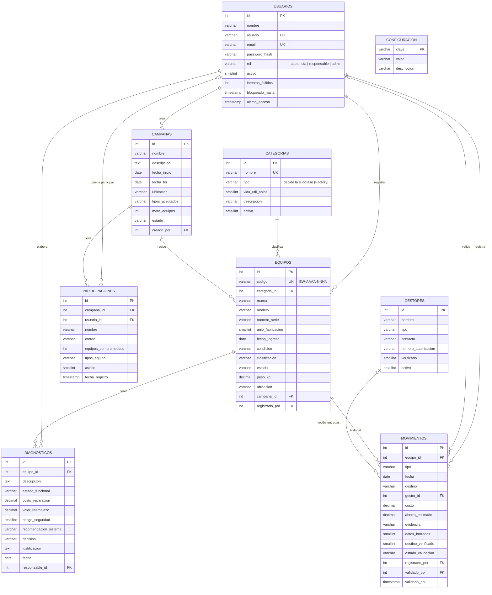

# Modelo de datos — E-Waste 360°

Base de datos relacional con **9 tablas** (la rúbrica pide al menos 5). El esquema existe en dos variantes equivalentes:
`database/mysql/schema.sql` (XAMPP) y `database/pgsql/schema.sql` (Neon/PostgreSQL).

## Diagrama entidad-relación

## Diccionario de datos

| Tabla | Propósito | Relaciones |
|---|---|---|
| `usuarios` | Cuentas del personal. La contraseña se guarda solo como hash (`password_hash`, bcrypt). `intentos_fallidos` y `bloqueado_hasta` implementan el bloqueo por fuerza bruta. | Registra equipos, diagnósticos y movimientos; crea campañas. |
| `categorias` | Catálogo de tipos de dispositivo con su vida útil de referencia. `tipo` decide qué subclase crea la `EquipoFactory`. | 1:N con `equipos`. |
| `equipos` | Inventario. `clasificacion` la fija el diagnóstico; `estado` cambia solo con movimientos validados. | N:1 con `categorias`, `campanas` (opcional) y `usuarios`. 1:N con `diagnosticos` y `movimientos`. |
| `diagnosticos` | Evaluaciones técnicas: lo que recomendó el sistema (`recomendacion_sistema`) y lo que decidió el responsable (`decision`). | N:1 con `equipos` y `usuarios`. |
| `movimientos` | Historial verificable de cada equipo (trazabilidad): ingreso, reparación, reasignación, conservación y entrega. | N:1 con `equipos`, `gestores` (opcional) y `usuarios` (registra y valida). |
| `gestores` | Destinos para la gestión especializada. `verificado` indica que se revisó su autorización ambiental. | 1:N con `movimientos`. |
| `campanas` | Campañas de recolección con fechas, lugar, equipos aceptados y meta. | 1:N con `participaciones` y con `equipos` recibidos. |
| `participaciones` | Registro público de participantes, con datos mínimos (nombre y correo opcional). | N:1 con `campanas` (en cascada) y opcionalmente con `usuarios`. |
| `configuracion` | Parámetros de la política institucional (umbral de reparación, factor de vida útil, nombre de la institución). | — |

## Restricciones de integridad y su justificación

- **Llaves foráneas** en todas las relaciones: no puede existir un diagnóstico o movimiento de un equipo inexistente,
  ni un equipo con una categoría inexistente.
- **Sin borrado físico de equipos:** `diagnosticos` y `movimientos` referencian a `equipos` sin `ON DELETE CASCADE`.
  El historial de un equipo es evidencia ambiental y no debe desaparecer. El cierre de un registro se modela con el
  estado final `entregado_gestor`.
- **`ON DELETE SET NULL`** en `equipos.campana_id` y `participaciones.usuario_id`: si se elimina la campaña o la cuenta,
  el equipo y la participación se conservan.
- **`ON DELETE CASCADE`** en `participaciones.campana_id`: una participación no tiene sentido sin su campaña.
- **`CHECK`** sobre los valores de catálogo (rol, condición, clasificación, estado, tipo de movimiento, decisión),
  montos no negativos, `fecha_fin >= fecha_inicio`, vida útil entre 1 y 50 años y entre 1 y 200 equipos por participación.
- **`UNIQUE`** en `usuarios.usuario`, `usuarios.email`, `categorias.nombre` y `equipos.codigo`.
- **Índices** sobre `equipos.clasificacion`, `equipos.estado` y `movimientos.estado_validacion`, que son los filtros más usados.

Las reglas que dependen de varias tablas se validan en la capa de negocio dentro de una **transacción**. Por ejemplo:
"no se permite un segundo movimiento pendiente", "un equipo con riesgo solo va a gestión especializada" y
"una entrega exige un gestor y una evidencia".
