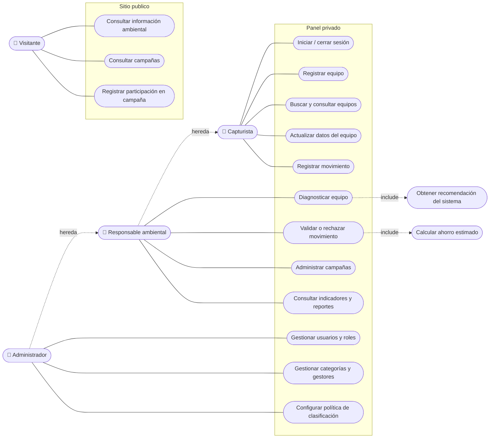
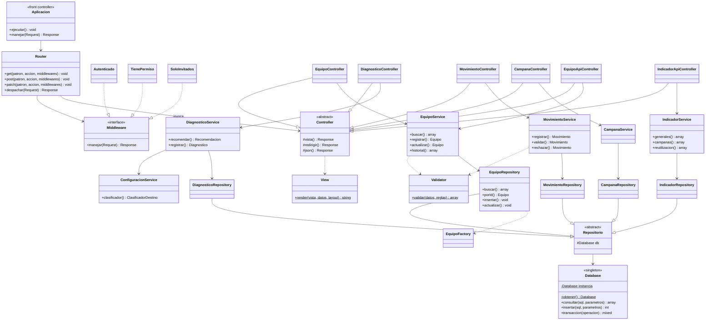
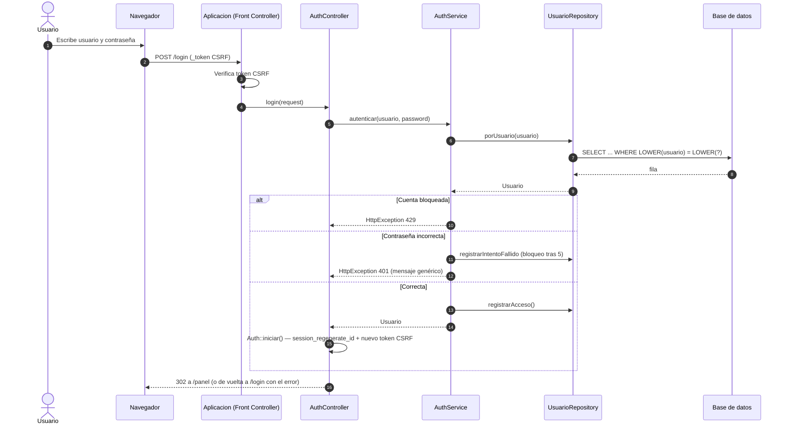
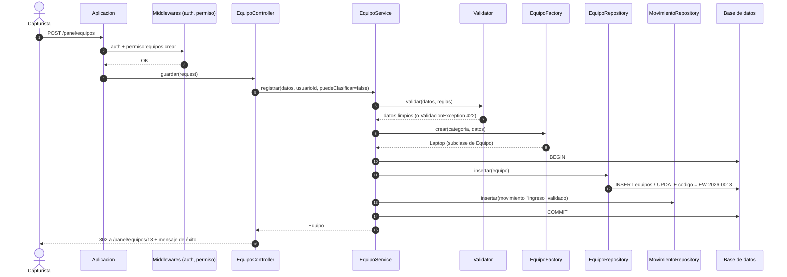
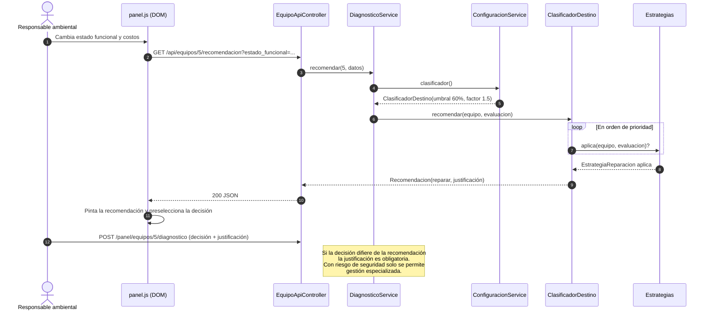
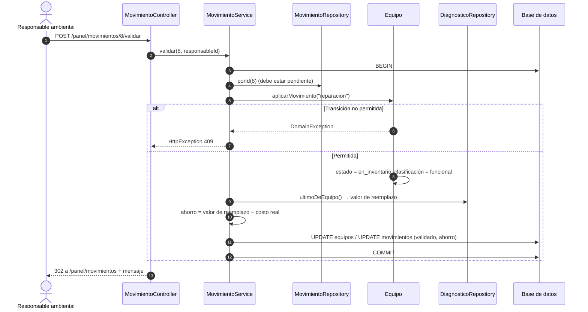
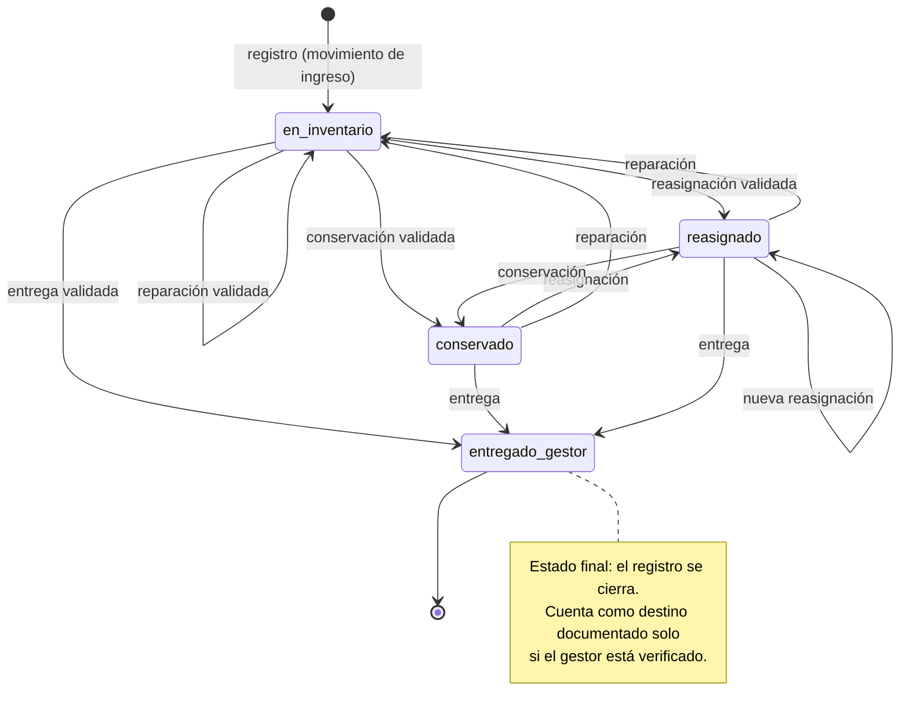
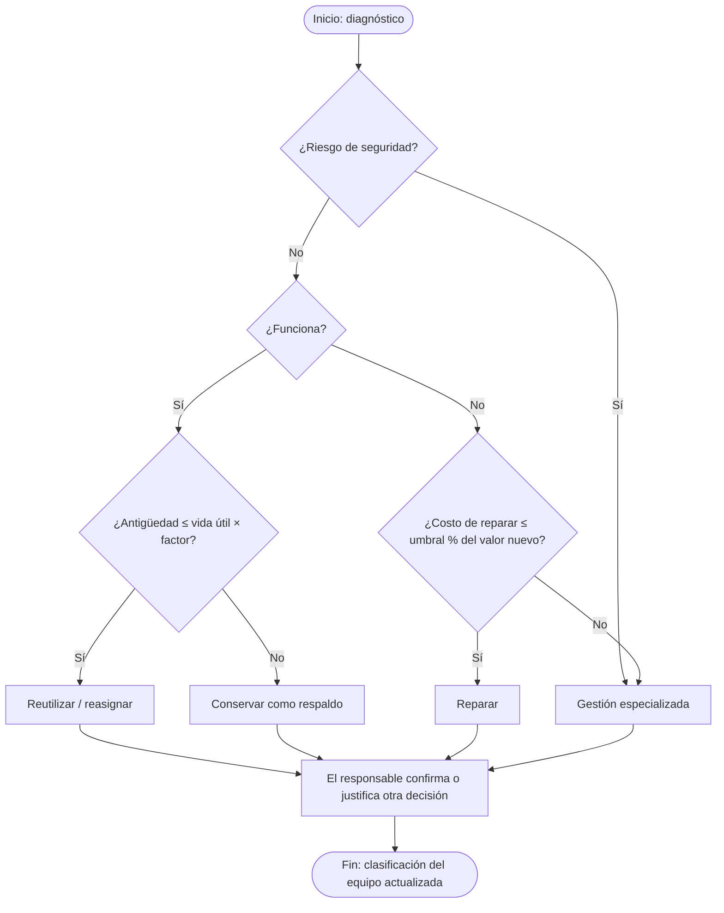
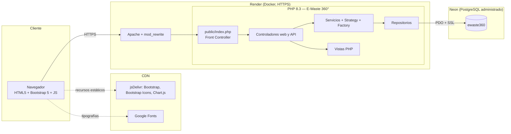

# Diagramas UML — E-Waste 360°

Los diagramas están escritos en [Mermaid](https://mermaid.js.org/): GitHub los dibuja automáticamente y
`docs/diagramas.html` los muestra todos en el navegador, listos para copiarlos o exportarlos como imagen al reporte.
Si necesitas PNG/SVG, pega cada bloque en <https://mermaid.live> y usa *Actions → PNG/SVG*.

1. [Casos de uso](#1-casos-de-uso)
2. [Clases del dominio (Factory y Strategy)](#2-clases-del-dominio)
3. [Clases por capas (MVC + Repository)](#3-clases-por-capas)
4. [Secuencia: iniciar sesión](#4-secuencia-iniciar-sesión)
5. [Secuencia: registrar un equipo](#5-secuencia-registrar-un-equipo)
6. [Secuencia: diagnóstico con recomendación](#6-secuencia-diagnóstico-con-recomendación)
7. [Secuencia: validar un movimiento](#7-secuencia-validar-un-movimiento)
8. [Estados del equipo](#8-estados-del-equipo)
9. [Actividad: decisión de destino](#9-actividad-decisión-de-destino)
10. [Componentes y despliegue](#10-componentes-y-despliegue)

---

## 1. Casos de uso

Mermaid no tiene un tipo "casos de uso", así que se representa con un diagrama de flujo: los actores a la izquierda,
los casos de uso como óvalos y la herencia de roles con flechas punteadas (un rol superior puede hacer todo lo del inferior).

| Caso de uso | Actor principal | Descripción breve |
|---|---|---|
| Registrar equipo | Capturista | Da de alta un equipo; el sistema genera el código `EW-AAAA-NNNN` y un movimiento de ingreso. |
| Registrar movimiento | Capturista | Reparación, reasignación, conservación o entrega a gestor. Queda pendiente si no tiene permiso de validar. |
| Diagnosticar equipo | Responsable | Registra fallas y costos; el sistema recomienda un destino (Strategy) y el responsable decide. |
| Validar movimiento | Responsable | Aplica el movimiento al equipo, cambia su estado y calcula el ahorro estimado. |
| Administrar campañas | Responsable | Crea campañas, controla participaciones, asistencia y equipos recibidos. |
| Consultar indicadores | Responsable | Tablero con gráficas, tablas y exportación CSV, alimentado por la API de indicadores. |
| Gestionar usuarios | Administrador | Alta de cuentas, roles, activación y cambio de contraseña. |
| Configurar política | Administrador | Umbral de reparación y tolerancia de vida útil que usan las estrategias. |

---

## 2. Clases del dominio

**Factory:** `EquipoFactory` crea la subclase de `Equipo` según el tipo de la categoría.
**Strategy:** `ClasificadorDestino` delega en las estrategias que implementan `EstrategiaDestino`.

```mermaid
classDiagram
    direction TB

    class Equipo {
        <<abstract>>
        -int id
        -string codigo
        -string marca
        -string modelo
        -int anioFabricacion
        -string condicion
        -string clasificacion
        -string estado
        -float pesoKg
        +tipo()* string
        +icono()* string
        +requiereBorradoDatos() bool
        +contieneMaterialesPeligrosos() bool
        +recomendacionesEntrega() array
        +puedeRecibir(tipoMovimiento) bool
        +aplicarMovimiento(tipoMovimiento) void
        +asignarClasificacion(clasificacion) void
        +movimientosPermitidos() array
        +antiguedadAnios(anioActual) int
        +superaVidaUtil(factor, anioActual) bool
        +generarCodigo(id, fechaIngreso)$ string
        +toArray() array
    }
    class Categoria {
        +int id
        +string nombre
        +string tipo
        +int vidaUtilAnios
        +nombreTipo() string
    }
    class Computadora {
        +requiereBorradoDatos() bool
    }
    class Laptop {
        +requiereBorradoDatos() bool
        +contieneMaterialesPeligrosos() bool
    }
    class Celular {
        +requiereBorradoDatos() bool
        +contieneMaterialesPeligrosos() bool
    }
    class Monitor {
        +contieneMaterialesPeligrosos() bool
    }
    class Impresora {
        +contieneMaterialesPeligrosos() bool
    }
    class Bateria {
        +contieneMaterialesPeligrosos() bool
    }
    class Periferico
    class Accesorio
    class EquipoGenerico

    Equipo <|-- Computadora
    Equipo <|-- Laptop
    Equipo <|-- Celular
    Equipo <|-- Monitor
    Equipo <|-- Impresora
    Equipo <|-- Bateria
    Equipo <|-- Periferico
    Equipo <|-- Accesorio
    Equipo <|-- EquipoGenerico
    Equipo "*" --> "1" Categoria : pertenece a

    class EquipoFactory {
        <<factory>>
        +crear(Categoria, datos)$ Equipo
        +desdeFila(fila)$ Equipo
        +tiposSoportados()$ array
    }
    EquipoFactory ..> Equipo : crea

    class EstrategiaDestino {
        <<interface>>
        +decision() string
        +aplica(Equipo, EvaluacionTecnica) bool
        +justificacion(Equipo, EvaluacionTecnica) string
    }
    class EstrategiaReutilizacion {
        -float factorVidaUtil
    }
    class EstrategiaConservacion
    class EstrategiaReparacion {
        -float umbralPorcentaje
    }
    class EstrategiaGestionEspecializada
    EstrategiaReutilizacion ..|> EstrategiaDestino
    EstrategiaConservacion ..|> EstrategiaDestino
    EstrategiaReparacion ..|> EstrategiaDestino
    EstrategiaGestionEspecializada ..|> EstrategiaDestino

    class ClasificadorDestino {
        -array estrategias
        +politicaInstitucional(umbral, factor)$ ClasificadorDestino
        +recomendar(Equipo, EvaluacionTecnica) Recomendacion
    }
    class EvaluacionTecnica {
        +string estadoFuncional
        +float costoReparacion
        +float valorReemplazo
        +bool riesgoSeguridad
        +porcentajeCosto() float
    }
    class Recomendacion {
        +string decision
        +string justificacion
        +string estrategia
    }
    ClasificadorDestino o-- "1..*" EstrategiaDestino : usa en orden
    ClasificadorDestino ..> EvaluacionTecnica
    ClasificadorDestino ..> Recomendacion : devuelve

    class Diagnostico {
        +int equipoId
        +string estadoFuncional
        +float costoReparacion
        +float valorReemplazo
        +string recomendacionSistema
        +string decision
        +clasificacionResultante() string
        +siguioRecomendacion() bool
        +ahorroPotencial() float
    }
    class Movimiento {
        +int equipoId
        +string tipo
        +string estadoValidacion
        +bool destinoVerificado
        +float ahorroEstimado
        +estaPendiente() bool
    }
    class Campana {
        +string nombre
        +string fechaInicio
        +string fechaFin
        +string estado
        +aceptaParticipaciones() bool
        +vigencia() string
    }
    class Participacion {
        +string nombre
        +int equiposComprometidos
        +bool asistio
        +correoOculto() string
    }
    class Gestor {
        +string nombre
        +bool verificado
    }
    class Usuario {
        -string passwordHash
        +string rol
        +bool activo
        +verificarPassword(password) bool
        +estaBloqueado() bool
        +hashear(password)$ string
    }

    Equipo "1" --> "*" Diagnostico
    Equipo "1" --> "*" Movimiento
    Movimiento "*" --> "0..1" Gestor
    Campana "1" --> "*" Participacion
    Equipo "*" --> "0..1" Campana : recibido en
```

---

## 3. Clases por capas

Las flechas muestran que cada capa solo conoce a la de abajo: las vistas reciben datos del controlador y nunca consultan la base.

---

## 4. Secuencia: iniciar sesión

## 5. Secuencia: registrar un equipo

## 6. Secuencia: diagnóstico con recomendación

## 7. Secuencia: validar un movimiento

---

## 8. Estados del equipo

Clasificación (independiente del estado): `pendiente → funcional | reparable | reutilizable | gestion_especializada`,
asignada por el diagnóstico. Un equipo en `gestion_especializada` ya no admite reparación ni reasignación.

## 9. Actividad: decisión de destino

## 10. Componentes y despliegue

