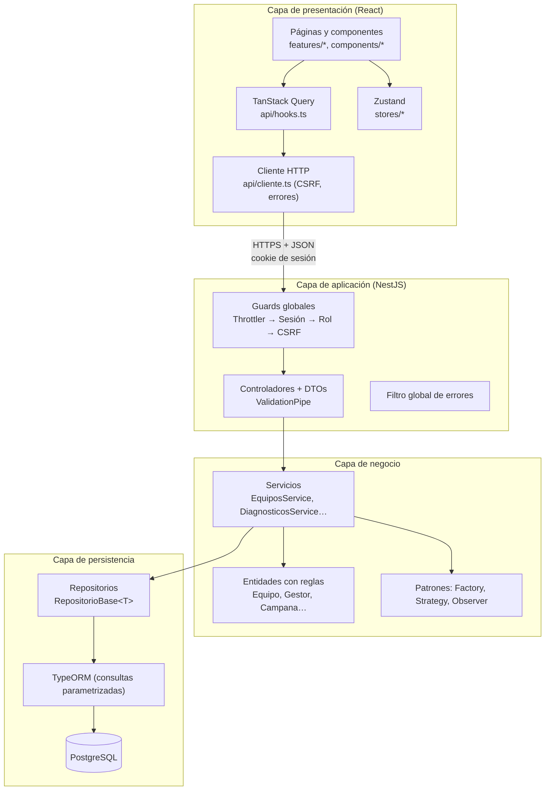
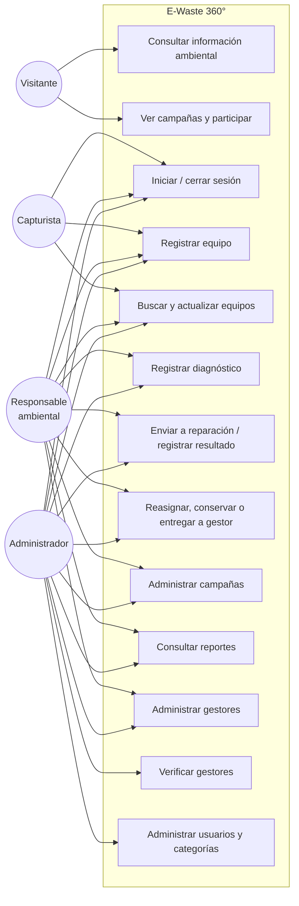
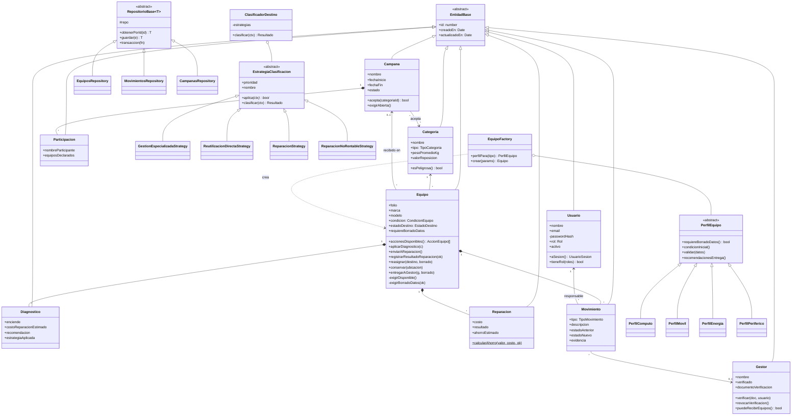
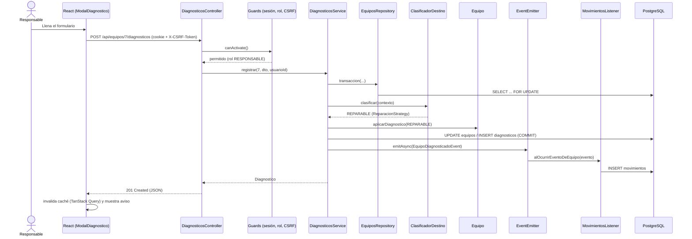
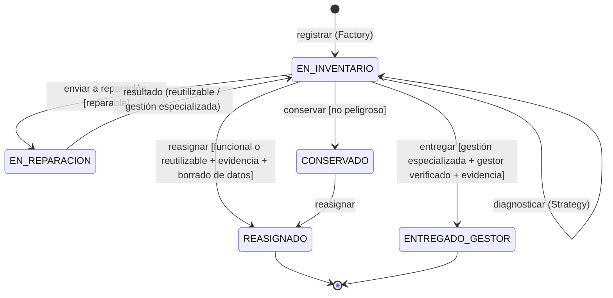
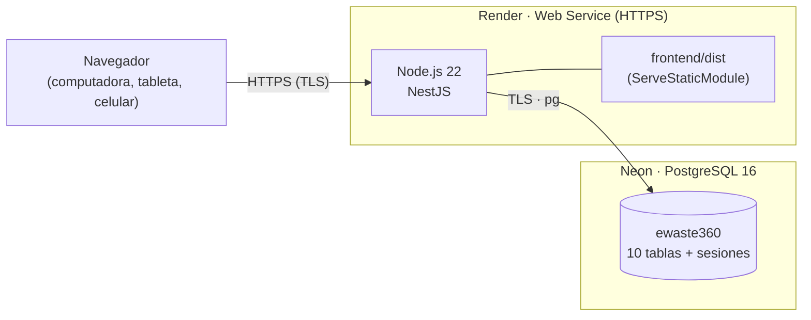

# Arquitectura de E-Waste 360°

## 1. Arquitectura en capas y MVC

La aplicación es una **SPA (React) que consume una API REST (NestJS)**. El patrón MVC se reparte así:

| MVC | Dónde está | Responsabilidad |
|---|---|---|
| **Vista** | `frontend/src/features/**`, `components/**` | Mostrar información y capturar acciones. **Nunca accede a la base de datos**: solo llama a la API mediante `frontend/src/api/cliente.ts`. |
| **Controlador** | `backend/src/modules/*/*.controller.ts` | Recibir la petición HTTP, validar el DTO, aplicar guards (sesión, rol, CSRF) y delegar en el servicio. No contiene reglas de negocio. |
| **Modelo** | Entidades (`*.entity.ts`) + servicios (`*.service.ts`) + repositorios (`*.repository.ts`) | Reglas de negocio, estado del dominio y persistencia. |

**Regla de dependencias:** cada capa solo conoce a la siguiente. Los controladores no usan repositorios
directamente y los servicios no construyen SQL: lo hacen los repositorios.

Esta separación facilita:
- **Mantenimiento:** cambiar la regla para decidir si un equipo se repara solo toca una clase Strategy.
- **Pruebas:** las reglas del dominio se prueban sin base de datos (`equipo.spec.ts`, `clasificador-destino.spec.ts`).
- **Ampliación:** un nuevo tipo de dispositivo es un nuevo `PerfilEquipo` en la Factory.

### Módulos del backend

| Módulo | Contenido |
|---|---|
| `auth` | Inicio y cierre de sesión, `GET /auth/me`, token CSRF |
| `usuarios` | Cuentas del personal y `PasswordService` (argon2id) |
| `catalogos` | Categorías de equipo y gestores de residuos (con verificación) |
| `equipos` | Inventario, `EquipoFactory` y los perfiles por tipo de dispositivo |
| `diagnosticos` | Diagnóstico y estrategias de clasificación de destino |
| `reparaciones` | Resultado de reparaciones y cálculo de ahorro |
| `movimientos` | Trazabilidad: decisiones de destino y `MovimientosListener` (Observer) |
| `campanas` | Campañas de recolección y participaciones |
| `indicadores` | Consultas agregadas para reportes |

## 2. Patrones de diseño

### 2.1 Repository (`common/repositories/repositorio-base.ts`)

**Problema:** si cada servicio arma sus consultas, el acceso a datos queda disperso y repetido, y cambiar el ORM o
una consulta obliga a tocar la lógica de negocio.

**Solución:** `RepositorioBase<T>` es una clase abstracta genérica con las operaciones comunes (`obtenerPorId` con
404 automático, `guardar`, `transaccion`). Cada repositorio concreto hereda de ella y agrega sus consultas, por ejemplo
`EquiposRepository.buscar()` (búsqueda paginada con filtros), `siguienteFolio()` y `obtenerParaActualizar()`
(bloqueo de fila). `IndicadoresRepository` concentra todas las consultas agregadas.

### 2.2 Strategy (`modules/diagnosticos/strategies/`)

**Problema:** decidir si un equipo se **repara**, se **reutiliza** o va a **gestión especializada** depende de varios
criterios que cambian con el tiempo (umbrales de costo, materiales peligrosos…). Si todo vive en un `if/else` dentro
del servicio, cada cambio arriesga romper los demás.

**Solución:** cada criterio es una clase que hereda de `EstrategiaClasificacion`:

| Prioridad | Estrategia | Aplica cuando | Resultado |
|---|---|---|---|
| 1 | `GestionEspecializadaStrategy` | Categoría de energía, componentes peligrosos o daño estructural | Gestión especializada |
| 2 | `ReutilizacionDirectaStrategy` | Enciende y no requiere reparación | Funcional |
| 3 | `ReparacionStrategy` | Costo de reparación ≤ 50 % del valor de reposición | Reparable |
| 99 | `ReparacionNoRentableStrategy` | Siempre (respaldo) | Gestión especializada |

`ClasificadorDestino` (el *contexto*) recibe la lista inyectada por Nest, la ordena por prioridad y aplica la primera
que corresponda. Para agregar un criterio nuevo basta con registrarlo en `diagnosticos.module.ts`. La interfaz
muestra la recomendación **en vivo** mientras se captura el diagnóstico (`POST /equipos/:id/diagnosticos/simular`).

### 2.3 Factory (`modules/equipos/factory/`)

**Problema:** cada tipo de dispositivo se registra con reglas distintas. Las computadoras exigen número de serie y
borrado de datos, los celulares también requieren borrado y las baterías entran directo a gestión especializada.

**Solución:** `EquipoFactory.crear()` elige un `PerfilEquipo` según el tipo de categoría (`PerfilComputo`,
`PerfilMovil`, `PerfilEnergia`, `PerfilPeriferico`, `PerfilCableado`, `PerfilGenerico`) y construye el `Equipo` ya
configurado. Cada perfil redefine por **polimorfismo** `validar()`, `condicionInicial()`, `requiereBorradoDatos()` y
`recomendacionesEntrega()`.

### 2.4 Observer (`common/events/equipo.events.ts`, `movimientos/movimientos.listener.ts`)

**Problema:** registrar, diagnosticar y reparar equipos debe quedar en el historial, pero esos módulos no deberían
depender del módulo de movimientos.

**Solución:** los servicios emiten eventos de dominio (`EquipoRegistradoEvent`, `EquipoDiagnosticadoEvent`,
`EquipoReparadoEvent`, subclases de `EventoEquipo`) y `MovimientosListener` los observa con `@OnEvent('equipo.*')`
y crea el movimiento. Cada evento sabe describirse a sí mismo (`describir()`).

### 2.5 Otros patrones presentes

- **Inyección de dependencias / Singleton:** los servicios y repositorios son instancias únicas que administra Nest.
- **Decorator:** `@Public()`, `@Roles()`, `@UsuarioActual()`.
- **Chain of Responsibility:** los guards globales se ejecutan en cadena (Throttler → Sesión → Rol → CSRF).

## 3. Programación orientada a objetos

- **Encapsulamiento:** el estado de un `Equipo` solo cambia mediante sus métodos (`aplicarDiagnostico`,
  `enviarAReparacion`, `registrarResultadoReparacion`, `reasignar`, `conservar`, `entregarAGestor`), que validan las
  transiciones y lanzan `ReglaNegocioError` si se viola una regla. Los métodos auxiliares (`exigirDisponible`,
  `exigirBorradoDatos`) son privados. `Usuario.passwordHash` nunca se selecciona por defecto.
- **Herencia:** todas las entidades heredan de `EntidadBase` (id y marcas de tiempo); los repositorios de
  `RepositorioBase<T>`; las estrategias de `EstrategiaClasificacion`; los perfiles de `PerfilEquipo`; los eventos de
  `EventoEquipo`.
- **Polimorfismo:** `ClasificadorDestino` y `EquipoFactory` trabajan con la clase base sin conocer la subclase concreta.
- **Abstracción:** clases abstractas con métodos abstractos (`aplica`, `clasificar`, `describir`).
- **Responsabilidades claras:** `PasswordService` solo cifra; `CsrfService` solo maneja tokens; `Reparacion.calcularAhorro`
  concentra el cálculo de ahorro.
- **Relaciones:** asociaciones 1:N (Categoría–Equipo, Equipo–Movimiento), N:M (Campaña–Categoría), composición
  del historial (los movimientos se borran en cascada con su equipo).

## 4. Diagramas UML

### 4.1 Casos de uso

### 4.2 Diagrama de clases (dominio y patrones)

### 4.3 Secuencia: registrar un diagnóstico

### 4.4 Estados de un equipo

### 4.5 Despliegue

Front y API comparten el mismo dominio, así que la cookie de sesión puede ser `HttpOnly`, `Secure` y
`SameSite=Lax` sin configurar CORS.
