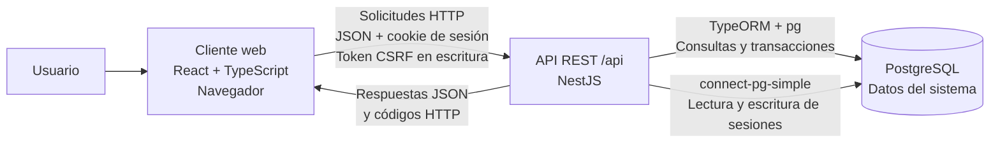
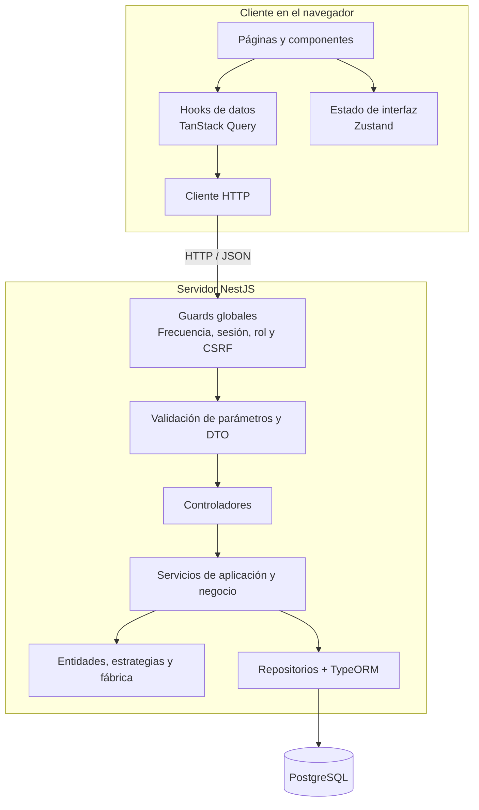
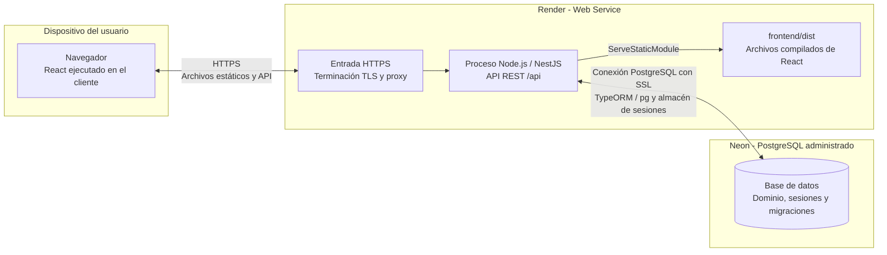
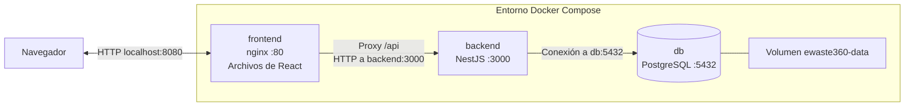

# Documentación técnica de E-Waste 360°

## Arquitectura del sistema

E-Waste 360° se organiza como una aplicación cliente-servidor: una interfaz React ejecutada en el navegador consume una API REST desarrollada con NestJS, y el servidor administra el acceso a PostgreSQL. El backend constituye una aplicación modular que reúne las funciones del sistema en un mismo proceso, con separación lógica de responsabilidades.

### 1. Diagrama general: cliente, API y base de datos



El cliente muestra los datos y captura las acciones del usuario. La API valida las solicitudes, comprueba permisos, ejecuta las reglas de negocio y obtiene o modifica los datos persistentes. PostgreSQL conserva la información del dominio y las sesiones.

Las operaciones de negocio se exponen bajo `/api`, mientras que la documentación de los servicios está disponible en `/api/docs`. En el despliegue público se requiere HTTPS; el entorno local contempla HTTP para desarrollo.

### 2. Arquitectura en capas

Las capas son divisiones lógicas del código. No requieren servidores independientes: presentación y API pueden servirse desde el mismo proceso de NestJS en la configuración de publicación, aunque React se ejecuta en el navegador.

| Capa | Responsabilidad | Ubicación en el proyecto | Ejemplos |
|---|---|---|---|
| Presentación | Mostrar páginas, capturar datos, validar formularios para orientar al usuario y presentar resultados. | `frontend/src/features/`, `frontend/src/components/`, `frontend/src/app/`, `frontend/src/hooks/` y `frontend/src/index.css`. | `EquiposPage.tsx`, `EquipoNuevoPage.tsx`, `Campo.tsx` y `router.tsx`. |
| Comunicación y estado del cliente | Encapsular solicitudes HTTP, tipos de respuesta, caché del servidor y estado local de interfaz. | `frontend/src/api/`, `frontend/src/stores/` y utilidades en `frontend/src/lib/`. | `cliente.ts`, `hooks.ts`, `tipos.ts` y `ui.store.ts`. |
| Aplicación y entrada HTTP | Recibir solicitudes, aplicar controles de acceso y validación, delegar casos de uso y devolver respuestas. | Controladores y DTO en `backend/src/modules/`; guards, decoradores y filtros en `backend/src/common/`; configuración HTTP en `backend/src/app.setup.ts`. | `equipos.controller.ts`, `equipos.dto.ts`, `roles.guard.ts` y `http-exception.filter.ts`. |
| Negocio y dominio | Coordinar operaciones y transacciones, aplicar reglas y determinar cambios válidos de condición y destino. | Servicios y entidades en `backend/src/modules/`; estrategias en `modules/diagnosticos/strategies/`; fábrica en `modules/equipos/factory/`; eventos en `backend/src/common/events/`. | `equipos.service.ts`, `equipo.entity.ts`, `clasificador-destino.ts` y `equipo.factory.ts`. |
| Persistencia | Consultar y guardar registros, cargar relaciones y administrar el esquema de PostgreSQL. | Repositorios en `backend/src/modules/`; base común en `backend/src/common/repositories/`; configuración y migraciones en `backend/src/database/`. | `equipos.repository.ts`, `repositorio-base.ts` y `typeorm.config.ts`. |



El diagrama resume el recorrido principal de una solicitud válida. Los guards rechazan solicitudes que incumplen los controles correspondientes y los pipes validan los datos antes de ejecutar el método del controlador. El filtro global normaliza las excepciones para devolver respuestas de error al cliente.

Los servicios coordinan los casos de uso y las entidades encapsulan reglas del equipo. Los repositorios concentran las consultas y operaciones habituales de persistencia. La separación es lógica: las entidades también declaran su mapeo TypeORM y algunos servicios coordinan transacciones mediante `EntityManager`. En particular, el registro de equipos ejecuta un bloqueo SQL dentro de la transacción para proteger la generación del folio.

### 3. Cómo se aplica MVC

El enfoque **Modelo–Vista–Controlador (MVC)** se distribuye entre el frontend y el backend. Las vistas se construyen en React y los controladores del servidor responden con datos JSON para que el cliente actualice la interfaz.

| Elemento | Implementación | Responsabilidad |
|---|---|---|
| Modelo | Entidades, servicios de negocio y repositorios del backend. | Representar datos, aplicar reglas y administrar su persistencia. |
| Vista | Páginas, componentes y layouts de React. | Presentar información y capturar las acciones del usuario. |
| Controlador | Clases `*.controller.ts` de NestJS. | Definir rutas, recibir parámetros y DTO validados, obtener el usuario de sesión y delegar en servicios. |

Por ejemplo, al consultar el inventario:

1. `EquiposPage.tsx` obtiene los filtros seleccionados por el usuario y utiliza los hooks de datos del cliente.
2. El cliente HTTP envía una solicitud `GET /api/equipos` con los filtros correspondientes.
3. Los guards comprueban la sesión y el rol; la validación procesa los parámetros recibidos.
4. `EquiposController.buscar()` delega la consulta en `EquiposService.buscar()`.
5. El servicio utiliza `EquiposRepository.buscar()`, que consulta PostgreSQL mediante TypeORM y devuelve una página de resultados.
6. La API devuelve JSON y React actualiza la vista con los equipos y la información de paginación.

Los controladores mantienen la coordinación HTTP y delegan las decisiones del dominio. Por ejemplo, las restricciones para reasignar un equipo o enviarlo a reparación se encuentran en métodos de `Equipo`, utilizados por los servicios.

### 4. Separación de responsabilidades: acceso a la base de datos

Las vistas acceden a los datos mediante el cliente HTTP de `frontend/src/api/cliente.ts`, que realiza solicitudes a rutas relativas `/api`. La conexión PostgreSQL, sus credenciales y la configuración de TypeORM se administran en el servidor.

Esta separación tiene los siguientes propósitos:

- **Seguridad:** evita distribuir credenciales de PostgreSQL al navegador y concentra la autenticación y autorización de las operaciones en el servidor.
- **Consistencia:** los datos atraviesan validaciones y reglas compartidas antes de guardarse. Una solicitud directa a la API queda sujeta a las mismas restricciones que una acción desde la interfaz.
- **Mantenimiento:** la vista consume operaciones y respuestas de la API, lo que permite modificar consultas o detalles de almacenamiento sin trasladarlos a los componentes.
- **Pruebas:** permite comprobar reglas del dominio, servicios web e interfaz con distintos niveles de aislamiento.
- **Reutilización:** otros clientes pueden consumir los servicios implementados si cumplen sus contratos y controles de acceso.

La validación de formularios y la protección de rutas en React mejoran la experiencia del usuario. La validación definitiva de las operaciones privadas corresponde al servidor, porque las solicitudes pueden realizarse sin utilizar las pantallas de la aplicación.

### 5. Estructura de carpetas del proyecto

La siguiente estructura resume las carpetas y los archivos principales; omite dependencias instaladas, archivos generados y algunos archivos auxiliares.

```text
proyecto_final/
├── backend/
│   ├── src/
│   │   ├── common/
│   │   │   ├── decorators/       Decoradores de acceso y usuario actual
│   │   │   ├── entities/         Entidad base compartida
│   │   │   ├── errors/           Errores de reglas de negocio
│   │   │   ├── events/           Eventos del ciclo de vida de equipos
│   │   │   ├── filters/          Normalización de errores HTTP
│   │   │   ├── guards/           Validación de sesión, roles y CSRF
│   │   │   ├── repositories/     Repositorio base y paginación
│   │   │   ├── types/            Tipos de sesión
│   │   │   └── enums.ts          Roles, condiciones, estados y movimientos
│   │   ├── config/              Validación de variables de entorno
│   │   ├── database/
│   │   │   ├── migrations/      Cambios versionados del esquema
│   │   │   ├── seeds/           Datos de demostración
│   │   │   ├── data-source.ts   Entrada de la CLI de TypeORM
│   │   │   └── typeorm.config.ts Configuración de persistencia
│   │   ├── modules/
│   │   │   ├── auth/            Autenticación y tokens CSRF
│   │   │   ├── usuarios/        Cuentas, roles y contraseñas
│   │   │   ├── catalogos/       Categorías y gestores
│   │   │   ├── equipos/         Inventario y fábrica de equipos
│   │   │   ├── diagnosticos/    Evaluación y estrategias de clasificación
│   │   │   ├── reparaciones/    Resultados, costos y ahorro
│   │   │   ├── movimientos/     Decisiones, historial y listener de eventos
│   │   │   ├── campanas/        Campañas y participaciones
│   │   │   └── indicadores/     Consultas agregadas para reportes
│   │   ├── app.module.ts        Registro de módulos y guards globales
│   │   ├── app.setup.ts         Configuración HTTP, sesiones y Swagger
│   │   └── main.ts              Inicio del servidor
│   ├── test/                   Pruebas HTTP e2e y su configuración
│   ├── Dockerfile              Construcción de la imagen del backend
│   ├── docker-entrypoint.sh    Arranque del backend en contenedores
│   └── package.json            Dependencias y scripts del backend
├── frontend/
│   ├── public/                 Recursos públicos estáticos
│   ├── src/
│   │   ├── api/                Cliente HTTP, hooks de datos y tipos
│   │   ├── app/                Rutas y protección de navegación
│   │   ├── components/
│   │   │   ├── ilustraciones/  Ilustraciones reutilizables
│   │   │   ├── layout/         Estructuras pública y privada
│   │   │   └── ui/             Campos, botones, modales y avisos
│   │   ├── features/
│   │   │   ├── admin/          Usuarios, categorías y gestores
│   │   │   ├── auth/           Inicio de sesión
│   │   │   ├── campanas/       Administración de campañas
│   │   │   ├── equipos/        Registro, edición, detalle y acciones
│   │   │   ├── panel/          Resumen privado
│   │   │   ├── publico/        Inicio, guía y campañas públicas
│   │   │   └── reportes/       Indicadores y reportes
│   │   ├── hooks/              Formularios e interacción con el DOM
│   │   ├── lib/                Formato, exportación y utilidades visuales
│   │   ├── stores/             Estado de interfaz y borradores
│   │   ├── index.css           Estilos globales
│   │   └── main.tsx            Inicio de React
│   ├── Dockerfile              Compilación y servicio con nginx
│   ├── nginx.conf              Archivos estáticos y proxy de /api
│   ├── vite.config.ts          Compilación y proxy de desarrollo
│   └── package.json            Dependencias y scripts del frontend
├── docs/                       Documentación y evidencias de pruebas
├── .env.example                Ejemplo de variables para Docker Compose
├── docker-compose.yml          Servicios y volumen del entorno local
├── render.yaml                 Configuración de publicación en Render
├── package.json                Scripts de coordinación del proyecto
└── README.md                   Presentación e instrucciones generales
```

Dentro de los módulos del backend, el sufijo del archivo indica su responsabilidad: `*.module.ts` registra componentes e inyecciones, `*.controller.ts` define operaciones HTTP, `*.dto.ts` declara entradas y validaciones, `*.service.ts` coordina operaciones, `*.entity.ts` representa entidades persistentes y `*.repository.ts` concentra el acceso a datos. Algunos módulos incorporan archivos específicos, como estrategias, fábricas o listeners.

### 6. Diagrama de despliegue

#### 6.1. Publicación configurada en Render y Neon



El proceso de compilación genera el frontend y el backend. Al iniciar, NestJS incorpora `ServeStaticModule` si encuentra `frontend/dist`, por lo que puede servir la aplicación React y la API bajo un mismo dominio. El navegador descarga los recursos y ejecuta React localmente.

`render.yaml` configura el proceso de Node.js, los comandos de compilación e inicio, las variables de entorno y la ruta de salud `/api/indicadores/publico`. TypeORM ejecuta las migraciones pendientes al inicializar la conexión. Los datos de demostración se cargan mediante un script separado.

Este diagrama representa la modalidad prevista en los archivos del proyecto. La existencia de una publicación activa y su funcionamiento deben verificarse mediante la URL del servicio.

#### 6.2. Ejecución local con Docker Compose



En esta modalidad, nginx sirve la interfaz y reenvía `/api` al backend. Compose espera a que PostgreSQL supere su comprobación de salud antes de iniciar el backend y a que el backend esté saludable antes de iniciar el frontend. El volumen conserva la información de PostgreSQL entre recreaciones de contenedores, salvo que se elimine expresamente.

Los puertos publicados por defecto son 8080 para la interfaz, 3000 para el acceso directo al backend y 5544 para PostgreSQL. Estos dos últimos accesos permiten trabajar con la API y la base desde el equipo local. La configuración de desarrollo utiliza HTTP y no representa por sí sola una publicación con HTTPS.
