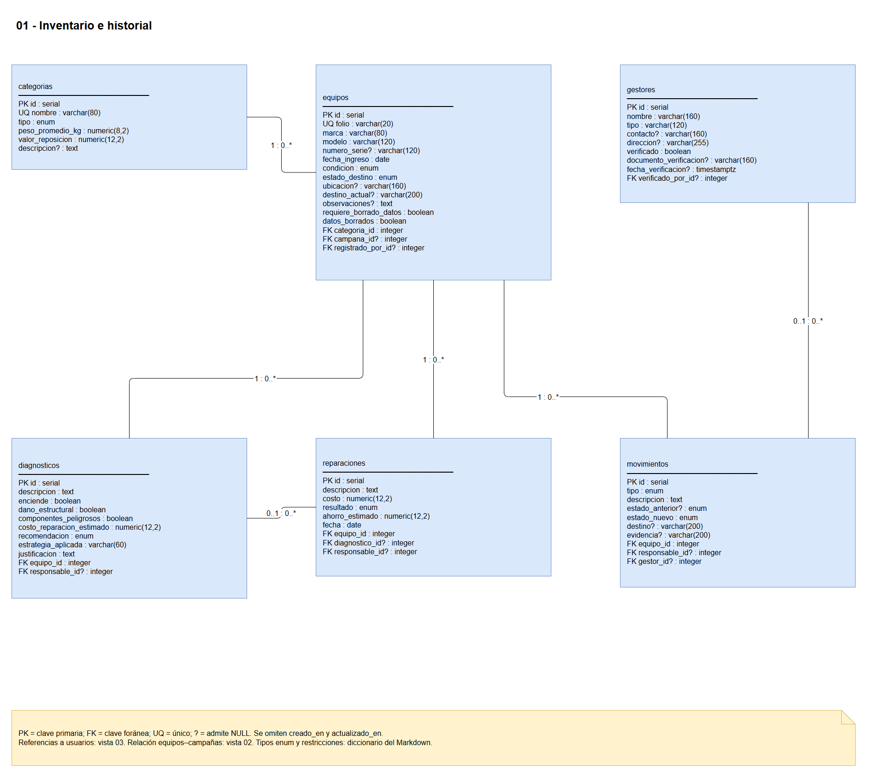
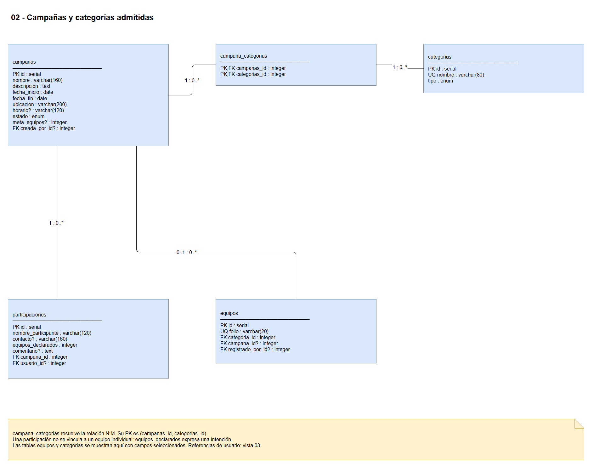
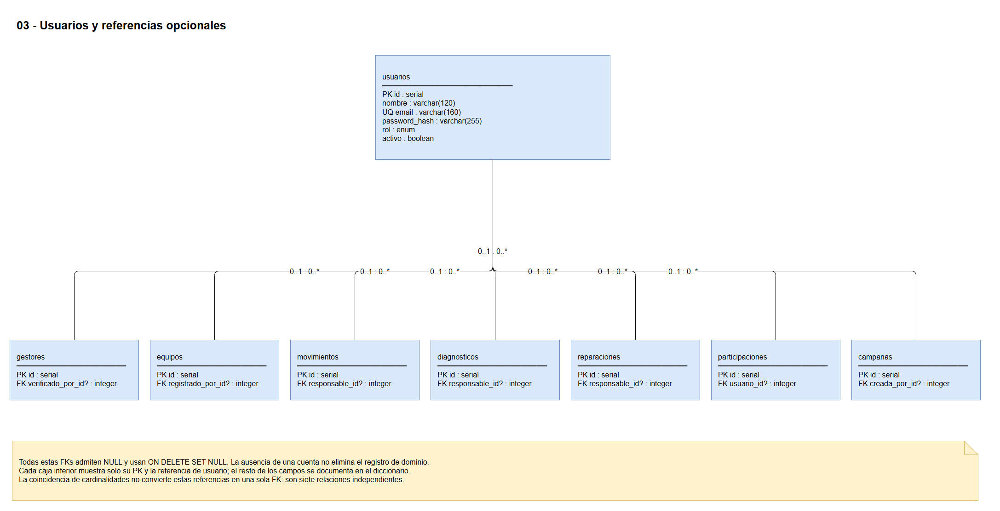
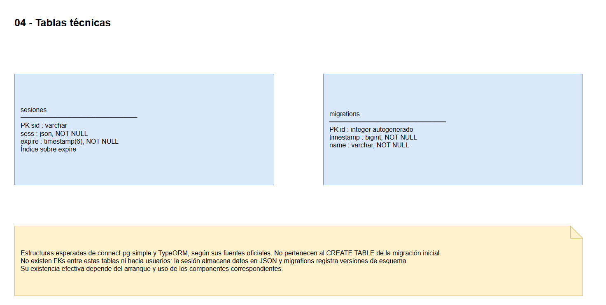

# Documentación técnica de E-Waste 360°

## Base de datos

E-Waste 360° utiliza PostgreSQL y TypeORM. El esquema de dominio está definido por la migración [Inicial1795488747254](../backend/src/database/migrations/1795488747254-Inicial.ts) y las entidades de `backend/src/modules/`. Se utiliza `snake_case` en SQL y `camelCase` en TypeScript mediante [SnakeNamingStrategy](../backend/src/database/snake-naming.strategy.ts).

Este documento describe el esquema versionado y la configuración del proyecto; no representa una inspección de una base de datos en ejecución. Hay **nueve tablas de entidades y una tabla de unión**, además de dos tablas técnicas previstas por las dependencias: `sesiones` y `migrations`.

### 1. Modelo entidad-relación

El modelo se elaboró en un **archivo editable compatible con draw.io (diagrams.net)**: [base-datos-ewaste360.drawio](diagramas/base-datos-ewaste360.drawio). Se divide en cuatro vistas para mantener legibles los campos y conectores:

| Página | Contenido |
|---|---|
| 01 | Inventario, diagnósticos, reparaciones, movimientos, categorías y gestores. |
| 02 | Campañas, categorías admitidas, participaciones y equipos recibidos. |
| 03 | Usuarios y referencias de autoría, responsabilidad y verificación. |
| 04 | Tablas técnicas de sesiones y control de migraciones. |

En los conectores, la cardinalidad se lee de la primera tabla hacia la segunda. `1 : 0..*` significa que cada registro hijo requiere un padre y que un padre puede tener cero o muchos hijos; `0..1 : 0..*` indica que la referencia al padre es opcional. **PK** identifica la clave primaria, **FK** una clave foránea y **UQ** una clave única. El signo `?` identifica campos que admiten `NULL`.

Las vistas 01 y 02 omiten las marcas de tiempo comunes y remiten a la vista 03 para las relaciones con usuarios. Las repeticiones de tablas entre vistas son referencias a la misma tabla física.









### 2. Diccionario de datos

Se utilizan los nombres físicos de las columnas. `varchar(n)` equivale a `character varying(n)`; `timestamptz` a `timestamp with time zone`; `serial` representa un entero con generación mediante secuencia. **NN** significa `NOT NULL`. Si no se indica un valor predeterminado, el esquema no define uno explícito.

Los campos de auditoría se incluyen en cada tabla para que el diccionario sea completo: provienen de `EntidadBase`. `actualizado_en` tiene valor inicial `now()` y TypeORM lo actualiza en las operaciones que gestiona; la migración no crea un trigger que lo actualice ante cualquier SQL externo.

<!-- INICIO DICCIONARIO GENERADO -->

#### 2.0. Tipos enumerados de PostgreSQL

| Tipo | Valores permitidos |
|---|---|
| `rol_usuario` | `CAPTURISTA`, `RESPONSABLE`, `ADMIN` |
| `tipo_categoria` | `COMPUTO`, `PERIFERICO`, `MOVIL`, `ENERGIA`, `CABLEADO`, `OTRO` |
| `condicion_equipo` | `PENDIENTE`, `FUNCIONAL`, `REPARABLE`, `REUTILIZABLE`, `GESTION_ESPECIALIZADA` |
| `estado_destino` | `EN_INVENTARIO`, `EN_REPARACION`, `REASIGNADO`, `CONSERVADO`, `ENTREGADO_GESTOR` |
| `tipo_movimiento` | `INGRESO`, `DIAGNOSTICO`, `ENVIO_REPARACION`, `REPARACION`, `REASIGNACION`, `CONSERVACION`, `ENTREGA_GESTOR` |
| `resultado_reparacion` | `EXITOSA`, `FALLIDA` |
| `estado_campana` | `PROGRAMADA`, `ACTIVA`, `CERRADA` |

#### 2.1. Tabla `usuarios`

| Campo | Tipo PostgreSQL | Restricciones | Descripción |
|---|---|---|---|
| `id` | `serial` | PK; NN; Generado por secuencia | Identificador autogenerado del registro. |
| `creado_en` | `timestamptz` | NN; DEFAULT now() | Fecha y hora de creación del registro. |
| `actualizado_en` | `timestamptz` | NN; DEFAULT now() | Fecha y hora de la última actualización gestionada por el ORM. |
| `nombre` | `varchar(120)` | NN | Nombre de la persona titular de la cuenta. |
| `email` | `varchar(160)` | NN; UQ | Correo de acceso normalizado por la aplicación. |
| `password_hash` | `varchar(255)` | NN | Hash de la contraseña; la entidad excluye su selección ordinaria. |
| `rol` | `rol_usuario` | NN; DEFAULT 'CAPTURISTA' | Rol de autorización de la cuenta. |
| `activo` | `boolean` | NN; DEFAULT true | Indica si la cuenta puede operar en el sistema. |

#### 2.2. Tabla `categorias`

| Campo | Tipo PostgreSQL | Restricciones | Descripción |
|---|---|---|---|
| `id` | `serial` | PK; NN; Generado por secuencia | Identificador autogenerado del registro. |
| `creado_en` | `timestamptz` | NN; DEFAULT now() | Fecha y hora de creación del registro. |
| `actualizado_en` | `timestamptz` | NN; DEFAULT now() | Fecha y hora de la última actualización gestionada por el ORM. |
| `nombre` | `varchar(80)` | NN; UQ | Nombre único de la categoría de dispositivos. |
| `tipo` | `tipo_categoria` | NN | Tipo del dispositivo en el catálogo. |
| `peso_promedio_kg` | `numeric(8,2)` | NN; DEFAULT '0'; CHECK (peso_promedio_kg >= 0) | Peso promedio por unidad para estimaciones ambientales, en kg. |
| `valor_reposicion` | `numeric(12,2)` | NN; DEFAULT '0'; CHECK (valor_reposicion >= 0) | Valor estimado de un equipo nuevo equivalente, en MXN. |
| `descripcion` | `text` | Admite NULL | Descripción opcional de la categoría. |

#### 2.3. Tabla `gestores`

| Campo | Tipo PostgreSQL | Restricciones | Descripción |
|---|---|---|---|
| `id` | `serial` | PK; NN; Generado por secuencia | Identificador autogenerado del registro. |
| `creado_en` | `timestamptz` | NN; DEFAULT now() | Fecha y hora de creación del registro. |
| `actualizado_en` | `timestamptz` | NN; DEFAULT now() | Fecha y hora de la última actualización gestionada por el ORM. |
| `nombre` | `varchar(160)` | NN | Nombre de la organización receptora. |
| `tipo` | `varchar(120)` | NN | Tipo de organización receptora, como reciclador o centro de acopio. |
| `contacto` | `varchar(160)` | Admite NULL | Medio de contacto, como correo o teléfono. |
| `direccion` | `varchar(255)` | Admite NULL | Domicilio del gestor. |
| `verificado` | `boolean` | NN; DEFAULT false | Indica si se ha documentado la verificación del gestor. |
| `documento_verificacion` | `varchar(160)` | Admite NULL | Referencia del documento que respalda la verificación. |
| `fecha_verificacion` | `timestamptz` | Admite NULL | Fecha y hora de la verificación del gestor. |
| `verificado_por_id` | `integer` | Admite NULL; FK → usuarios.id; DELETE SET NULL; UPDATE NO ACTION | Usuario que documentó la verificación. |

#### 2.4. Tabla `equipos`

| Campo | Tipo PostgreSQL | Restricciones | Descripción |
|---|---|---|---|
| `id` | `serial` | PK; NN; Generado por secuencia | Identificador autogenerado del registro. |
| `creado_en` | `timestamptz` | NN; DEFAULT now() | Fecha y hora de creación del registro. |
| `actualizado_en` | `timestamptz` | NN; DEFAULT now() | Fecha y hora de la última actualización gestionada por el ORM. |
| `folio` | `varchar(20)` | NN; UQ | Identificador legible y único del equipo, generado por la aplicación. |
| `marca` | `varchar(80)` | NN | Marca del dispositivo. |
| `modelo` | `varchar(120)` | NN | Modelo del dispositivo. |
| `numero_serie` | `varchar(120)` | Admite NULL | Número de serie; la aplicación lo exige para cómputo. |
| `fecha_ingreso` | `date` | NN | Fecha de ingreso declarada para el inventario. |
| `condicion` | `condicion_equipo` | NN; Índice; DEFAULT 'PENDIENTE' | Condición técnica actual del equipo. |
| `estado_destino` | `estado_destino` | NN; Índice; DEFAULT 'EN_INVENTARIO' | Situación actual del equipo en su ciclo de gestión. |
| `ubicacion` | `varchar(160)` | Admite NULL | Ubicación física actual del equipo en inventario. |
| `destino_actual` | `varchar(200)` | Admite NULL | Área o nombre del gestor de destino documentado. |
| `observaciones` | `text` | Admite NULL | Notas adicionales del inventario. |
| `requiere_borrado_datos` | `boolean` | NN; DEFAULT false | Indica si el perfil del dispositivo exige borrado antes de la entrega. |
| `datos_borrados` | `boolean` | NN; DEFAULT false | Confirmación registrada del borrado de datos. |
| `categoria_id` | `integer` | NN; FK → categorias.id; DELETE RESTRICT; UPDATE NO ACTION | Categoría a la que pertenece el equipo. |
| `campana_id` | `integer` | Admite NULL; FK → campanas.id; DELETE SET NULL; UPDATE NO ACTION | Campaña de origen del equipo, si ingresó por una campaña. |
| `registrado_por_id` | `integer` | Admite NULL; FK → usuarios.id; DELETE SET NULL; UPDATE NO ACTION | Usuario que registró el equipo. |

#### 2.5. Tabla `diagnosticos`

| Campo | Tipo PostgreSQL | Restricciones | Descripción |
|---|---|---|---|
| `id` | `serial` | PK; NN; Generado por secuencia | Identificador autogenerado del registro. |
| `creado_en` | `timestamptz` | NN; DEFAULT now() | Fecha y hora de creación del registro. |
| `actualizado_en` | `timestamptz` | NN; DEFAULT now() | Fecha y hora de la última actualización gestionada por el ORM. |
| `descripcion` | `text` | NN | Descripción de la revisión técnica realizada. |
| `enciende` | `boolean` | NN | Resultado de la comprobación de encendido. |
| `dano_estructural` | `boolean` | NN; DEFAULT false | Indica daño que afecta la integridad física del dispositivo. |
| `componentes_peligrosos` | `boolean` | NN; DEFAULT false | Indica presencia de componentes peligrosos evaluada en el diagnóstico. |
| `costo_reparacion_estimado` | `numeric(12,2)` | NN; DEFAULT '0'; CHECK (costo_reparacion_estimado >= 0) | Costo estimado de reparación, en MXN. |
| `recomendacion` | `condicion_equipo` | NN | Condición recomendada por el clasificador. |
| `estrategia_aplicada` | `varchar(60)` | NN | Nombre de la estrategia que produjo la recomendación. |
| `justificacion` | `text` | NN | Explicación de la recomendación del diagnóstico. |
| `equipo_id` | `integer` | NN; FK → equipos.id; DELETE CASCADE; UPDATE NO ACTION | Equipo al que pertenece el registro del historial. |
| `responsable_id` | `integer` | Admite NULL; FK → usuarios.id; DELETE SET NULL; UPDATE NO ACTION | Usuario responsable de la operación. |

#### 2.6. Tabla `reparaciones`

| Campo | Tipo PostgreSQL | Restricciones | Descripción |
|---|---|---|---|
| `id` | `serial` | PK; NN; Generado por secuencia | Identificador autogenerado del registro. |
| `creado_en` | `timestamptz` | NN; DEFAULT now() | Fecha y hora de creación del registro. |
| `actualizado_en` | `timestamptz` | NN; DEFAULT now() | Fecha y hora de la última actualización gestionada por el ORM. |
| `descripcion` | `text` | NN | Descripción de la intervención de reparación. |
| `costo` | `numeric(12,2)` | NN; CHECK (costo >= 0) | Costo de la reparación, en MXN. |
| `resultado` | `resultado_reparacion` | NN | Resultado exitoso o fallido de la reparación. |
| `ahorro_estimado` | `numeric(12,2)` | NN; DEFAULT '0' | Ahorro calculado por la aplicación, en MXN; no es una columna calculada por SQL. |
| `fecha` | `date` | NN | Fecha de la intervención de reparación. |
| `equipo_id` | `integer` | NN; FK → equipos.id; DELETE CASCADE; UPDATE NO ACTION | Equipo al que pertenece el registro del historial. |
| `diagnostico_id` | `integer` | Admite NULL; FK → diagnosticos.id; DELETE SET NULL; UPDATE NO ACTION | Diagnóstico vinculado a la reparación, cuando existe. |
| `responsable_id` | `integer` | Admite NULL; FK → usuarios.id; DELETE SET NULL; UPDATE NO ACTION | Usuario responsable de la operación. |

#### 2.7. Tabla `movimientos`

| Campo | Tipo PostgreSQL | Restricciones | Descripción |
|---|---|---|---|
| `id` | `serial` | PK; NN; Generado por secuencia | Identificador autogenerado del registro. |
| `creado_en` | `timestamptz` | NN; DEFAULT now() | Fecha y hora de creación del registro. |
| `actualizado_en` | `timestamptz` | NN; DEFAULT now() | Fecha y hora de la última actualización gestionada por el ORM. |
| `tipo` | `tipo_movimiento` | NN; Índice | Tipo de operación registrada en el historial. |
| `descripcion` | `text` | NN | Descripción del ingreso, evaluación o cambio de destino registrado. |
| `estado_anterior` | `estado_destino` | Admite NULL | Destino previo al movimiento; puede faltar en un ingreso. |
| `estado_nuevo` | `estado_destino` | NN | Destino registrado tras el movimiento. |
| `destino` | `varchar(200)` | Admite NULL | Área o destino indicado en el movimiento. |
| `evidencia` | `varchar(200)` | Admite NULL | Referencia textual al documento de respaldo; no almacena un archivo binario. |
| `equipo_id` | `integer` | NN; Índice; FK → equipos.id; DELETE CASCADE; UPDATE NO ACTION | Equipo al que pertenece el registro del historial. |
| `responsable_id` | `integer` | Admite NULL; FK → usuarios.id; DELETE SET NULL; UPDATE NO ACTION | Usuario responsable de la operación. |
| `gestor_id` | `integer` | Admite NULL; FK → gestores.id; DELETE RESTRICT; UPDATE NO ACTION | Gestor asociado a una entrega documentada. |

#### 2.8. Tabla `campanas`

| Campo | Tipo PostgreSQL | Restricciones | Descripción |
|---|---|---|---|
| `id` | `serial` | PK; NN; Generado por secuencia | Identificador autogenerado del registro. |
| `creado_en` | `timestamptz` | NN; DEFAULT now() | Fecha y hora de creación del registro. |
| `actualizado_en` | `timestamptz` | NN; DEFAULT now() | Fecha y hora de la última actualización gestionada por el ORM. |
| `nombre` | `varchar(160)` | NN | Nombre de la campaña de acopio. |
| `descripcion` | `text` | NN | Descripción y propósito de la campaña. |
| `fecha_inicio` | `date` | NN; CHECK (fecha_fin >= fecha_inicio) | Fecha de inicio de la campaña. |
| `fecha_fin` | `date` | NN; CHECK (fecha_fin >= fecha_inicio) | Fecha de finalización de la campaña. |
| `ubicacion` | `varchar(200)` | NN | Lugar de recepción de equipos de la campaña. |
| `horario` | `varchar(120)` | Admite NULL | Texto del horario de atención de la campaña. |
| `estado` | `estado_campana` | NN; DEFAULT 'PROGRAMADA' | Estado operativo de la campaña. |
| `meta_equipos` | `integer` | Admite NULL | Objetivo opcional de equipos por recibir. |
| `creada_por_id` | `integer` | Admite NULL; FK → usuarios.id; DELETE SET NULL; UPDATE NO ACTION | Usuario que creó la campaña. |

#### 2.9. Tabla `participaciones`

| Campo | Tipo PostgreSQL | Restricciones | Descripción |
|---|---|---|---|
| `id` | `serial` | PK; NN; Generado por secuencia | Identificador autogenerado del registro. |
| `creado_en` | `timestamptz` | NN; DEFAULT now() | Fecha y hora de creación del registro. |
| `actualizado_en` | `timestamptz` | NN; DEFAULT now() | Fecha y hora de la última actualización gestionada por el ORM. |
| `nombre_participante` | `varchar(120)` | NN | Nombre proporcionado al registrar la participación. |
| `contacto` | `varchar(160)` | Admite NULL | Medio de contacto, como correo o teléfono. |
| `equipos_declarados` | `integer` | NN; DEFAULT '1'; CHECK (equipos_declarados >= 0) | Cantidad de equipos que la persona declara que llevará. |
| `comentario` | `text` | Admite NULL | Comentario opcional de la persona participante. |
| `campana_id` | `integer` | NN; FK → campanas.id; DELETE CASCADE; UPDATE NO ACTION | Campaña a la que corresponde la participación. |
| `usuario_id` | `integer` | Admite NULL; FK → usuarios.id; DELETE SET NULL; UPDATE NO ACTION | Cuenta asociada a la participación, si se proporciona. |

#### 2.10. Tabla `campana_categorias`

| Campo | Tipo PostgreSQL | Restricciones | Descripción |
|---|---|---|---|
| `campanas_id` | `integer` | PK compuesta; NN; Índice; FK → campanas.id; DELETE CASCADE; UPDATE CASCADE | Campaña de la pareja de categorías admitidas. |
| `categorias_id` | `integer` | PK compuesta; NN; Índice; FK → categorias.id; DELETE CASCADE; UPDATE CASCADE | Categoría aceptada por la campaña. |

<!-- FIN DICCIONARIO GENERADO -->

#### 2.11. Tabla técnica `sesiones`

Almacena las sesiones del servidor. [app.setup.ts](../backend/src/app.setup.ts) configura `connect-pg-simple` con `tableName: 'sesiones'` y `createTableIfMissing: true`; esta tabla no pertenece a la migración inicial de dominio. Su estructura esperada se documenta a partir del [SQL oficial de connect-pg-simple 10.0.0](https://github.com/voxpelli/node-connect-pg-simple/blob/v10.0.0/table.sql), adaptando el nombre configurado.

| Campo | Tipo | Restricciones | Descripción |
|---|---|---|---|
| `sid` | `varchar` sin longitud explícita | PK, NN | Identificador de la sesión. |
| `sess` | `json` | NN | Información serializada de la sesión y sus opciones de cookie. |
| `expire` | `timestamp(6)` sin zona horaria | NN, índice | Momento de expiración utilizado por el almacén. |

No hay una FK desde `sess` hacia `usuarios`: la referencia del usuario está dentro del JSON. El almacén administra expiración y eliminación de sesiones; el proyecto configura ocho horas de inactividad con renovación de la cookie.

#### 2.12. Tabla técnica `migrations`

TypeORM crea esta tabla para registrar las migraciones ejecutadas. El proyecto no cambia su nombre predeterminado. La estructura esperada se obtiene del [ejecutor de migraciones de TypeORM 0.3.31](https://github.com/typeorm/typeorm/blob/0.3.31/src/migration/MigrationExecutor.ts) y sus [tipos para PostgreSQL](https://github.com/typeorm/typeorm/blob/0.3.31/src/driver/postgres/PostgresDriver.ts).

| Campo | Tipo PostgreSQL | Restricciones | Descripción |
|---|---|---|---|
| `id` | `integer` autogenerado mediante secuencia | PK, NN | Identificador del registro de ejecución. |
| `timestamp` | `bigint` | NN | Marca numérica de versión extraída del nombre de la migración; no es una columna SQL de fecha. |
| `name` | `varchar` sin longitud explícita | NN | Nombre de la clase de migración aplicada. |

No tiene claves foráneas hacia las tablas de dominio. La migración inicial no crea vistas ni columnas generadas que requieran documentar una tabla adicional `typeorm_metadata` para este esquema.

### 3. Relaciones y cardinalidades

Las cardinalidades siguientes corresponden a la nulabilidad y las claves foráneas de la migración. Un padre puede tener cero hijos aunque la API exija datos adicionales al crear una operación.

<!-- INICIO RELACIONES GENERADAS -->

| Padre | Hijo y FK | Cardinalidad padre : hijos | ON DELETE | ON UPDATE |
|---|---|---|---|---|
| `usuarios.id` | `gestores.verificado_por_id` | `0..1 : 0..*` | SET NULL | NO ACTION |
| `categorias.id` | `equipos.categoria_id` | `1 : 0..*` | RESTRICT | NO ACTION |
| `campanas.id` | `equipos.campana_id` | `0..1 : 0..*` | SET NULL | NO ACTION |
| `usuarios.id` | `equipos.registrado_por_id` | `0..1 : 0..*` | SET NULL | NO ACTION |
| `equipos.id` | `movimientos.equipo_id` | `1 : 0..*` | CASCADE | NO ACTION |
| `usuarios.id` | `movimientos.responsable_id` | `0..1 : 0..*` | SET NULL | NO ACTION |
| `gestores.id` | `movimientos.gestor_id` | `0..1 : 0..*` | RESTRICT | NO ACTION |
| `equipos.id` | `diagnosticos.equipo_id` | `1 : 0..*` | CASCADE | NO ACTION |
| `usuarios.id` | `diagnosticos.responsable_id` | `0..1 : 0..*` | SET NULL | NO ACTION |
| `equipos.id` | `reparaciones.equipo_id` | `1 : 0..*` | CASCADE | NO ACTION |
| `diagnosticos.id` | `reparaciones.diagnostico_id` | `0..1 : 0..*` | SET NULL | NO ACTION |
| `usuarios.id` | `reparaciones.responsable_id` | `0..1 : 0..*` | SET NULL | NO ACTION |
| `campanas.id` | `participaciones.campana_id` | `1 : 0..*` | CASCADE | NO ACTION |
| `usuarios.id` | `participaciones.usuario_id` | `0..1 : 0..*` | SET NULL | NO ACTION |
| `usuarios.id` | `campanas.creada_por_id` | `0..1 : 0..*` | SET NULL | NO ACTION |
| `campanas.id` | `campana_categorias.campanas_id` | `1 : 0..*` | CASCADE | CASCADE |
| `categorias.id` | `campana_categorias.categorias_id` | `1 : 0..*` | CASCADE | CASCADE |

<!-- FIN RELACIONES GENERADAS -->

La relación conceptual **campañas–categorías es N:M** y se resuelve mediante `campana_categorias`. Su PK compuesta evita registrar dos veces la misma pareja. La API exige seleccionar al menos una categoría, pero las FKs por sí solas no garantizan que toda campaña tenga una fila en la tabla de unión.

Una participación expresa una intención y una cantidad declarada; los equipos efectivamente registrados en una campaña se consultan desde `equipos.campana_id`. No se crea una FK entre una participación y cada equipo recibido.

### 4. Restricciones de integridad y justificación

#### 4.1. Identidad, obligatoriedad y unicidad

| Restricción | Justificación |
|---|---|
| PK autogenerada `id` en las nueve entidades | Identificar cada registro y permitir referencias estables desde otras tablas. |
| PK compuesta de `campana_categorias` | Evitar parejas campaña–categoría duplicadas. |
| Índice único en `usuarios.email` | Evitar cuentas con el mismo correo almacenado. El servicio normaliza a minúsculas; el índice no utiliza `LOWER()` ni `citext`. |
| Índice único en `equipos.folio` | Mantener un identificador de inventario irrepetible. El formato `EW-AAAA-NNNN` se construye en la aplicación, no mediante un `CHECK`. |
| Índice único en `categorias.nombre` | Evitar nombres exactamente duplicados en el catálogo. |
| Columnas NN y longitudes `varchar(n)` | Exigir los datos esenciales y limitar el tamaño almacenado. NN no impide por sí solo una cadena vacía; las longitudes mínimas se validan en los DTO. |

#### 4.2. Restricciones `CHECK`

| Tabla | Condición SQL | Justificación |
|---|---|---|
| `categorias` | `peso_promedio_kg >= 0` | No admitir pesos negativos en estimaciones ambientales. |
| `categorias` | `valor_reposicion >= 0` | No admitir valores de reposición negativos. |
| `diagnosticos` | `costo_reparacion_estimado >= 0` | Conservar costos estimados válidos. |
| `reparaciones` | `costo >= 0` | Impedir costos de intervención negativos. |
| `participaciones` | `equipos_declarados >= 0` | Evitar cantidades negativas en registros almacenados. La API es más estricta: admite de 1 a 500. |
| `campanas` | `fecha_fin >= fecha_inicio` | Evitar un intervalo de campaña invertido. |

No existe un `CHECK` para `ahorro_estimado >= 0` ni para `meta_equipos > 0`: el cálculo del ahorro y la validación de la meta se realizan en la aplicación. Los enums restringen valores individuales, pero no validan por sí mismos combinaciones entre condición, destino, evidencia y gestor.

#### 4.3. Integridad referencial y acciones de borrado

Todas las FKs, sus cardinalidades y sus reglas de borrado están detalladas en la sección 3. Su justificación es:

- **RESTRICT:** una categoría con equipos o un gestor con movimientos no puede borrarse mientras existan esas referencias.
- **CASCADE:** borrar un equipo elimina sus diagnósticos, reparaciones y movimientos; borrar una campaña elimina sus participaciones y sus parejas de categorías; borrar una categoría elimina sus parejas en la tabla de unión, siempre que otras referencias no impidan ese borrado.
- **SET NULL:** permite conservar registros cuando desaparece la cuenta referenciada, una campaña asociada a un equipo o un diagnóstico asociado a una reparación.

Las FKs de dominio usan `ON UPDATE NO ACTION`; las dos FKs de `campana_categorias` usan `ON UPDATE CASCADE`. Estas acciones describen lo que ejecutaría PostgreSQL ante un borrado o cambio de clave. No significan que la API publique endpoints para eliminar todos esos registros: los usuarios se desactivan y el historial no ofrece edición o eliminación desde sus rutas.

#### 4.4. Índices

Además de las PK e índices únicos, la migración declara índices sobre:

- `equipos.condicion` y `equipos.estado_destino`, para filtros del inventario.
- `movimientos.equipo_id` y `movimientos.tipo`, para consultas del historial y sus tipos.
- `campana_categorias.campanas_id` y `campana_categorias.categorias_id`, para consultar asociaciones.

El almacén de sesiones prevé un índice sobre `sesiones.expire`. Los índices no únicos ayudan al acceso a datos; no agregan restricciones de unicidad.

#### 4.5. Reglas de aplicación y concurrencia

Estas reglas se implementan en entidades, DTO y servicios; no deben atribuirse a restricciones SQL inexistentes:

| Regla | Implementación |
|---|---|
| Número de serie obligatorio en cómputo y comprobación de series duplicadas | `PerfilComputo.validar()` y consulta de `EquiposRepository` desde el servicio. No hay índice único sobre `numero_serie`; la comprobación previa no equivale a una garantía SQL frente a inserciones concurrentes. |
| Folio consecutivo sin colisiones entre los registros coordinados por el servicio | `pg_advisory_xact_lock(360)` durante la transacción de registro, más el índice único del folio. |
| Transiciones válidas del equipo | Métodos de `Equipo` y bloqueo `pessimistic_write` al actualizar registros durante los flujos de gestión. |
| Entrega a un gestor verificado con documento, evidencia y confirmación de borrado cuando procede | Métodos de dominio, validaciones del DTO de movimientos y `MovimientosService`. La FK solo exige que el gestor referenciado exista. |
| Coherencia entre campaña y categoría recibida | El servicio comprueba `campana.acepta(categoria.id)` al registrar el equipo. No hay una FK compuesta que fuerce esa pertenencia. |
| Correspondencia del diagnóstico con el equipo reparado | El servicio selecciona el diagnóstico del equipo. Las FKs independientes no comprueban que ambos `equipo_id` coincidan si se insertaran datos externos. |
| Fechas de ingreso y reparación no futuras | Validaciones de los servicios; no hay un `CHECK` contra la fecha actual. |

`MovimientosService.registrarDecision()` actualiza el equipo y guarda su movimiento en la misma transacción. En cambio, registro de equipo, diagnóstico y resultado de reparación publican eventos **después** de confirmar su transacción principal. El listener guarda el historial por separado: un fallo de ese registro no revierte la operación principal ya confirmada. Véase [Patrones de diseño](documentacion-tecnica-patrones-diseno.md).

### 5. Migraciones y datos semilla

#### 5.1. Estrategia de migraciones

La configuración compartida se encuentra en [typeorm.config.ts](../backend/src/database/typeorm.config.ts): `synchronize: false` evita la sincronización automática de entidades; `migrationsRun: true` ejecuta migraciones pendientes al iniciar la aplicación o el contexto del seed. El [DataSource de la CLI](../backend/src/database/data-source.ts) establece `migrationsRun: false` para ejecutar explícitamente el comando solicitado.

Actualmente existe una migración versionada: `1795488747254-Inicial.ts`. Su método `up()` crea siete enums, diez tablas de dominio, índices, seis restricciones `CHECK` y diecisiete FKs. `down()` elimina esos objetos en orden inverso de dependencias; revertir esta migración elimina las tablas y sus datos. No incluye `sesiones`, y TypeORM administra por separado `migrations`.

Los comandos siguientes se ejecutan **desde `proyecto_final/backend`**, con dependencias instaladas y `DATABASE_URL` configurada en `.env`:

```powershell
# Consultar el estado de las migraciones.
npm run typeorm -- migration:show

# Aplicar las migraciones pendientes.
npm run migration:run

# Generar una nueva migración tras cambiar las entidades.
npm run migration:generate -- src/database/migrations/NombreDelCambio
```

La generación compara las entidades con la base configurada; el SQL generado debe revisarse y versionarse junto al cambio. Los scripts se definen en [backend/package.json](../backend/package.json).

Para revertir deliberadamente la última migración aplicada se utiliza `npm run migration:revert`. No es un mecanismo de respaldo: en la migración inicial, su `down()` destruye el esquema de dominio.

#### 5.2. Datos semilla

El script [seed.ts](../backend/src/database/seeds/seed.ts) utiliza [SeedModule](../backend/src/database/seeds/seed.module.ts), un contexto NestJS sin servidor HTTP. Crea los datos mediante los servicios reales para aplicar validaciones, perfiles, estrategias y generación del historial.

| Conjunto | Contenido definido en el script |
|---|---|
| Usuarios | Tres cuentas: `admin@ewaste360.mx`, `responsable@ewaste360.mx` y `capturista@ewaste360.mx`, una por rol. |
| Categorías | Once: computadora de escritorio, laptop, monitor, impresora, teclado y ratón, proyector, celular, tableta, batería/pila, no-break y cables/cargadores. Incluyen pesos promedio y valores de reposición de demostración. |
| Gestores | Tres organizaciones ficticias: dos verificadas con documentos marcados como demo y una sin verificar. |
| Campañas | Tres campañas: una cerrada, una activa y una programada, con sus categorías aceptadas. |
| Participaciones | Doce: ocho para la primera campaña y cuatro para la segunda. |
| Equipos | Cuarenta y seis equipos con rutas que pueden incluir diagnóstico, reparación exitosa o fallida, reasignación, conservación y entrega a gestor, además de equipos pendientes. |
| Historial | Diagnósticos, reparaciones y movimientos generados según la ruta de cada equipo. Sus cantidades dependen del recorrido; no son cuarenta y seis filas en cada tabla. |

La selección pseudoaleatoria comienza con una semilla fija `360`, pero las fechas se calculan respecto al día de ejecución y los folios utilizan el año del registro. Por ello, los datos no son idénticos en todos sus campos al ejecutarlos en fechas distintas.

La contraseña de las cuentas proviene de `SEED_DEMO_PASSWORD`; el código contiene un valor de respaldo para demostración. `UsuariosService` transforma la contraseña en un hash antes de guardarla. Los documentos de los gestores y las cifras del seed son ejemplos de demostración, no verificaciones o mediciones de organizaciones reales.

```powershell
# Poblar la base cuando no contiene usuarios.
npm run seed

# Ejecutar el seed compilado, después de construir el backend.
npm run seed:prod
```

El script comprueba **solo el número de usuarios**: si es mayor que cero y no se indica reinicio, termina sin insertar. No completa conjuntos parcialmente cargados ni verifica que todas las tablas estén vacías; no es un mecanismo de reparación ni un upsert idempotente por registro. La carga completa tampoco está envuelta en una única transacción global, de modo que un fallo puede dejar datos parciales.

Existe la opción `npm run seed -- --reset`, que ejecuta `TRUNCATE ... RESTART IDENTITY CASCADE` sobre las tablas de dominio antes de repoblarlas. Borra sus registros y reinicia sus secuencias; el listado del script no incluye `sesiones` ni `migrations`. Este documento describe la opción; no se ejecutó durante su elaboración.

#### 5.3. Arranque en Docker

[docker-entrypoint.sh](../backend/docker-entrypoint.sh) intenta ejecutar el seed compilado cuando `SEED_ON_START` vale `true`, su valor predeterminado. El contexto del seed aplica primero las migraciones pendientes. Después se inicia el backend, que también tiene activada la ejecución de migraciones.

Si el seed falla, el entrypoint muestra un aviso y continúa hacia el arranque del servidor; ese aviso no garantiza una carga completa. Las variables del contenedor se definen en [docker-compose.yml](../docker-compose.yml). La disponibilidad de datos demo debe comprobarse en el entorno donde se ejecute.

### 6. Fuentes y mantenimiento

El esquema de dominio se contrastó con la migración inicial, las entidades y los servicios del repositorio. Las tablas técnicas se documentan según la configuración local y las fuentes oficiales de las dependencias enlazadas en sus apartados; su creación efectiva depende de la ejecución del sistema.

El script [generar_base_datos.py](diagramas/generar_base_datos.py) reconstruye el draw.io y actualiza los bloques marcados del diccionario y las relaciones a partir de la migración inicial. No aplica SQL a PostgreSQL. Sobrescribe esos bloques y el archivo de diagramas; cualquier cambio manual debe incorporarse al script o conservarse aparte. Si cambia el esquema, deben revisarse también las descripciones y exportarse nuevamente las imágenes.
