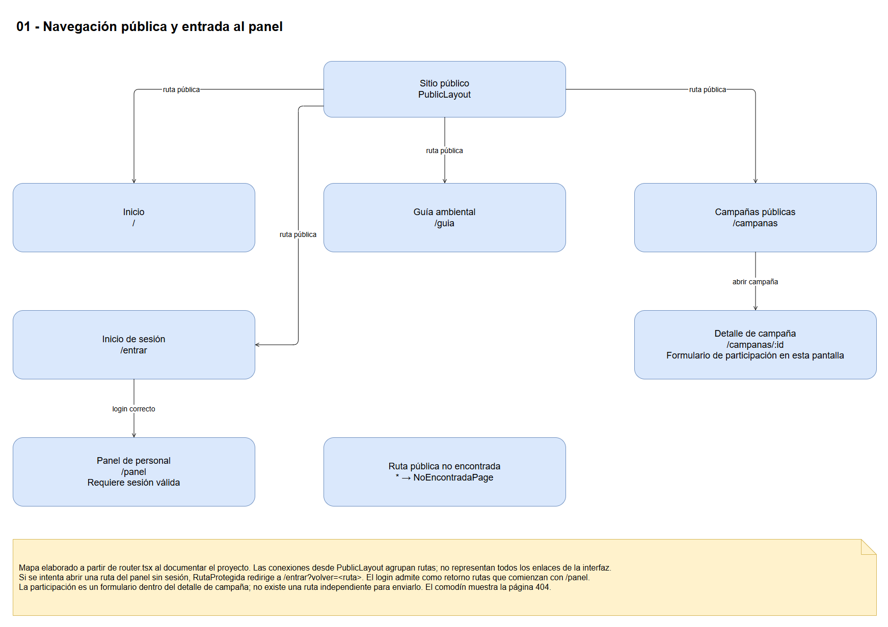
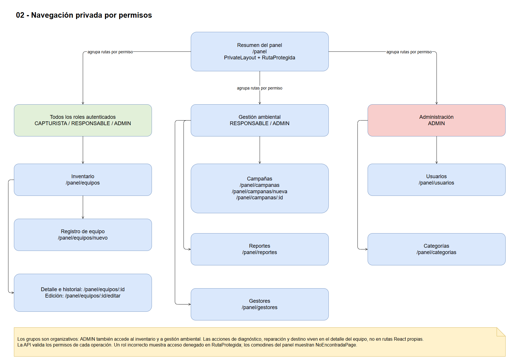

# Documentación técnica de E-Waste 360°

## Conclusiones y trabajo futuro

### 1. Conclusiones

E-Waste 360° integra la sensibilización sobre residuos electrónicos con herramientas para registrar equipos, evaluar su condición, documentar reparaciones y controlar su destino. La plataforma relaciona las actividades públicas de campañas con la gestión interna del inventario, manteniendo una distinción entre equipos declarados por participantes y dispositivos efectivamente registrados.

La separación entre frontend, API y persistencia permite distribuir las responsabilidades del sistema. React presenta la información y gestiona la interacción; los controladores de NestJS reciben solicitudes; los servicios coordinan los casos de uso; las entidades aplican reglas de dominio y los repositorios concentran consultas. La base de datos PostgreSQL conserva las relaciones mediante claves foráneas, enums y restricciones de integridad, y las migraciones versionan el esquema.

El proyecto aplica programación orientada a objetos mediante entidades con comportamiento, clases abstractas, repositorios genéricos y perfiles especializados. Los patrones Factory, Strategy, Observer y Repository tienen usos concretos: crear equipos según su categoría, clasificar diagnósticos, generar trazabilidad mediante eventos y organizar el acceso a los datos. Su implementación favorece la reutilización, aunque conserva dependencias prácticas de TypeORM en algunas operaciones de servicio.

La seguridad se comprueba principalmente en el servidor. Las sesiones almacenadas en PostgreSQL, el hash Argon2id, la actualización del rol en cada solicitud privada, la protección CSRF y la validación de datos limitan el acceso y las operaciones permitidas. Las comprobaciones del frontend complementan esos controles. La configuración de cookies seguras y HTTPS depende del entorno de producción y no equivale, por sí sola, a una verificación del despliegue público.

La ejecución documentada del **25 de noviembre de 2026** aprobó **12 pruebas unitarias y 20 pruebas de servicios web en Jest**. Otras **24 comprobaciones HTTP complementarias** devolvieron el estado esperado y ampliaron la evidencia de campañas, usuarios y catálogos. Los resultados respaldan los escenarios ejecutados; no representan una cobertura completa de interfaz, concurrencia, rendimiento o seguridad de producción. Las pruebas se realizaron con una base temporal aislada.

Los indicadores ofrecen una base para conocer los equipos recuperados, las entregas documentadas y las estimaciones económicas y ambientales. Su interpretación depende de los registros y de los valores de referencia del catálogo: los pesos promedio y ahorros estimados no son mediciones físicas ni acreditan por sí mismos un reciclaje final certificado. De igual manera, confirmar el borrado de datos registra una declaración del operador, pero no ejecuta el borrado del dispositivo.

La solución constituye una base funcional para apoyar la gestión institucional de residuos electrónicos y demostrar los conocimientos de desarrollo web del proyecto. Su evolución requiere cerrar los hallazgos técnicos identificados y ampliar la validación con usuarios y entornos reales antes de atribuirle garantías de operación o resultados ambientales que todavía no se han demostrado.

### 2. Trabajo futuro

Las siguientes propuestas se derivan del código y de los límites de la evidencia disponibles. Se distinguen las correcciones pendientes de las ampliaciones funcionales; ninguna se presenta como ya implementada.

| Prioridad | Línea de trabajo | Acción propuesta | Criterio de comprobación |
|---|---|---|---|
| Alta | Recuperación de CSRF | Conservar un código de error CSRF compatible con el cliente o ajustar el contrato de ambos extremos. | Un token inválido provoca una sola renovación y un reintento; un 403 por rol no lo provoca. |
| Alta | Recursos inexistentes en escrituras | Traducir la ausencia de equipo en búsquedas con bloqueo a una respuesta 404 controlada. | Diagnosticar, reparar o mover un id inexistente devuelve 404 sin datos internos. |
| Alta | Atomicidad del historial | Revisar la confirmación separada de equipo/diagnóstico/reparación y sus movimientos; valorar guardado conjunto o un mecanismo de eventos persistentes. | Un fallo inducido del historial no deja una operación sin trazabilidad sin detectar ni permite duplicarla al reintentar. |
| Alta | Integridad ante concurrencia | Respaldar la unicidad de series y otras reglas críticas con una estrategia transaccional o restricciones apropiadas, respetando campos opcionales y normalización. | Solicitudes simultáneas no crean series duplicadas y producen errores controlados. |
| Alta | TLS y despliegue | Revisar la validación del certificado de PostgreSQL y comprobar la configuración del proxy, HTTPS y cookies en el entorno real. | Evidencia de certificados, atributos `Secure`/`HttpOnly`, cabeceras y acceso a una URL operativa. |
| Alta | Pruebas de interfaz y capturas | Ejecutar los recorridos de aceptación de React y obtener capturas reales de navegador o cliente HTTP. | Evidencia de formularios, navegación por rol, diseño móvil, impresión y CSV; los reportes visuales actuales se mantienen identificados como tales. |
| Media | Consistencia de indicadores | Revisar conteos con varias reparaciones por equipo y unificar la interpretación de entregas documentadas entre reportes. | Fixtures con múltiples reparaciones y entregas incompletas producen totales acordes con la definición de cada métrica. |
| Media | Ampliación de pruebas | Incorporar simulación de diagnóstico por HTTP, reparaciones fallidas, conservación, campañas cerradas, último administrador y límites de solicitudes. | Casos positivos y negativos reproducibles, incluidos los escenarios hoy no cubiertos. |
| Media | Sesiones y datos locales | Evaluar invalidación de sesiones tras cambio de contraseña y limpieza del borrador al cerrar sesión. | Las sesiones revocadas no acceden y no reaparece información de un borrador del usuario anterior. |
| Media | Conservación de datos y operación | Definir retención, anonimización, acceso a logs, respaldo y restauración. | Procedimientos documentados y una restauración de prueba con resultados verificados. |
| Media | Validación con usuarios | Revisar el sistema con capturistas, responsables y administradores, incluidas personas que utilicen teclado o tecnologías de asistencia. | Registro de observaciones, ajustes y repetición de los recorridos afectados. |
| Baja | Identificación física | Valorar etiquetas QR o códigos de barras vinculados al folio y al detalle autorizado del equipo. | Lectura de etiqueta sin exponer datos privados a personas sin sesión. |
| Baja | Evidencia de destino y medición | Valorar adjuntos documentales con controles de acceso y registro de pesos reales frente a estimaciones. | Los reportes distinguen valores medidos, estimados y evidencia documental; las cargas de archivos tienen validación propia. |

Antes de ampliar funciones conviene completar las correcciones y las verificaciones de prioridad alta. El detalle de los hallazgos está en [Seguridad](documentacion-tecnica-seguridad.md), [Servicios web](documentacion-tecnica-servicios-web.md) y [Pruebas](documentacion-tecnica-pruebas.md).

## Anexos

### Anexo A. Bocetos y prototipos disponibles

En la revisión de los archivos del proyecto no se localizaron bocetos, wireframes, archivos de Figma ni prototipos de interfaz identificados como entregables previos al desarrollo. Por ello, no se anexan diseños retrospectivos como si fueran evidencia de una etapa anterior.

El frontend implementado puede utilizarse para demostrar el sistema, pero corresponde a la aplicación desarrollada y no se presenta como un prototipo histórico. Sus pantallas están organizadas en [frontend/src/features](../frontend/src/features) y sus estructuras comunes en [frontend/src/components/layout](../frontend/src/components/layout).

Si posteriormente se recuperan bocetos o prototipos originales, pueden incorporarse indicando su procedencia, fecha o versión y su relación con la interfaz final. Su ausencia en el repositorio no demuestra que nunca se hayan realizado fuera de él.

### Anexo B. Mapa de navegación implementado

Se elaboró un mapa a partir de [router.tsx](../frontend/src/app/router.tsx), [PublicLayout.tsx](../frontend/src/components/layout/PublicLayout.tsx) y [PrivateLayout.tsx](../frontend/src/components/layout/PrivateLayout.tsx). Describe las rutas actuales; no es un boceto previo al desarrollo.

**Archivo editable en draw.io:** [mapa-navegacion-ewaste360.drawio](diagramas/mapa-navegacion-ewaste360.drawio).

| Página | Contenido |
|---|---|
| 01 | Rutas públicas, detalle de campaña e ingreso al panel. |
| 02 | Rutas privadas agrupadas por permisos. |

Los grupos del diagrama organizan rutas, no representan una jerarquía formal de herencia de roles. El administrador accede también a las pantallas compartidas del inventario y de gestión ambiental. Las líneas no enumeran todos los enlaces, botones o retornos disponibles en cada pantalla.

#### B.1. Rutas públicas

| Ruta | Pantalla | Observación |
|---|---|---|
| `/` | Inicio | Información general y cifras públicas. |
| `/guia` | Guía ambiental | En el menú aparece como «Cuida tus equipos». |
| `/campanas` | Listado de campañas | Permite abrir el detalle de una campaña. |
| `/campanas/:id` | Detalle de campaña | Incluye el formulario de participación; no tiene una ruta independiente de formulario. |
| `/entrar` | Inicio de sesión | Al autenticar, dirige al panel o a una ruta de retorno admitida. |
| `*` | Página no encontrada | Comodín para rutas públicas no reconocidas. |

#### B.2. Rutas privadas

Todas requieren sesión. «Todos» corresponde a `CAPTURISTA`, `RESPONSABLE` y `ADMIN`; «Gestión» a `RESPONSABLE` y `ADMIN`.

| Ruta | Pantalla | Roles |
|---|---|---|
| `/panel` | Resumen del panel | Todos |
| `/panel/equipos` | Listado de equipos | Todos |
| `/panel/equipos/nuevo` | Registro de equipo por pasos | Todos |
| `/panel/equipos/:id` | Detalle e historial | Todos |
| `/panel/equipos/:id/editar` | Edición de datos permitidos | Todos |
| `/panel/campanas` | Gestión de campañas | Gestión |
| `/panel/campanas/nueva` | Alta de campaña | Gestión |
| `/panel/campanas/:id` | Gestión del detalle de campaña | Gestión |
| `/panel/reportes` | Indicadores y reportes | Gestión |
| `/panel/gestores` | Gestión de receptores externos | Gestión; verificar o revocar requiere `ADMIN` en la API. |
| `/panel/usuarios` | Administración de cuentas | `ADMIN` |
| `/panel/categorias` | Administración de categorías | `ADMIN` |
| `/panel/*` | Página no encontrada dentro del panel | Sesión válida por el contenedor privado. |

Los formularios de diagnóstico, reparación y decisión de destino se abren desde el detalle del equipo; no corresponden a rutas React independientes. Su disponibilidad depende de la condición, el destino y los permisos de la operación en la API.

Si no hay sesión, [RutaProtegida](../frontend/src/app/RutaProtegida.tsx) redirige a `/entrar?volver=<ruta>`. Si hay sesión pero el rol no permite la pantalla, muestra acceso denegado. El login solo acepta como destino de retorno cadenas que comienzan con `/panel`. La API mantiene sus propias comprobaciones aunque se acceda directamente a una URL.

### Anexo C. Material técnico complementario

| Material | Archivo y contenido |
|---|---|
| Casos de uso, clases, secuencias y estados | [Diseño UML](documentacion-tecnica-diseno-uml.md) y [draw.io editable](diagramas/diseno-uml-ewaste360.drawio). |
| Diagramas de patrones | [Patrones de diseño](documentacion-tecnica-patrones-diseno.md) y [draw.io editable](diagramas/patrones-diseno-ewaste360.drawio). |
| Modelo entidad-relación y diccionario | [Base de datos](documentacion-tecnica-base-datos.md) y [draw.io editable](diagramas/base-datos-ewaste360.drawio). |
| Arquitectura y despliegue previsto | [Arquitectura del sistema](documentacion-tecnica-arquitectura.md). |
| Evidencia de pruebas | [Pruebas](documentacion-tecnica-pruebas.md) y [registros de la ejecución del 25 de noviembre](evidencias/pruebas-2026-11-25). |
| Instrucciones de uso | [Manual de usuario](manual-usuario.md). |
| Contexto ambiental y estimaciones | [Reporte de sustentabilidad](reporte-sustentabilidad.md). |

El script [generar_mapa_navegacion.py](diagramas/generar_mapa_navegacion.py) permite reconstruir el mapa con Python y su biblioteca estándar. Sobrescribe el archivo draw.io; los cambios manuales deben conservarse aparte o incorporarse al script. Al actualizar rutas también deben revisarse la tabla y las exportaciones PNG.
