# Documentación técnica de E-Waste 360°

## Diseño UML

Este apartado describe las interacciones de los usuarios, las clases principales, los flujos de ejecución y el ciclo de vida de los equipos de E-Waste 360°. Los diagramas se elaboraron en un **archivo editable compatible con draw.io (diagrams.net)** y se contrastaron con los controladores, servicios, entidades y repositorios del proyecto.

**Archivo de diagramas:** [diseno-uml-ewaste360.drawio](diagramas/diseno-uml-ewaste360.drawio).

Para consultarlo o editarlo, abrir el archivo en draw.io y seleccionar la pestaña del diagrama. Las imágenes incluidas en este documento son exportaciones del mismo archivo; el `.drawio` conserva las figuras, los textos y los conectores editables.

| Página en draw.io | Contenido |
|---|---|
| 01 | Casos de uso general. |
| 02 | Casos de uso del visitante. |
| 03 | Casos de uso del capturista. |
| 04 | Casos de uso del responsable ambiental. |
| 05 | Casos de uso del administrador. |
| 06 | Clases: entidades y relaciones principales. |
| 07 | Clases: servicios y repositorios. |
| 08 | Secuencia de inicio de sesión. |
| 09 | Secuencia de registro de equipo. |
| 10 | Secuencia de registro de diagnóstico. |
| 11 | Secuencia de movimiento: entrega a gestor. |
| 12 | Ciclo de vida resumido, con condiciones técnicas y destinos. |
| 13 | Máquina de estados de destino implementada. |

### 1. Diagramas de casos de uso

Los casos de uso representan las funciones disponibles para los actores que interactúan con el sistema. El rectángulo delimita E-Waste 360°, las elipses representan casos de uso y las líneas continuas indican la participación de un actor.

Las asociaciones se muestran de forma explícita por rol. El servidor implementa permisos mediante listas de roles y guards; los diagramas no presuponen una jerarquía de herencia entre los actores.

#### 1.1. Diagrama general

El sistema contempla cuatro actores: visitante, capturista, responsable ambiental y administrador. Los casos del diagrama general agrupan funciones para ofrecer una vista del alcance completo. Las páginas por rol desglosan las acciones disponibles.

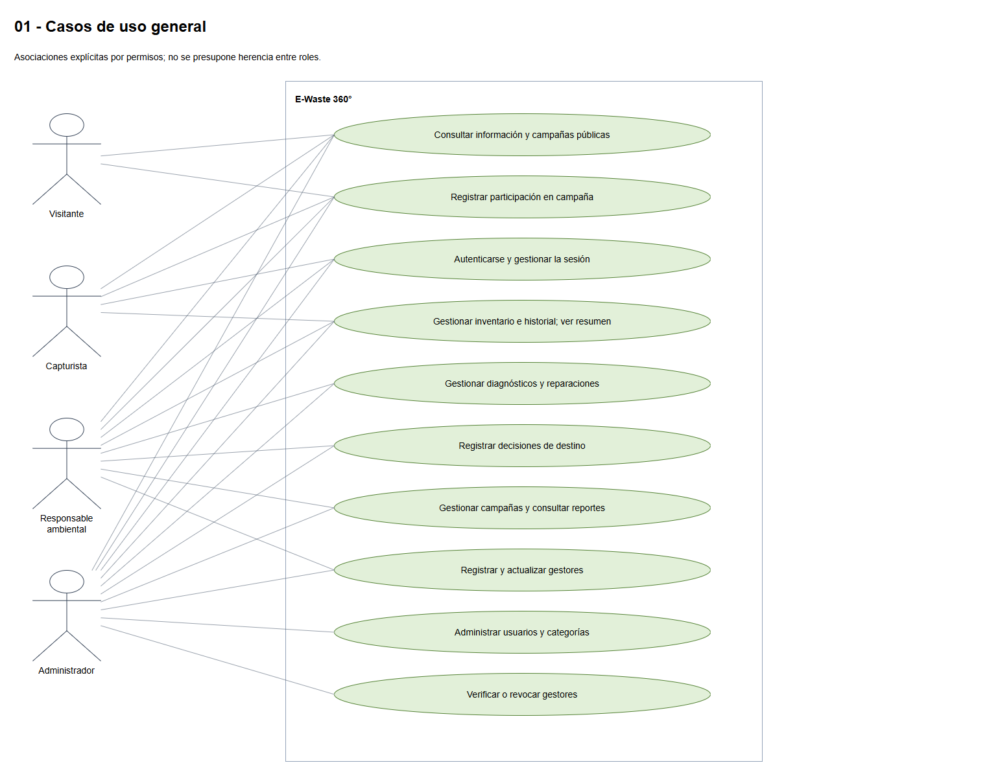

| Actor | Participación principal |
|---|---|
| Visitante | Consultar información ambiental, campañas y cifras públicas; registrar una participación. |
| Capturista | Utilizar las funciones públicas, autenticarse, gestionar los datos permitidos del inventario y consultar historial y resumen del panel. |
| Responsable ambiental | Utilizar las funciones de captura y realizar diagnósticos, reparaciones y decisiones de destino; administrar campañas, consultar participantes y reportes, y mantener registros de gestores. |
| Administrador | Utilizar las funciones de gestión y administrar usuarios, roles y categorías; verificar gestores o revocar su verificación. |

#### 1.2. Visitante

El visitante consulta la sección pública y puede registrar su intención de participar en campañas que no estén cerradas. La participación permite declarar equipos; su recepción efectiva se registra posteriormente en el inventario. El formulario de inicio de sesión permite acceder con una cuenta existente y asumir el rol asignado a ella.

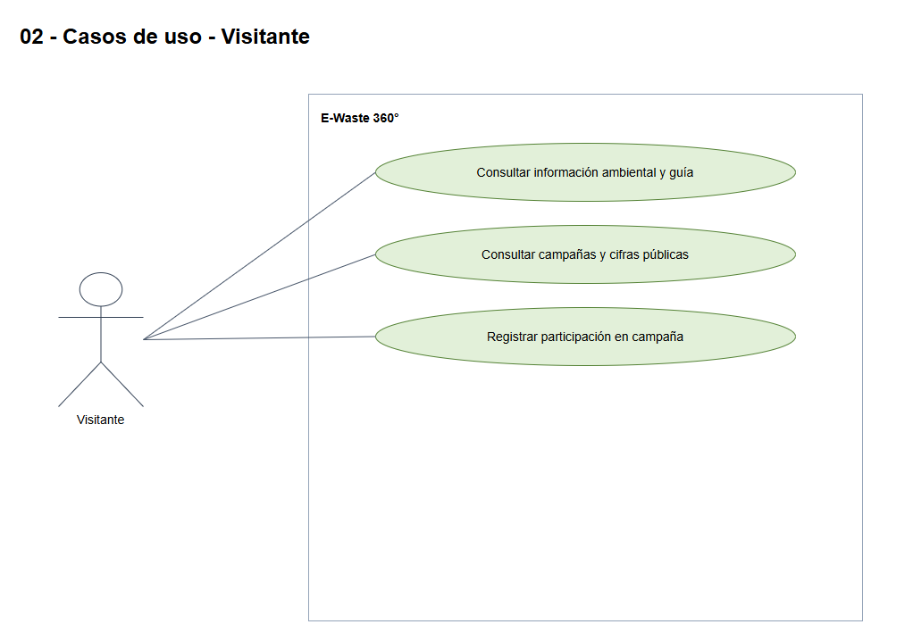

#### 1.3. Capturista

El capturista registra equipos, consulta y actualiza campos autorizados, revisa el historial e imprime la ficha. También consulta el resumen de indicadores del panel. Las decisiones de destino y los reportes detallados requieren los roles de gestión.

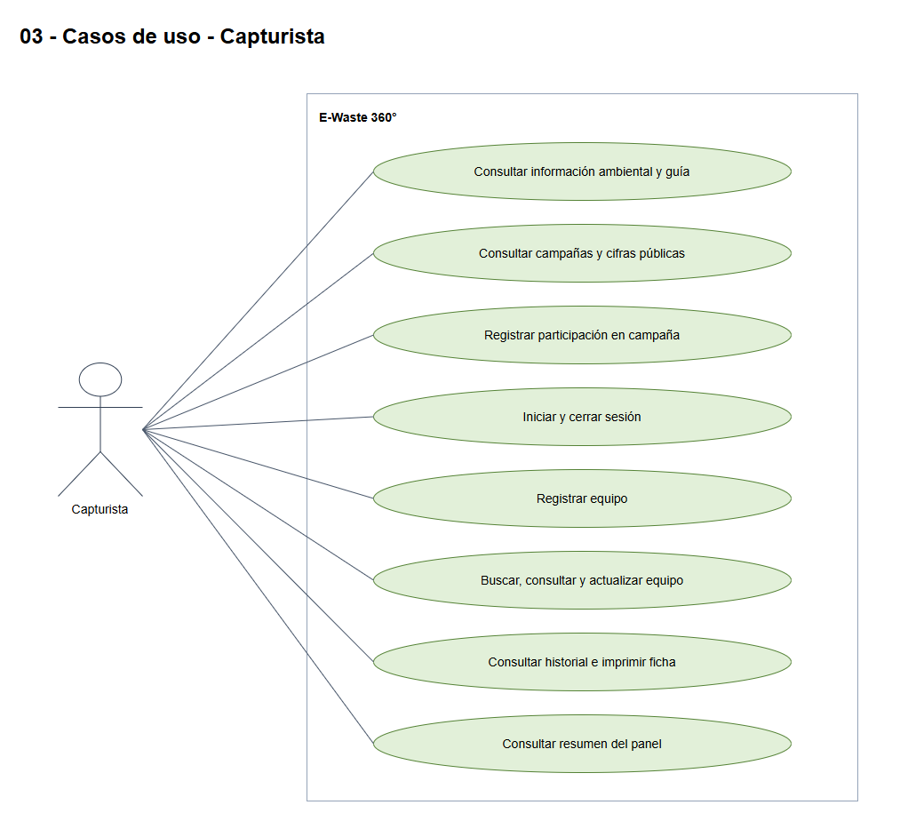

#### 1.4. Responsable ambiental

El responsable ambiental dispone de las funciones de captura y de las operaciones para diagnosticar, reparar, reasignar, conservar o entregar equipos. Administra campañas, consulta sus participantes y reportes, y registra o actualiza gestores.

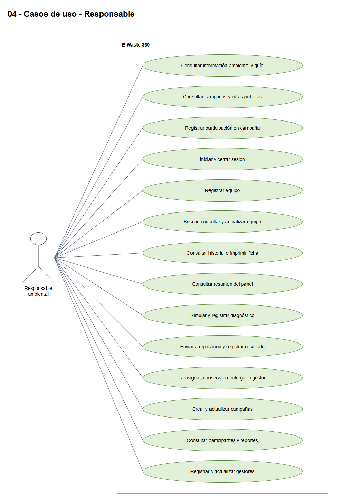

#### 1.5. Administrador

El administrador dispone de las operaciones de gestión y administra las cuentas, los roles y las categorías. La verificación de gestores y su revocación se reservan a este rol. Los permisos administrativos siguen sujetos a las reglas de negocio del equipo y a las restricciones de administración de cuentas.

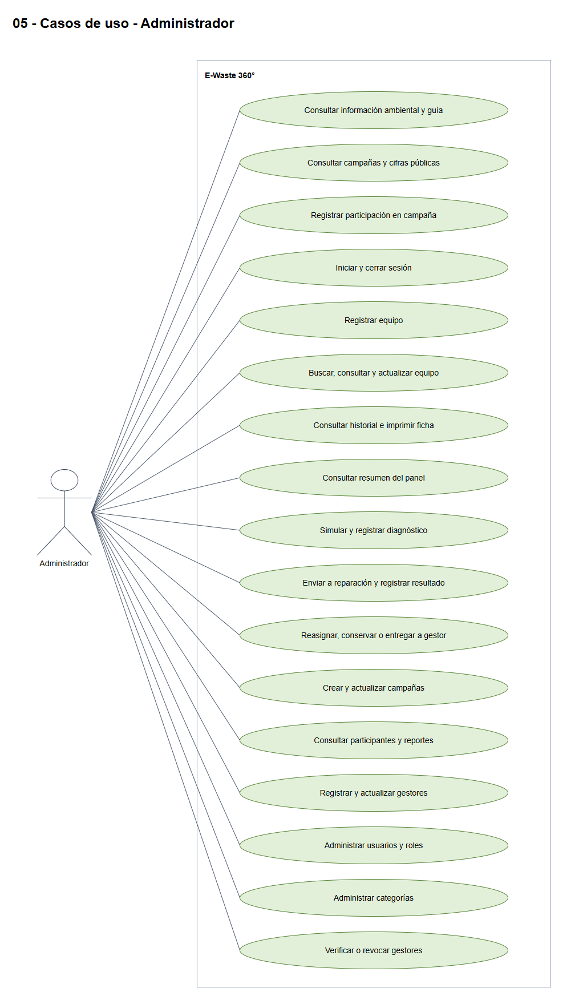

**Referencia en el código:** controladores de `backend/src/modules/`, `backend/src/common/guards/roles.guard.ts` y rutas de `frontend/src/app/router.tsx`. La matriz detallada de permisos se encuentra en [Requerimientos](documentacion-tecnica-requerimientos.md).

### 2. Diagramas de clases

El modelo se divide en dos vistas para facilitar la lectura: entidades del dominio y colaboración entre servicios y repositorios. Los atributos, métodos y dependencias mostrados son una selección de los existentes en el código.

Se utiliza la siguiente notación:

- `+`: miembro público.
- `-`: miembro privado.
- `#`: miembro protegido.
- `«abstract»`: clase abstracta.
- Triángulo vacío dirigido a la clase base: generalización o herencia.
- Línea continua entre entidades: asociación; las etiquetas indican multiplicidades.
- Flecha discontinua: dependencia de uso.
- `?` o multiplicidad `0..1`: valor o relación opcional.
- `0..*`: cero o más instancias.

#### 2.1. Entidades

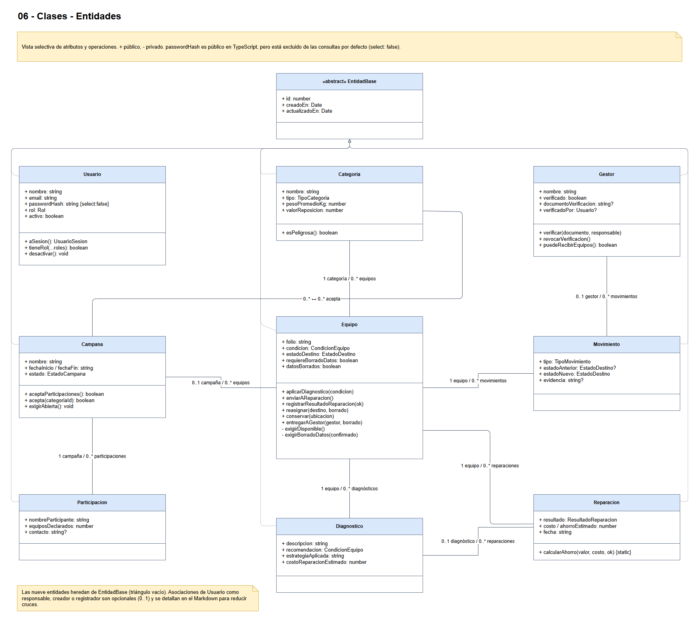

| Clase | Responsabilidad |
|---|---|
| `EntidadBase` | Proporcionar identificador y fechas de creación y actualización a las nueve entidades. |
| `Usuario` | Representar una cuenta, su rol y estado activo; construir los datos mínimos de sesión. |
| `Categoria` | Definir tipo de equipo, peso promedio y valor de reposición; identificar categorías peligrosas. |
| `Equipo` | Representar el inventario y aplicar las reglas de diagnóstico, reparación, conservación, reasignación y entrega. |
| `Diagnostico` | Conservar la evaluación, recomendación, estrategia aplicada y justificación. |
| `Reparacion` | Documentar resultado, costo y fecha, y proporcionar el cálculo de ahorro estimado. |
| `Movimiento` | Registrar acciones relevantes, responsables, estados, destinos y referencias de evidencia. |
| `Gestor` | Representar al receptor de residuos y controlar su verificación documental. |
| `Campana` | Representar una campaña, sus fechas, estado y categorías aceptadas; validar si admite participaciones. |
| `Participacion` | Registrar a una persona participante, los equipos declarados y sus datos opcionales. |

Un equipo pertenece a una categoría y puede relacionarse con una campaña de origen. Tiene cero o más diagnósticos, reparaciones y movimientos; cada uno de estos registros pertenece a un equipo. Una campaña admite varias categorías y una categoría puede participar en varias campañas mediante la tabla de asociación `campana_categorias`.

Para reducir cruces, algunas asociaciones con `Usuario` se documentan en esta tabla complementaria:

| Referencia | Multiplicidad respecto al usuario |
|---|---|
| `Equipo.registradoPor` | Cada equipo tiene `0..1` usuario registrador; un usuario puede registrar `0..*` equipos. |
| `Diagnostico.responsable` | Cada diagnóstico tiene `0..1` responsable; un usuario puede tener `0..*` diagnósticos. |
| `Reparacion.responsable` | Cada reparación tiene `0..1` responsable; un usuario puede tener `0..*` reparaciones. |
| `Movimiento.responsable` | Cada movimiento tiene `0..1` responsable; un usuario puede tener `0..*` movimientos. |
| `Campana.creadaPor` | Cada campaña tiene `0..1` creador; un usuario puede crear `0..*` campañas. |
| `Participacion.usuario` | Cada participación puede asociarse con `0..1` cuenta; un usuario puede tener `0..*` participaciones. |
| `Gestor.verificadoPor` | Cada gestor tiene `0..1` usuario verificador; un usuario puede verificar `0..*` gestores. |

La opcionalidad representa el esquema persistente, que permite referencias nulas. Las operaciones autenticadas registran al usuario responsable al crear los datos correspondientes. Las relaciones de participación permiten también personas sin cuenta.

`Usuario.passwordHash` es un atributo público en TypeScript. La protección de su lectura se configura con `select: false` en TypeORM, y la sesión se construye mediante `aSesion()` sin incluirlo. La visibilidad UML del atributo se mantiene conforme al código.

**Referencia en el código:** archivos `*.entity.ts` de los módulos y `backend/src/common/entities/base.entity.ts`.

#### 2.2. Servicios y repositorios

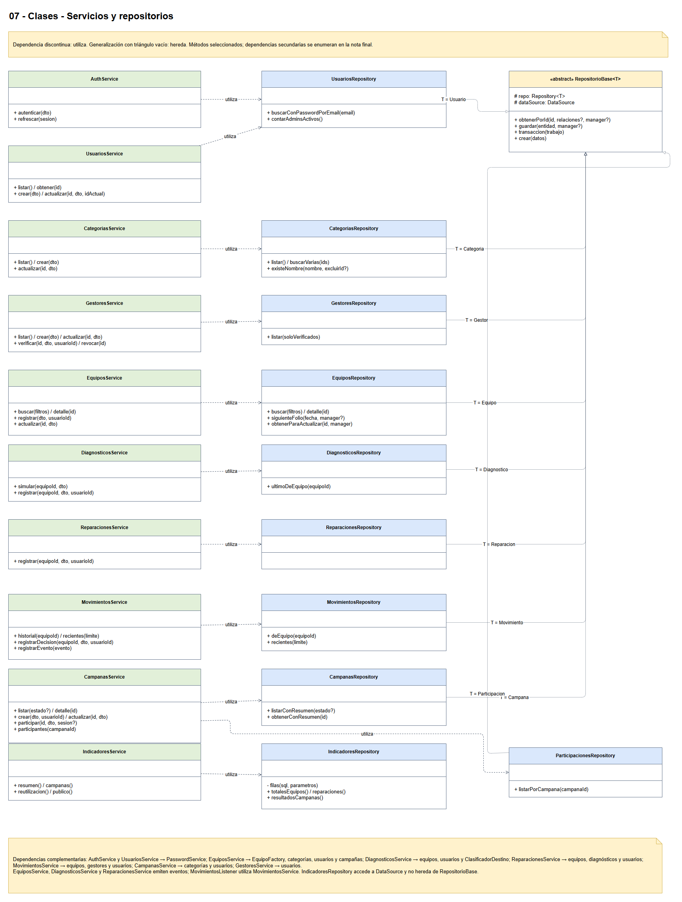

Los servicios coordinan los casos de uso y los repositorios proporcionan operaciones de consulta y persistencia. La clase abstracta genérica `RepositorioBase<T>` concentra creación de entidades, consulta por identificador, guardado y ejecución de transacciones.

Los repositorios de usuarios, categorías, gestores, equipos, diagnósticos, reparaciones, movimientos, campañas y participaciones heredan de esta clase. `IndicadoresRepository` utiliza directamente `DataSource` para consultas agregadas y parametrizadas.

Las flechas principales muestran el repositorio asociado con cada servicio; la nota del diagrama enumera dependencias secundarias. Por ejemplo, `EquiposService` utiliza también categorías, usuarios y campañas, y delega la construcción del equipo a `EquipoFactory`. `DiagnosticosService` utiliza `ClasificadorDestino` para aplicar la estrategia correspondiente. `MovimientosListener` recibe eventos y utiliza `MovimientosService` para completar el historial.

**Referencia en el código:** archivos `*.service.ts` y `*.repository.ts` de los módulos, `backend/src/common/repositories/repositorio-base.ts`, `modules/equipos/factory/`, `modules/diagnosticos/strategies/` y `modules/movimientos/movimientos.listener.ts`.

### 3. Diagramas de secuencia

Los diagramas muestran participantes, líneas de vida y mensajes ordenados de arriba hacia abajo. Las llamadas utilizan flechas continuas y los retornos resumidos utilizan flechas discontinuas. Las notas explican precondiciones, alternativas de error y límites transaccionales.

Para mantener la lectura, algunos participantes agrupan componentes: **API** reúne los guards, pipes y el controlador cuando así se indica; **repositorios** reúne las clases enumeradas en cada diagrama; **eventos e historial** representa la cadena `EventEmitter2 → MovimientosListener → MovimientosService → MovimientosRepository`. Algunas respuestas se muestran directamente entre participantes extremos y omiten retornos intermedios.

#### 3.1. Inicio de sesión

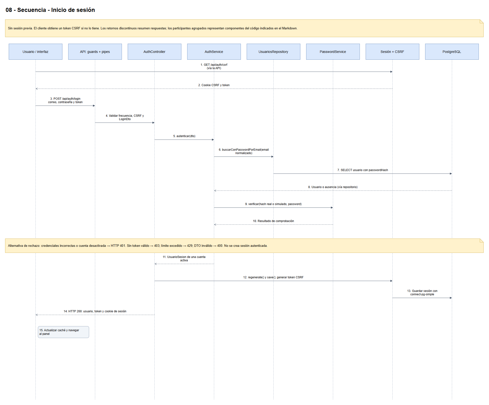

1. El cliente obtiene un token CSRF si todavía no dispone de uno.
2. Envía el correo y la contraseña a `POST /api/auth/login` con el token correspondiente.
3. La API aplica el límite de solicitudes, comprueba CSRF y valida el DTO.
4. `AuthController` utiliza `AuthService`, que consulta la cuenta por correo normalizado y verifica la contraseña con `PasswordService` y Argon2id. Si no existe la cuenta, utiliza un hash simulado para realizar la comprobación.
5. Si las credenciales son válidas y la cuenta está activa, el controlador regenera el identificador de sesión y guarda la sesión en PostgreSQL.
6. Devuelve el usuario de sesión y un token CSRF, además de establecer la cookie. El cliente actualiza su caché y navega al panel.

Las credenciales inválidas o la cuenta desactivada provocan una respuesta 401. Un token inválido, un exceso de solicitudes o datos mal formados producen el rechazo antes de completar la autenticación.

**Referencia:** `modules/auth/auth.controller.ts`, `modules/auth/auth.service.ts`, `modules/usuarios/password.service.ts`, `app.setup.ts` y los hooks `useLogin()` de `frontend/src/api/hooks.ts`.

#### 3.2. Registro de equipo

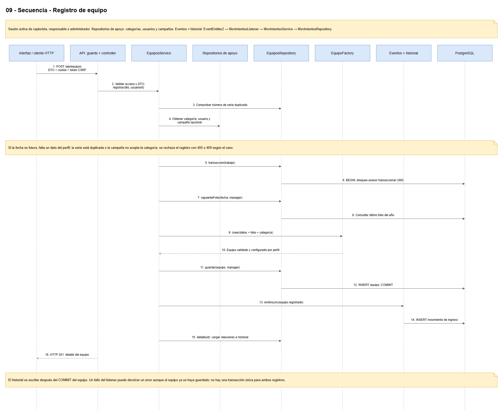

1. Un capturista, responsable o administrador envía `POST /api/equipos` con los datos del equipo.
2. La API valida sesión, rol, CSRF y DTO, y delega en `EquiposService`.
3. El servicio comprueba la fecha y el número de serie, obtiene categoría y usuario, y valida la compatibilidad de la campaña si se seleccionó una.
4. Abre una transacción y obtiene un bloqueo asesor de PostgreSQL para proteger la generación del folio consecutivo.
5. `EquipoFactory` selecciona el perfil por categoría, valida los datos y construye el equipo con su condición inicial y estado `EN_INVENTARIO`.
6. El repositorio guarda el equipo y confirma la transacción.
7. El servicio emite `equipo.registrado`; el listener registra el movimiento de ingreso. Después se consulta el detalle y se devuelve una respuesta 201.

El equipo y el movimiento de ingreso se guardan en operaciones separadas: el evento se emite después de confirmar la transacción del equipo. Si falla el listener, el equipo puede permanecer guardado aunque la solicitud termine con error. Este comportamiento debe considerarse al revisar la operación antes de reintentar.

**Referencia:** `modules/equipos/equipos.controller.ts`, `equipos.service.ts`, `equipos.repository.ts`, `factory/equipo.factory.ts` y `modules/movimientos/movimientos.listener.ts`.

#### 3.3. Diagnóstico

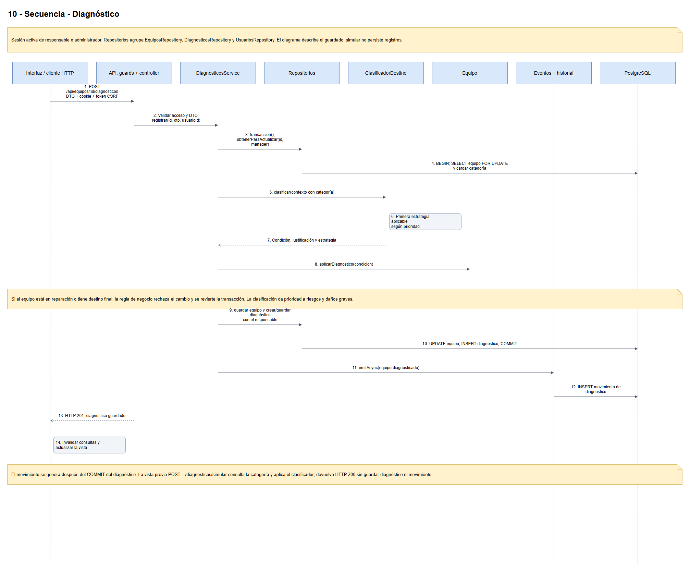

1. Un responsable o administrador envía `POST /api/equipos/:id/diagnosticos`.
2. La API valida el acceso y los datos, y ejecuta `DiagnosticosService.registrar()`.
3. Se abre una transacción y se bloquea la fila del equipo para evitar cambios simultáneos.
4. `ClasificadorDestino` selecciona la primera estrategia aplicable según su prioridad y devuelve condición, justificación y estrategia.
5. `Equipo.aplicarDiagnostico()` comprueba que el equipo admita el cambio. Se guarda la condición y el diagnóstico con su responsable dentro de la transacción.
6. Después del COMMIT, se emite `equipo.diagnosticado` y el listener agrega el movimiento al historial.
7. La API devuelve el diagnóstico con una respuesta 201 y el cliente invalida las consultas relacionadas para actualizar la vista.

El clasificador prioriza la gestión especializada por riesgos o daños graves; después evalúa el funcionamiento sin reparación y la viabilidad económica. El umbral de reparación admite un costo **menor o igual al 50 %** del valor de reposición.

La operación `POST /api/equipos/:id/diagnosticos/simular` consulta el equipo y ejecuta el clasificador, devuelve una respuesta 200 y permite mostrar una recomendación previa. El historial del diagnóstico definitivo se escribe después de confirmar su transacción, por lo que comparte la limitación de persistencia separada descrita para el registro de equipo.

**Referencia:** `modules/diagnosticos/diagnosticos.controller.ts`, `diagnosticos.service.ts`, `strategies/`, `modules/equipos/equipo.entity.ts` y `modules/movimientos/movimientos.listener.ts`.

#### 3.4. Movimiento

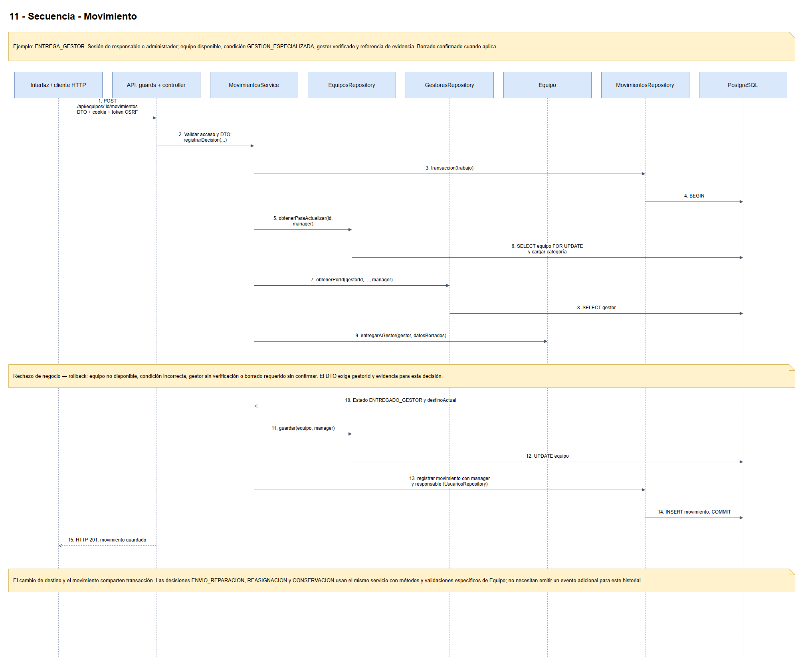

El ejemplo corresponde a una **entrega a gestor**, que concentra las validaciones de destino, verificación y protección de datos:

1. Un responsable o administrador envía `POST /api/equipos/:id/movimientos` con tipo `ENTREGA_GESTOR`, gestor, evidencia y confirmación de borrado cuando corresponda.
2. La API valida el acceso y el DTO. `MovimientosService` inicia una transacción.
3. Se bloquea y consulta el equipo, y se obtiene el gestor seleccionado.
4. `Equipo.entregarAGestor()` exige disponibilidad, condición de gestión especializada, gestor verificado y borrado confirmado si el equipo lo requiere y aún no estaba confirmado.
5. El servicio guarda el nuevo estado y registra el movimiento con responsable, destino y evidencia dentro de la misma transacción.
6. Si ambas escrituras son correctas, se confirma la transacción y se devuelve una respuesta 201. Si falla una validación o escritura dentro de ella, se revierte.

Las decisiones `ENVIO_REPARACION`, `REASIGNACION` y `CONSERVACION` utilizan el mismo servicio con sus métodos de dominio correspondientes. El DTO exige una referencia de evidencia para reasignación y entrega. Estas decisiones crean el historial dentro de su propia transacción.

**Referencia:** `modules/movimientos/movimientos.controller.ts`, `movimientos.service.ts`, `movimientos.dto.ts`, `modules/equipos/equipo.entity.ts` y `modules/catalogos/gestor.entity.ts`.

### 4. Diagramas de estados del ciclo de vida de un equipo

El ciclo de vida distingue dos atributos:

| Atributo | Valores implementados | Significado |
|---|---|---|
| `condicion` | `PENDIENTE`, `FUNCIONAL`, `REPARABLE`, `REUTILIZABLE`, `GESTION_ESPECIALIZADA`. | Situación técnica del dispositivo. |
| `estadoDestino` | `EN_INVENTARIO`, `EN_REPARACION`, `REASIGNADO`, `CONSERVADO`, `ENTREGADO_GESTOR`. | Situación dentro del proceso institucional. |

**Registrado, diagnosticado y reparado son hitos del proceso**, representados por operaciones y registros de historial. El estado persistente se expresa mediante la combinación de condición y destino.

#### 4.1. Vista resumida del ciclo de vida

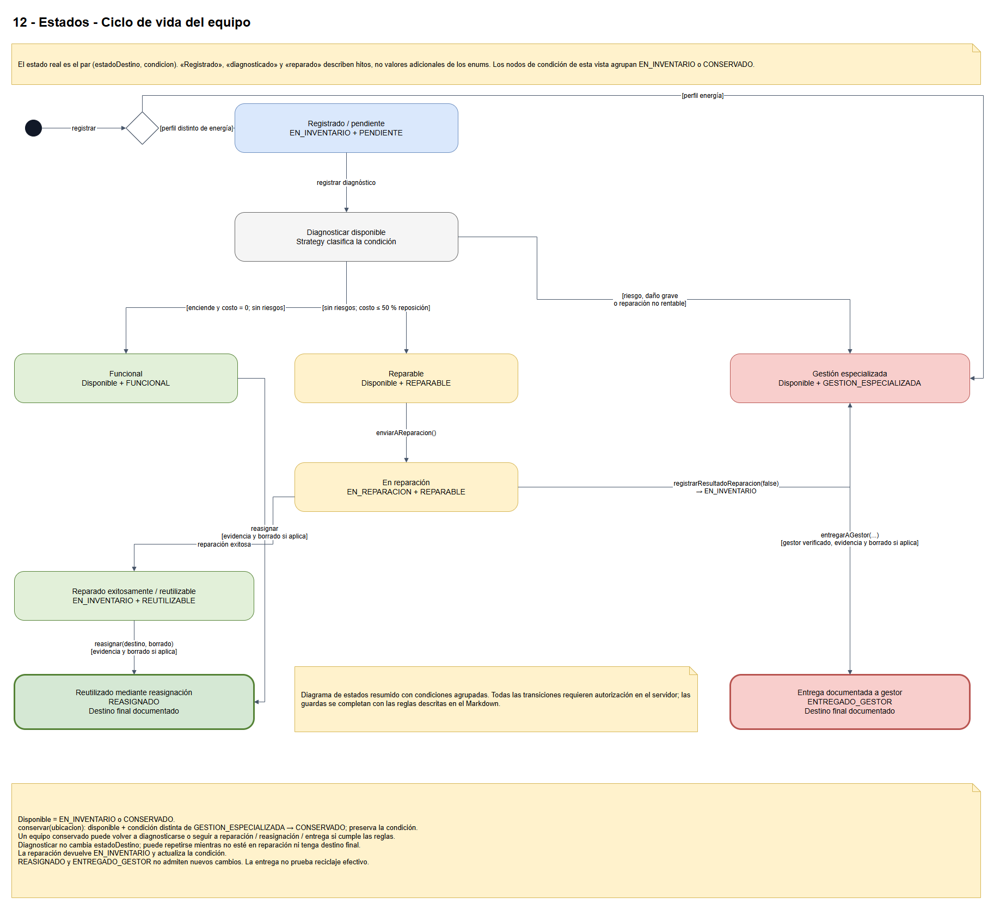

El flujo habitual es: registrar el equipo, diagnosticarlo y decidir entre aprovechamiento directo, reparación o gestión especializada. Una reparación exitosa permite clasificarlo como reutilizable; la reasignación documenta su aprovechamiento por un destinatario. Una reparación fallida lo clasifica para gestión especializada.

La categoría de energía constituye una excepción al ingreso pendiente: `PerfilEnergia` asigna directamente `GESTION_ESPECIALIZADA` al registrar el equipo. El estado de destino inicial sigue siendo `EN_INVENTARIO`.

Los nodos de condición de esta vista agrupan los destinos disponibles para facilitar la explicación. La siguiente vista representa los estados de destino concretos y sus transiciones.

#### 4.2. Estados de destino implementados

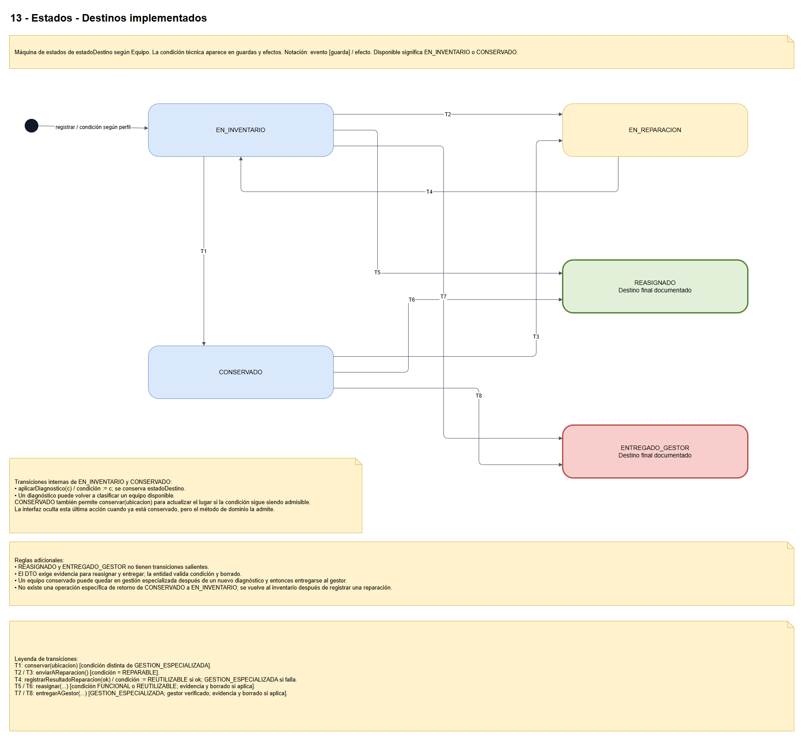

| Estado de origen | Operación y condición | Estado resultante y efecto |
|---|---|---|
| Inicio | Registro mediante `EquipoFactory`. | `EN_INVENTARIO`; condición inicial según el perfil. |
| `EN_INVENTARIO` o `CONSERVADO` | Registrar diagnóstico. | Se mantiene el destino y se actualiza la condición según la clasificación. |
| `EN_INVENTARIO` o `CONSERVADO` | Enviar a reparación; condición `REPARABLE`. | `EN_REPARACION`. |
| `EN_REPARACION` | Registrar reparación exitosa. | `EN_INVENTARIO` y condición `REUTILIZABLE`. |
| `EN_REPARACION` | Registrar reparación fallida. | `EN_INVENTARIO` y condición `GESTION_ESPECIALIZADA`. |
| `EN_INVENTARIO` o `CONSERVADO` | Conservar; condición distinta de `GESTION_ESPECIALIZADA`. | `CONSERVADO`; se registra la ubicación y se mantiene la condición. |
| `EN_INVENTARIO` o `CONSERVADO` | Reasignar; condición `FUNCIONAL` o `REUTILIZABLE`, evidencia y borrado confirmado si aplica. | `REASIGNADO`; se documenta el destino. |
| `EN_INVENTARIO` o `CONSERVADO` | Entregar; condición `GESTION_ESPECIALIZADA`, gestor verificado, evidencia y borrado confirmado si aplica. | `ENTREGADO_GESTOR`; se documentan destino y gestor. |

Reglas complementarias del ciclo de vida:

- Un equipo disponible puede volver a diagnosticarse. Si está en reparación, primero debe registrarse el resultado.
- Un diagnóstico puede cambiar la condición de un equipo conservado a gestión especializada; en ese caso puede registrarse su entrega a un gestor.
- El método `conservar()` admite actualizar la ubicación de un equipo ya conservado si cumple sus validaciones. La interfaz omite la acción de conservar cuando el equipo ya tiene ese destino.
- `REASIGNADO` y `ENTREGADO_GESTOR` son destinos finales para las operaciones implementadas: el sistema rechaza nuevos cambios de estado y ediciones de datos.
- El sistema registra la confirmación de borrado y la referencia de evidencia; el borrado físico y la entrega ocurren fuera de la aplicación.
- Una entrega documentada a un gestor no acredita por sí sola el reciclaje efectivo del equipo.

**Referencia:** `backend/src/common/enums.ts`, `modules/equipos/equipo.entity.ts`, `modules/equipos/equipos.service.ts`, `modules/equipos/factory/perfiles-equipo.ts`, `modules/reparaciones/reparaciones.service.ts` y `modules/movimientos/movimientos.dto.ts`.

### Archivos de apoyo y mantenimiento

El archivo [generar_uml.py](diagramas/generar_uml.py) permite regenerar la estructura del `.drawio` con Python y la biblioteca estándar. Al ejecutarlo, reemplaza el archivo de diagramas con la versión definida por el script; las modificaciones manuales en draw.io deben conservarse antes de regenerarlo.

Las imágenes de `docs/diagramas/` se exportan desde draw.io. Si cambia un diagrama, debe actualizarse también su PNG para mantener la correspondencia entre las vistas del Markdown y el archivo editable.
