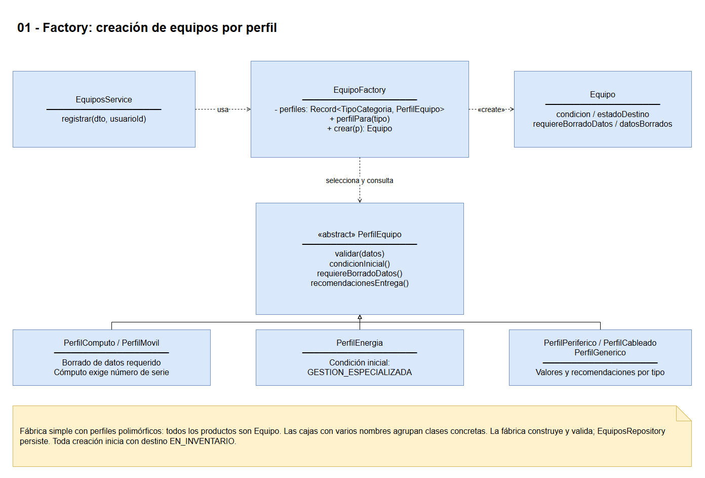
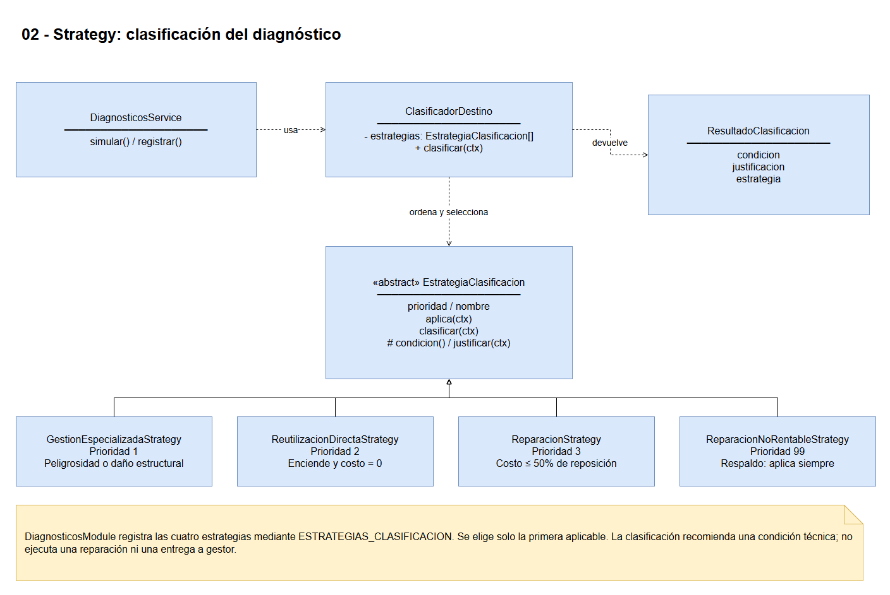
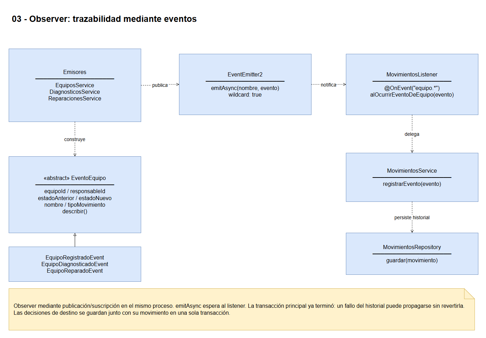
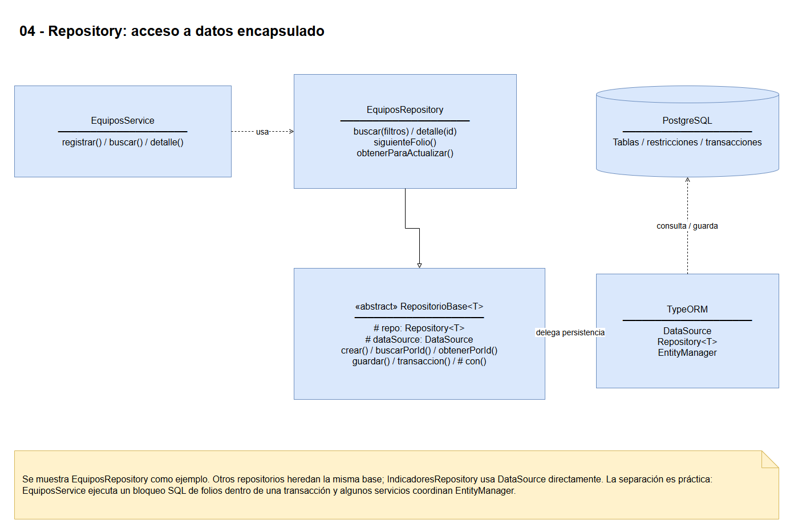

# Documentación técnica de E-Waste 360°

## Patrones de diseño

E-Waste 360° implementa cuatro patrones que organizan la creación de equipos, la clasificación de diagnósticos, la trazabilidad y el acceso a los datos. Este apartado describe su implementación real en el backend, con sus beneficios y límites.

Los diagramas se elaboraron en un **archivo editable compatible con draw.io (diagrams.net)**: [patrones-diseno-ewaste360.drawio](diagramas/patrones-diseno-ewaste360.drawio). Cada patrón tiene una página propia. Las imágenes de este documento son exportaciones de ese archivo.

| Página | Patrón | Tipo | Aplicación en el sistema |
|---|---|---|---|
| 01 | Factory, mediante una fábrica simple | Creacional | Construir equipos con las reglas de su categoría. |
| 02 | Strategy | Comportamiento | Seleccionar el criterio de clasificación del diagnóstico. |
| 03 | Observer, mediante publicación y suscripción | Comportamiento | Registrar movimientos a partir de eventos de dominio. |
| 04 | Repository | Acceso a datos | Encapsular consultas y operaciones de persistencia. |

En los diagramas, las flechas discontinuas representan dependencias; las flechas continuas con triángulo vacío representan herencia. Algunas cajas agrupan clases para facilitar la lectura; sus nombres corresponden a clases separadas en el código. Se muestran los participantes relevantes de cada patrón, sin reproducir todas las dependencias de cada módulo.

### 1. Factory: creación de equipos por categoría

#### Problema que resuelve

Los dispositivos tienen reglas de registro diferentes. Un equipo de cómputo requiere número de serie y puede almacenar información que debe borrarse antes de entregarlo; un dispositivo móvil también requiere borrado de datos; las baterías y fuentes de energía ingresan con condición de gestión especializada. Si estas reglas se distribuyeran entre controladores y servicios, podrían aplicarse de forma inconsistente.

#### Cómo se implementó

`EquiposService` delega la construcción en `EquipoFactory`. La fábrica mantiene un mapa de `TipoCategoria` a objetos derivados de `PerfilEquipo`: `PerfilComputo`, `PerfilMovil`, `PerfilEnergia`, `PerfilPeriferico`, `PerfilCableado` y `PerfilGenerico`.

El método `crear()` selecciona el perfil, valida los datos, construye una instancia de `Equipo` y establece su condición inicial y sus indicadores de borrado de datos. El servicio coordina después su persistencia mediante `EquiposRepository`. La fábrica también permite consultar recomendaciones de entrega desde el detalle del equipo.

Esta implementación es una **fábrica simple con perfiles polimórficos**. Todos los perfiles producen la misma entidad `Equipo`; no existe una jerarquía de creadores que sobrescriban un Factory Method. La especialización está en las reglas del perfil.

**Archivos principales:**

- [equipo.factory.ts](../backend/src/modules/equipos/factory/equipo.factory.ts).
- [perfiles-equipo.ts](../backend/src/modules/equipos/factory/perfiles-equipo.ts).
- [equipos.service.ts](../backend/src/modules/equipos/equipos.service.ts).

#### Diagrama



Página **01** del archivo draw.io.

#### Fragmento de código

Extractos de `EquipoFactory.crear()`. Se omiten las asignaciones de identificación y ubicación para mostrar la selección del perfil y la configuración inicial:

```typescript
crear(p: ParametrosCreacion): Equipo {
  const perfil = this.perfilPara(p.categoria.tipo);
  perfil.validar(p);

  const equipo = new Equipo();
  // ... asignación de los datos del equipo ...
  equipo.condicion = perfil.condicionInicial();
  equipo.estadoDestino = EstadoDestino.EN_INVENTARIO;
  equipo.requiereBorradoDatos = perfil.requiereBorradoDatos();
  equipo.datosBorrados = false;
  equipo.destinoActual = null;
  return equipo;
}
```

En `PerfilEnergia`, la especialización de la condición inicial es:

```typescript
override condicionInicial(): CondicionEquipo {
  return CondicionEquipo.GESTION_ESPECIALIZADA;
}
```

`GESTION_ESPECIALIZADA` es una **condición técnica**. El destino inicial continúa siendo `EN_INVENTARIO`: registrar una batería no significa que ya fue entregada a un gestor.

#### Beneficios

- Centraliza la creación y los valores iniciales de los equipos.
- Mantiene las reglas particulares dentro de cada perfil y reduce condicionales en el servicio.
- Facilita probar las validaciones de cada categoría de forma independiente.
- Permite incorporar perfiles sin cambiar el controlador; se debe registrar el nuevo perfil en el mapa de la fábrica y, cuando corresponda, ampliar el catálogo de tipos.

### 2. Strategy: clasificación del diagnóstico

#### Problema que resuelve

Determinar si un equipo es funcional, reparable o requiere gestión especializada implica combinar criterios de seguridad y costo. Concentrar todos esos criterios en el servicio de diagnósticos dificultaría modificarlos y verificar su prioridad.

#### Cómo se implementó

`EstrategiaClasificacion` define el contrato común: `prioridad`, `nombre`, `aplica(ctx)` y `clasificar(ctx)`. Las estrategias concretas definen su condición resultante y su justificación.

`DiagnosticosModule` registra los objetos de estrategia mediante el token `ESTRATEGIAS_CLASIFICACION`. NestJS los inyecta en `ClasificadorDestino`, que los ordena por prioridad y utiliza la primera estrategia aplicable. `DiagnosticosService` consume el clasificador tanto para simular como para registrar el diagnóstico.

| Prioridad | Clase | Criterio | Condición resultante |
|---|---|---|---|
| 1 | `GestionEspecializadaStrategy` | Categoría peligrosa, componentes peligrosos o daño estructural. | `GESTION_ESPECIALIZADA` |
| 2 | `ReutilizacionDirectaStrategy` | El equipo enciende y el costo estimado es cero. | `FUNCIONAL` |
| 3 | `ReparacionStrategy` | Costo estimado menor o igual al 50 % del valor de reposición. | `REPARABLE` |
| 99 | `ReparacionNoRentableStrategy` | Respaldo que aplica cuando no se seleccionó una estrategia anterior. | `GESTION_ESPECIALIZADA` |

La prioridad de seguridad se evalúa primero, incluso cuando el equipo enciende. El resultado incluye `condicion`, `justificacion` y `estrategia`. El clasificador no ejecuta reparaciones ni movimientos físicos; esas operaciones tienen sus propios flujos.

**Archivos principales:**

- [estrategia-clasificacion.ts](../backend/src/modules/diagnosticos/strategies/estrategia-clasificacion.ts).
- [clasificador-destino.ts](../backend/src/modules/diagnosticos/strategies/clasificador-destino.ts).
- [diagnosticos.module.ts](../backend/src/modules/diagnosticos/diagnosticos.module.ts).
- [diagnosticos.service.ts](../backend/src/modules/diagnosticos/diagnosticos.service.ts).

#### Diagrama



Página **02** del archivo draw.io.

#### Fragmento de código

Método de selección de `ClasificadorDestino`:

```typescript
clasificar(ctx: ContextoClasificacion): ResultadoClasificacion {
  const estrategia = this.estrategias.find((e) => e.aplica(ctx));
  if (!estrategia) {
    throw new Error('No hay una estrategia de clasificación aplicable.');
  }
  return estrategia.clasificar(ctx);
}
```

Criterio de `ReparacionStrategy`:

```typescript
aplica(ctx: ContextoClasificacion): boolean {
  const limite = ctx.categoria.valorReposicion * UMBRAL_REPARACION;
  return ctx.costoReparacionEstimado <= limite;
}
```

`UMBRAL_REPARACION` vale `0.5`. El arreglo se ordena en el constructor antes de ejecutar `find()`.

#### Beneficios

- Separa los criterios del servicio que coordina el diagnóstico.
- Hace explícito que las reglas de seguridad tienen precedencia sobre las económicas.
- Permite añadir una estrategia y registrarla en el módulo sin modificar el método de selección del clasificador.
- Produce una justificación asociada al criterio aplicado.
- Facilita las pruebas aisladas; el proyecto contiene [pruebas del clasificador](../backend/src/modules/diagnosticos/strategies/clasificador-destino.spec.ts) para escenarios funcionales, de reparación y de peligrosidad.

### 3. Observer: trazabilidad mediante eventos

#### Problema que resuelve

El registro de equipos, los diagnósticos y las reparaciones deben dejar evidencia en el historial. Si cada servicio implementara el registro completo del movimiento, se duplicaría lógica y aumentaría su dependencia del módulo de trazabilidad.

#### Cómo se implementó

Los servicios de equipos, diagnósticos y reparaciones publican eventos mediante `EventEmitter2`. Las clases `EquipoRegistradoEvent`, `EquipoDiagnosticadoEvent` y `EquipoReparadoEvent` heredan de `EventoEquipo` y contienen la información necesaria para describir el movimiento.

`AppModule` habilita eventos con comodines mediante `EventEmitterModule.forRoot({ wildcard: true, delimiter: '.' })`. `MovimientosListener` se suscribe a `equipo.*` y delega en `MovimientosService.registrarEvento()`, que construye y guarda el movimiento mediante su repositorio.

Es una aplicación de **Observer mediante publicación y suscripción dentro del mismo proceso**. Los emisores conocen los eventos y el bus, pero no necesitan llamar directamente al listener.

**Archivos principales:**

- [equipo.events.ts](../backend/src/common/events/equipo.events.ts).
- [movimientos.listener.ts](../backend/src/modules/movimientos/movimientos.listener.ts).
- [movimientos.service.ts](../backend/src/modules/movimientos/movimientos.service.ts).
- [app.module.ts](../backend/src/app.module.ts).

#### Diagrama



Página **03** del archivo draw.io.

#### Fragmento de código

Publicación desde `EquiposService`, después de guardar el equipo:

```typescript
await this.eventos.emitAsync(
  'equipo.registrado',
  new EquipoRegistradoEvent(
    guardado.id,
    usuarioId,
    guardado.folio,
    campana ? `recibido en la campaña "${campana.nombre}"` : null,
  ),
);
```

Suscripción en `MovimientosListener`:

```typescript
@OnEvent(EventoEquipo.PATRON, { promisify: true, suppressErrors: false })
async alOcurrirEventoDeEquipo(evento: EventoEquipo): Promise<void> {
  await this.movimientos.registrarEvento(evento);
}
```

`EventoEquipo.PATRON` tiene el valor `equipo.*`.

#### Beneficios y consideración transaccional

- Centraliza la transformación de eventos de dominio en movimientos del historial.
- Reduce el acoplamiento directo entre los servicios emisores y el listener.
- Permite incorporar otros observadores, por ejemplo para notificaciones, sin modificar los emisores; esos observadores adicionales no están implementados actualmente.
- Conserva descripciones específicas para el ingreso, el diagnóstico y el resultado de reparación.

La implementación utiliza `await emitAsync()`, por lo que la solicitud espera a que termine el listener. Sin embargo, el evento se emite **después de confirmar la transacción principal**. Si el listener falla, el error puede propagarse y el equipo, diagnóstico o reparación ya habrá quedado guardado. Este mecanismo no ofrece una cola persistente ni garantiza atomicidad entre la operación principal y su historial.

Las decisiones de destino registradas por `MovimientosService.registrarDecision()` siguen otro flujo: actualizan el equipo y guardan su movimiento dentro de la misma transacción, sin utilizar estos eventos.

### 4. Repository: encapsulación del acceso a datos

#### Problema que resuelve

Los módulos necesitan operaciones comunes de consulta y guardado, además de búsquedas propias de cada entidad. Repetir consultas de TypeORM en todos los controladores y servicios dificultaría mantener filtros, manejo de registros inexistentes y participación en transacciones.

#### Cómo se implementó

`RepositorioBase<T extends EntidadBase>` reúne `crear()`, `buscarPorId()`, `obtenerPorId()`, `guardar()` y `transaccion()`. También ofrece el método protegido `con(manager)`, que obtiene el repositorio de TypeORM asociado al `EntityManager` de una transacción cuando se proporciona.

Los repositorios concretos agregan consultas del módulo. Por ejemplo, `EquiposRepository` implementa búsqueda paginada y filtrada, consulta del detalle con relaciones, generación del siguiente folio y bloqueo de un equipo para actualización.

Los servicios reciben estos repositorios por inyección de dependencias de NestJS. Los controladores delegan en los servicios y las vistas de React consumen la API, sin acceder directamente a PostgreSQL.

**Archivos principales:**

- [repositorio-base.ts](../backend/src/common/repositories/repositorio-base.ts).
- [equipos.repository.ts](../backend/src/modules/equipos/equipos.repository.ts).
- [equipos.service.ts](../backend/src/modules/equipos/equipos.service.ts).

#### Diagrama



Página **04** del archivo draw.io.

#### Fragmento de código

Herencia y configuración del repositorio concreto:

```typescript
@Injectable()
export class EquiposRepository extends RepositorioBase<Equipo> {
  constructor(dataSource: DataSource) {
    super(dataSource, Equipo, 'El equipo');
  }
  // ... consultas específicas del inventario ...
}
```

Selección del repositorio y guardado en la clase base:

```typescript
protected con(manager?: EntityManager): Repository<T> {
  return manager ? manager.getRepository(this.entidad) : this.repo;
}

guardar(entidad: T, manager?: EntityManager): Promise<T> {
  return this.con(manager).save(entidad);
}
```

#### Beneficios y alcance

- Reutiliza operaciones comunes y el manejo de registros inexistentes.
- Mantiene juntas las consultas específicas de cada entidad.
- Facilita sustituir repositorios por dobles de prueba al verificar servicios.
- Permite guardar y consultar con el mismo `EntityManager` dentro de una transacción.
- Reduce la dispersión de detalles de persistencia, aunque cambiar de ORM todavía requeriría adaptar entidades y código dependiente de TypeORM.

La separación tiene límites concretos: `IndicadoresRepository` utiliza `DataSource` directamente en lugar de heredar de la base; algunos servicios coordinan `EntityManager` y `EquiposService` ejecuta `SELECT pg_advisory_xact_lock(360)` para proteger la generación de folios. Por ello, Repository organiza el acceso a datos, pero no elimina todas las referencias a TypeORM o SQL de la capa de servicios.

### 5. Relación entre los patrones

En el registro de un equipo, el servicio coordina la operación, **Factory** construye la entidad, **Repository** la persiste y **Observer** genera su movimiento de ingreso. Al diagnosticar, **Strategy** determina la condición, Repository guarda el diagnóstico y el equipo, y Observer registra el evento en el historial.

Estos patrones complementan la arquitectura por capas descrita en la documentación técnica. MVC organiza las responsabilidades de la aplicación; los cuatro patrones de este apartado resuelven problemas específicos dentro de esas responsabilidades.

### 6. Consulta y mantenimiento de los diagramas

Abrir [patrones-diseno-ewaste360.drawio](diagramas/patrones-diseno-ewaste360.drawio) en draw.io y seleccionar la pestaña correspondiente. El archivo conserva figuras, textos y conectores editables.

El script [generar_patrones.py](diagramas/generar_patrones.py) permite regenerar el archivo con Python y su biblioteca estándar. Regenerarlo sobrescribe el `.drawio`, por lo que los cambios manuales deben conservarse aparte o incorporarse al script. Si se actualizan los diagramas, también deben exportarse nuevamente las cuatro imágenes PNG para mantener sincronizado este Markdown.
