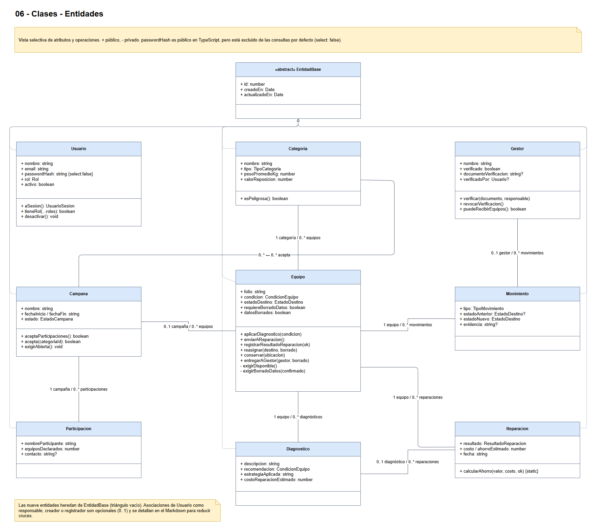
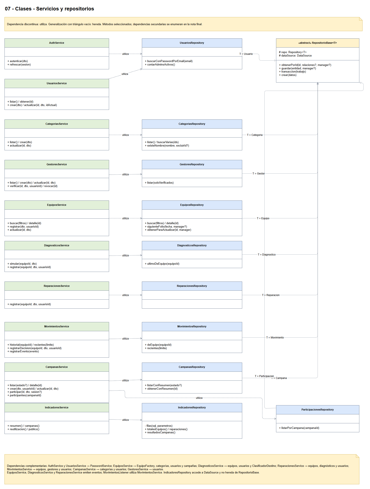

# Documentación técnica de E-Waste 360°

## Programación orientada a objetos

E-Waste 360° utiliza clases de TypeScript en el backend para representar las entidades del dominio, aplicar reglas de negocio, coordinar operaciones y encapsular el acceso a datos. NestJS administra los controladores y proveedores mediante inyección de dependencias; TypeORM relaciona las entidades con las tablas de PostgreSQL.

El frontend utiliza principalmente componentes funcionales de React y hooks. Los ejemplos de programación orientada a objetos de este apartado corresponden al backend, donde se encuentran las jerarquías y los comportamientos de dominio.

### 1. Clases principales y sus responsabilidades

#### 1.1. Entidades del dominio

Todas las entidades de esta tabla heredan de `EntidadBase` y se ubican en `backend/src/modules/`.

| Clase | Responsabilidad | Comportamientos o datos destacados | Archivo |
|---|---|---|---|
| `Equipo` | Representar un dispositivo del inventario y aplicar las reglas de su ciclo de vida. | `aplicarDiagnostico()`, `enviarAReparacion()`, `registrarResultadoReparacion()`, `reasignar()`, `conservar()`, `entregarAGestor()` y `accionesDisponibles()`. | [equipo.entity.ts](../backend/src/modules/equipos/equipo.entity.ts) |
| `Categoria` | Describir el tipo de dispositivo y sus valores de referencia. | Peso promedio, valor de reposición y `esPeligrosa()`. | [categoria.entity.ts](../backend/src/modules/catalogos/categoria.entity.ts) |
| `Usuario` | Representar una cuenta, su rol y su estado de actividad. | `aSesion()`, `tieneRol()`, `desactivar()` y el método estático `normalizarEmail()`. | [usuario.entity.ts](../backend/src/modules/usuarios/usuario.entity.ts) |
| `Gestor` | Representar a la organización externa que puede recibir equipos y su verificación documentada. | `verificar()`, `revocarVerificacion()` y `puedeRecibirEquipos()`. | [gestor.entity.ts](../backend/src/modules/catalogos/gestor.entity.ts) |
| `Diagnostico` | Conservar la evaluación técnica de un equipo. | Datos evaluados, condición recomendada, justificación y responsable. | [diagnostico.entity.ts](../backend/src/modules/diagnosticos/diagnostico.entity.ts) |
| `Reparacion` | Conservar el resultado y costo de una intervención. | Resultado, fecha, responsable y método estático `calcularAhorro()`. | [reparacion.entity.ts](../backend/src/modules/reparaciones/reparacion.entity.ts) |
| `Movimiento` | Representar un registro de trazabilidad. | Tipo de movimiento, estado anterior y nuevo, responsable, destino, gestor y evidencia. | [movimiento.entity.ts](../backend/src/modules/movimientos/movimiento.entity.ts) |
| `Campana` | Representar una campaña de acopio y sus condiciones de participación. | `aceptaParticipaciones()`, `acepta(categoriaId)` y `exigirAbierta()`. | [campana.entity.ts](../backend/src/modules/campanas/campana.entity.ts) |
| `Participacion` | Registrar la participación de una persona en una campaña. | Nombre, contacto opcional, cantidad de equipos declarada y usuario opcional. | [participacion.entity.ts](../backend/src/modules/campanas/participacion.entity.ts) |

La cantidad declarada en una participación no equivale por sí misma a equipos recibidos: los dispositivos ingresados al inventario se representan mediante instancias de `Equipo` asociadas a la campaña.

#### 1.2. Clases de aplicación y persistencia

| Clase o grupo | Responsabilidad | Ubicación representativa |
|---|---|---|
| `EquiposController` y demás controladores | Recibir solicitudes HTTP, obtener parámetros y datos del usuario, y delegar en el servicio correspondiente. | [equipos.controller.ts](../backend/src/modules/equipos/equipos.controller.ts) |
| `EquiposService` | Coordinar el registro, búsqueda, detalle y actualización de equipos; consultar catálogos, utilizar la fábrica y coordinar la persistencia. | [equipos.service.ts](../backend/src/modules/equipos/equipos.service.ts) |
| `DiagnosticosService` | Simular o registrar diagnósticos utilizando el clasificador y actualizar la condición del equipo. | [diagnosticos.service.ts](../backend/src/modules/diagnosticos/diagnosticos.service.ts) |
| `ReparacionesService` | Coordinar el registro del resultado de una reparación y su efecto en el equipo. | [reparaciones.service.ts](../backend/src/modules/reparaciones/reparaciones.service.ts) |
| `MovimientosService` | Registrar decisiones de destino y transformar eventos del equipo en registros de historial. | [movimientos.service.ts](../backend/src/modules/movimientos/movimientos.service.ts) |
| `AuthService` y `UsuariosService` | Verificar credenciales y administrar cuentas, respectivamente. | [auth.service.ts](../backend/src/modules/auth/auth.service.ts), [usuarios.service.ts](../backend/src/modules/usuarios/usuarios.service.ts) |
| `CampanasService` | Coordinar campañas, categorías admitidas y participaciones. | [campanas.service.ts](../backend/src/modules/campanas/campanas.service.ts) |
| `IndicadoresService` | Coordinar la consulta de indicadores y resúmenes del sistema. | [indicadores.service.ts](../backend/src/modules/indicadores/indicadores.service.ts) |
| `RepositorioBase<T>` y repositorios concretos | Reutilizar operaciones de persistencia y concentrar consultas propias de cada entidad. El nombre de la clase en el código es `RepositorioBase`. | [repositorio-base.ts](../backend/src/common/repositories/repositorio-base.ts), [equipos.repository.ts](../backend/src/modules/equipos/equipos.repository.ts) |
| `EquipoFactory` y clases derivadas de `PerfilEquipo` | Construir equipos con validaciones y valores iniciales según su categoría. | [equipo.factory.ts](../backend/src/modules/equipos/factory/equipo.factory.ts), [perfiles-equipo.ts](../backend/src/modules/equipos/factory/perfiles-equipo.ts) |
| `ClasificadorDestino` y clases derivadas de `EstrategiaClasificacion` | Seleccionar y aplicar el criterio de clasificación del diagnóstico. | [clasificador-destino.ts](../backend/src/modules/diagnosticos/strategies/clasificador-destino.ts), [estrategia-clasificacion.ts](../backend/src/modules/diagnosticos/strategies/estrategia-clasificacion.ts) |
| `EventoEquipo` y `MovimientosListener` | Representar eventos de dominio y observarlos para generar trazabilidad. | [equipo.events.ts](../backend/src/common/events/equipo.events.ts), [movimientos.listener.ts](../backend/src/modules/movimientos/movimientos.listener.ts) |

Los servicios coordinan casos de uso, mientras que las entidades como `Equipo`, `Gestor` y `Campana` contienen reglas sobre su propio estado. Por ejemplo, el servicio obtiene un equipo y un gestor; las entidades determinan si ese equipo puede entregarse y si el gestor puede recibirlo.

### 2. Encapsulamiento

El encapsulamiento reúne datos y comportamientos relacionados y limita el acceso a detalles internos. El proyecto lo aplica mediante métodos de dominio, miembros `private` y `protected`, y dependencias recibidas por constructor.

#### 2.1. Reglas de dominio dentro de la entidad

`Equipo.enviarAReparacion()` comprueba la disponibilidad y la condición técnica antes de modificar el destino:

```typescript
enviarAReparacion(): void {
  this.exigirDisponible();
  if (this.condicion !== CondicionEquipo.REPARABLE) {
    throw new ReglaNegocioError(
      'Solo los equipos diagnosticados como reparables pueden enviarse a reparación.',
    );
  }
  this.estadoDestino = EstadoDestino.EN_REPARACION;
}
```

Así, el código que solicita la transición no necesita reproducir sus comprobaciones. El método privado reutiliza otras consultas de la propia entidad:

```typescript
private exigirDisponible(): void {
  this.exigirNoFinalizado();
  if (!this.estaDisponible()) {
    throw new ReglaNegocioError(
      'El equipo no está disponible en inventario para esta acción.',
    );
  }
}
```

También se encapsulan la exigencia de borrado de datos antes de determinadas entregas y la prohibición de modificar equipos con destino final. `accionesDisponibles()` permite comunicar a la interfaz qué operaciones mostrar; los métodos de dominio vuelven a comprobar las reglas al ejecutarlas.

**Alcance real:** las propiedades persistidas de `Equipo`, como `condicion` y `estadoDestino`, son públicas en TypeScript. Los flujos de negocio utilizan métodos para validar las transiciones, pero el lenguaje no impide que otro código del backend asigne esos campos directamente. La fábrica, por ejemplo, los establece durante la construcción. No se trata de un modelo con todos los atributos privados y setters obligatorios.

#### 2.2. Visibilidad de los miembros

| Visibilidad o modificador | Ejemplo real | Efecto |
|---|---|---|
| Público, implícito cuando no se indica modificador | `Equipo.enviarAReparacion()` y `Usuario.aSesion()`. | Forma parte de la interfaz accesible de la instancia. |
| `private` | `Equipo.exigirDisponible()` y el mapa `EquipoFactory.perfiles`. | Restringe el acceso desde otras clases durante la comprobación de tipos de TypeScript. |
| `protected` | `RepositorioBase.repo`, `dataSource` y `con()`. | Permite el acceso desde la clase base y sus subclases. |
| `protected abstract` | `EstrategiaClasificacion.condicion()` y `justificar()`. | Exige implementación en las subclases y reserva su uso a la jerarquía. |
| `readonly` | Las referencias a dependencias declaradas como `private readonly` en constructores. | Evita reasignar la referencia en el código comprobado por TypeScript; no vuelve inmutable al objeto referenciado. |

Los modificadores `private` y `protected` utilizados aquí son los de TypeScript, no campos privados de JavaScript con sintaxis `#campo`. Expresan y comprueban restricciones en el código fuente; no deben confundirse con autorización de usuarios o protección criptográfica.

#### 2.3. Exposición controlada de información del usuario

`Usuario.aSesion()` devuelve únicamente los datos necesarios para la sesión:

```typescript
aSesion(): UsuarioSesion {
  return {
    id: this.id,
    nombre: this.nombre,
    email: this.email,
    rol: this.rol,
  };
}
```

El atributo `passwordHash` está declarado como público, pero su columna usa `@Column({ select: false, length: 255 })`, por lo que TypeORM no la incluye en las consultas ordinarias. `select: false` controla la selección de datos del ORM; no es un modificador de visibilidad de TypeScript. La autenticación utiliza una consulta específica para recuperar el hash cuando es necesario.

### 3. Herencia y abstracción

La **herencia** permite que una clase derive de otra y reutilice sus miembros. La **abstracción** expresa características y operaciones comunes sin obligar al consumidor a conocer todos los detalles de implementación.

#### 3.1. Entidad base

[EntidadBase](../backend/src/common/entities/base.entity.ts) centraliza el identificador y las marcas de tiempo:

```typescript
export abstract class EntidadBase {
  @PrimaryGeneratedColumn()
  id!: number;

  @CreateDateColumn({ type: 'timestamptz' })
  creadoEn!: Date;

  @UpdateDateColumn({ type: 'timestamptz' })
  actualizadoEn!: Date;
}
```

`Equipo`, `Usuario`, `Categoria`, `Gestor`, `Diagnostico`, `Reparacion`, `Movimiento`, `Campana` y `Participacion` declaran `extends EntidadBase`. De esta forma comparten la definición de esos campos, mientras cada clase incorpora sus datos y reglas particulares.

`abstract` impide instanciar directamente la base desde TypeScript. No es necesario que una clase abstracta tenga métodos abstractos: en este caso representa una estructura común. La clase base no declara una tabla propia con `@Entity`; sus columnas se incorporan a las tablas de las entidades concretas. Heredar de ella no crea una relación de clave foránea hacia una tabla de entidades base.

#### 3.2. Repositorio base genérico

[RepositorioBase](../backend/src/common/repositories/repositorio-base.ts) es una clase abstracta y genérica:

```typescript
export abstract class RepositorioBase<T extends EntidadBase> {
  protected readonly repo: Repository<T>;

  protected constructor(
    protected readonly dataSource: DataSource,
    private readonly entidad: EntityTarget<T>,
    private readonly nombreLegible: string,
  ) {
    this.repo = dataSource.getRepository(entidad);
  }

  // ... operaciones comunes de consulta, guardado y transacción ...
}
```

`T extends EntidadBase` restringe el tipo de entidad admitido y permite reutilizar operaciones como `buscarPorId()`, `obtenerPorId()` y `guardar()` manteniendo el tipo de sus resultados. El repositorio concreto fija el tipo y añade consultas específicas:

```typescript
@Injectable()
export class EquiposRepository extends RepositorioBase<Equipo> {
  constructor(dataSource: DataSource) {
    super(dataSource, Equipo, 'El equipo');
  }
  // ... búsqueda, detalle, folios y bloqueo para actualización ...
}
```

Al usar `RepositorioBase<Equipo>`, `obtenerPorId()` devuelve `Promise<Equipo>` y `guardar()` recibe un `Equipo`. La base reutiliza comportamiento; la subclase especializa las consultas del inventario.

El proyecto también tiene repositorios de usuarios, catálogos, diagnósticos, reparaciones, movimientos y campañas que utilizan esta base. `IndicadoresRepository` consulta con `DataSource` directamente y no pertenece a esta jerarquía.

#### 3.3. Abstracciones de comportamiento y polimorfismo

Además de las bases de entidad y repositorio, existen tres jerarquías de comportamiento:

| Base abstracta | Clases derivadas | Uso de la abstracción |
|---|---|---|
| `PerfilEquipo` | `PerfilComputo`, `PerfilMovil`, `PerfilEnergia`, `PerfilPeriferico`, `PerfilCableado` y `PerfilGenerico`. | La fábrica utiliza los mismos métodos para validar datos y obtener valores iniciales, con resultados distintos según el perfil. |
| `EstrategiaClasificacion` | `GestionEspecializadaStrategy`, `ReutilizacionDirectaStrategy`, `ReparacionStrategy` y `ReparacionNoRentableStrategy`. | El clasificador evalúa cada estrategia mediante el contrato común y aplica la primera que corresponda. |
| `EventoEquipo` | `EquipoRegistradoEvent`, `EquipoDiagnosticadoEvent` y `EquipoReparadoEvent`. | El listener procesa eventos mediante sus datos comunes y obtiene una descripción específica con `describir()`. |

El polimorfismo se aprecia en `PerfilEnergia`, que sobrescribe el comportamiento predeterminado de la condición inicial:

```typescript
// Implementación predeterminada en PerfilEquipo:
condicionInicial(): CondicionEquipo {
  return CondicionEquipo.PENDIENTE;
}

// Implementación en PerfilEnergia:
override condicionInicial(): CondicionEquipo {
  return CondicionEquipo.GESTION_ESPECIALIZADA;
}
```

La fábrica llama a `perfil.condicionInicial()` sin necesitar una rama distinta para ejecutar cada implementación. En esta jerarquía, la condición predeterminada es un método concreto; `tipo` y `descripcion` son propiedades abstractas que cada perfil debe definir.

Los ejemplos de esta sección son extractos del código; los comentarios con puntos suspensivos indican miembros omitidos para facilitar la lectura.

### 4. Relaciones entre clases

#### 4.1. Asociaciones entre entidades

Las asociaciones representan vínculos entre objetos del dominio. TypeORM las declara mediante `@ManyToOne`, `@OneToMany` y `@ManyToMany`.

En la tabla, `0..*` significa cero o muchos objetos relacionados, `1` significa exactamente uno y `0..1` significa una referencia opcional.

| Relación | Multiplicidad y significado | Representación en el código |
|---|---|---|
| `Categoria` — `Equipo` | Una categoría puede clasificar `0..*` equipos; cada equipo requiere `1` categoría. | `Equipo.categoria`, `@ManyToOne` no anulable. |
| `Campana` — `Equipo` | Una campaña puede recibir `0..*` equipos; cada equipo puede referirse a `0..1` campaña. | `Campana.equiposRecibidos` y `Equipo.campana`. |
| `Equipo` — `Diagnostico` | Un equipo puede tener `0..*` diagnósticos; cada diagnóstico corresponde a `1` equipo. | `Equipo.diagnosticos` y `Diagnostico.equipo`. |
| `Equipo` — `Reparacion` | Un equipo puede tener `0..*` reparaciones; cada reparación corresponde a `1` equipo. | `Equipo.reparaciones` y `Reparacion.equipo`. |
| `Equipo` — `Movimiento` | Un equipo puede tener `0..*` movimientos; cada movimiento corresponde a `1` equipo. | `Equipo.movimientos` y `Movimiento.equipo`. |
| `Diagnostico` — `Reparacion` | Un diagnóstico puede vincularse con `0..*` reparaciones; cada reparación puede referirse a `0..1` diagnóstico. | `Reparacion.diagnostico`, relación opcional. |
| `Campana` — `Participacion` | Una campaña puede tener `0..*` participaciones; cada participación corresponde a `1` campaña. | `Campana.participaciones` y `Participacion.campana`. |
| `Campana` — `Categoria` | Una campaña puede aceptar varias categorías y una categoría puede aparecer en varias campañas. | `Campana.categoriasAceptadas`, `@ManyToMany` y tabla de unión `campana_categorias`. |
| `Gestor` — `Movimiento` | Un gestor puede vincularse con `0..*` movimientos; un movimiento puede referirse a `0..1` gestor. | `Movimiento.gestor`, referencia opcional utilizada en entregas. |
| `Usuario` — registros de dominio | Un usuario puede intervenir en múltiples registros; cada referencia de autoría o responsabilidad admite `0..1` usuario. | `Equipo.registradoPor`, `Diagnostico.responsable`, `Reparacion.responsable`, `Movimiento.responsable`, `Campana.creadaPor`, `Participacion.usuario` y `Gestor.verificadoPor`. |

La multiplicidad expresa la estructura de las relaciones; las validaciones del servicio pueden exigir información adicional según la operación. Una asociación tampoco necesita declararse en ambos extremos: por ejemplo, `Equipo` referencia a `Categoria` aunque `Categoria` no declare una colección inversa de equipos.

#### 4.2. Dependencia, colaboración y creación de objetos

| Relación entre clases | Ejemplo real | Explicación |
|---|---|---|
| Generalización o herencia | `Equipo extends EntidadBase`. | La subclase es una especialización de la base y hereda sus miembros. |
| Colaboración mediante una referencia inyectada | `EquiposController` recibe `EquiposService`; el servicio recibe `EquiposRepository` y `EquipoFactory`. | Cada clase delega tareas en colaboradores sin construirlos directamente. NestJS proporciona las instancias registradas en el módulo. |
| Creación | `EquipoFactory` ejecuta `new Equipo()`. | La fábrica construye y configura un objeto; el repositorio se encarga de persistirlo. |
| Contención de colaboradores | `EquipoFactory` mantiene un mapa de instancias de `PerfilEquipo`. | La fábrica crea perfiles con `new` y los conserva para aplicar reglas por tipo. |
| Dependencia por parámetro | `Equipo.entregarAGestor(gestor, datosBorrados)`. | La operación consulta el comportamiento de otro objeto, `gestor.puedeRecibirEquipos()`. El equipo no guarda una relación ORM directa con el gestor; esa referencia se registra en `Movimiento`. |
| Publicación y suscripción | Servicios emisores, `EventoEquipo` y `MovimientosListener`. | Los servicios publican eventos; el listener reacciona a ellos sin una llamada directa desde el emisor. |

Recibir una dependencia en el constructor no significa que la clase sea dueña de su ciclo de vida. Por ello, las colaboraciones entre controladores, servicios y repositorios no se presentan automáticamente como composiciones UML.

Los diagnósticos, reparaciones y movimientos dependen de un equipo mediante referencias obligatorias con `onDelete: 'CASCADE'`. Esto establece una regla de borrado en la base de datos; no equivale por sí solo a afirmar que toda relación `OneToMany` es una composición de objetos. Las referencias de usuario usan `SET NULL` para permitir conservar el registro de dominio cuando desaparece la cuenta referenciada.

#### 4.3. Diagramas de apoyo en draw.io

Se reutilizan los diagramas editables elaborados para las secciones anteriores, con el fin de mantener una misma representación de las clases del proyecto:

- [Diseño UML en draw.io](diagramas/diseno-uml-ewaste360.drawio): página **06**, entidades y relaciones; página **07**, servicios y repositorios.
- [Patrones de diseño en draw.io](diagramas/patrones-diseno-ewaste360.drawio): páginas **01**, perfiles; **02**, estrategias; **03**, eventos; y **04**, repositorio base.

**Entidades y relaciones principales:**



**Servicios y repositorios:**



Las imágenes son exportaciones de los archivos draw.io enlazados. El detalle de los patrones y sus beneficios se encuentra en [Patrones de diseño](documentacion-tecnica-patrones-diseno.md), y la descripción de los flujos y diagramas completos en [Diseño UML](documentacion-tecnica-diseno-uml.md).
