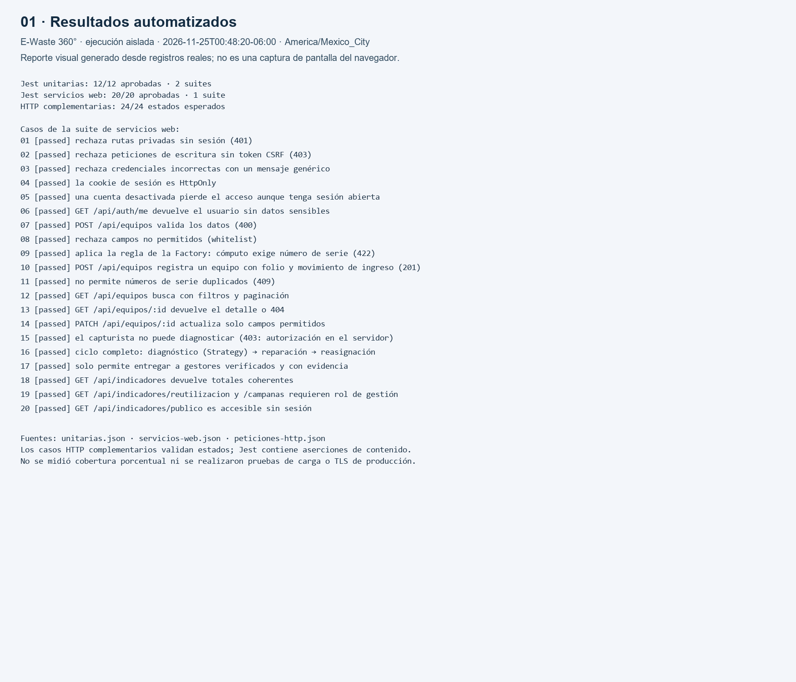
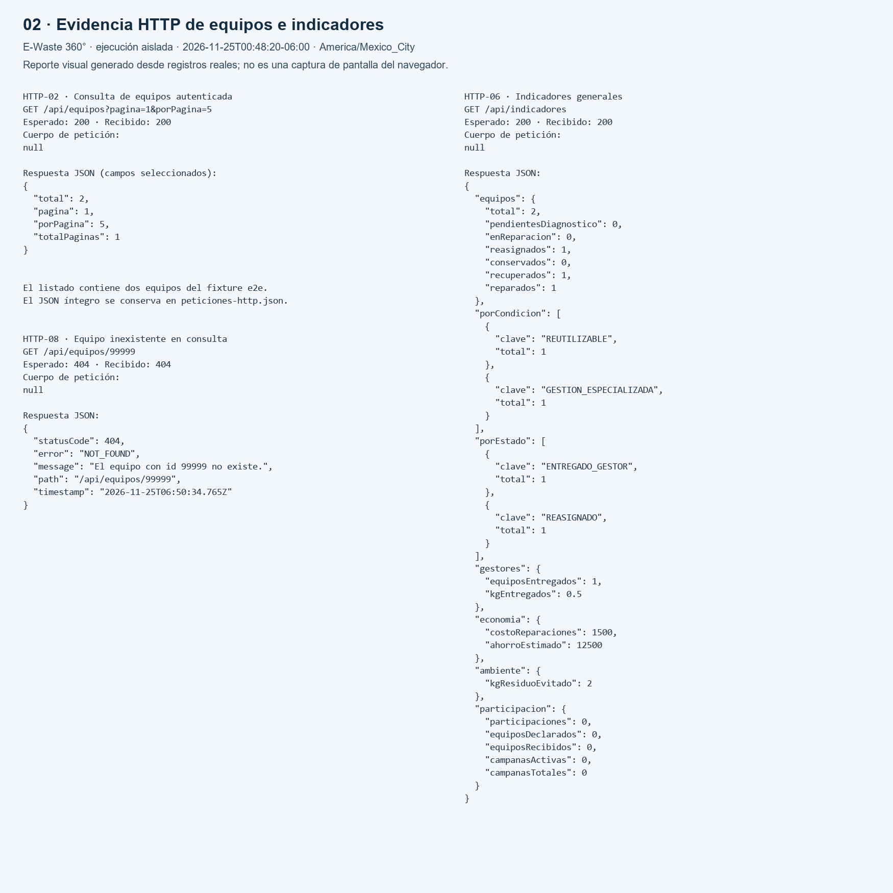
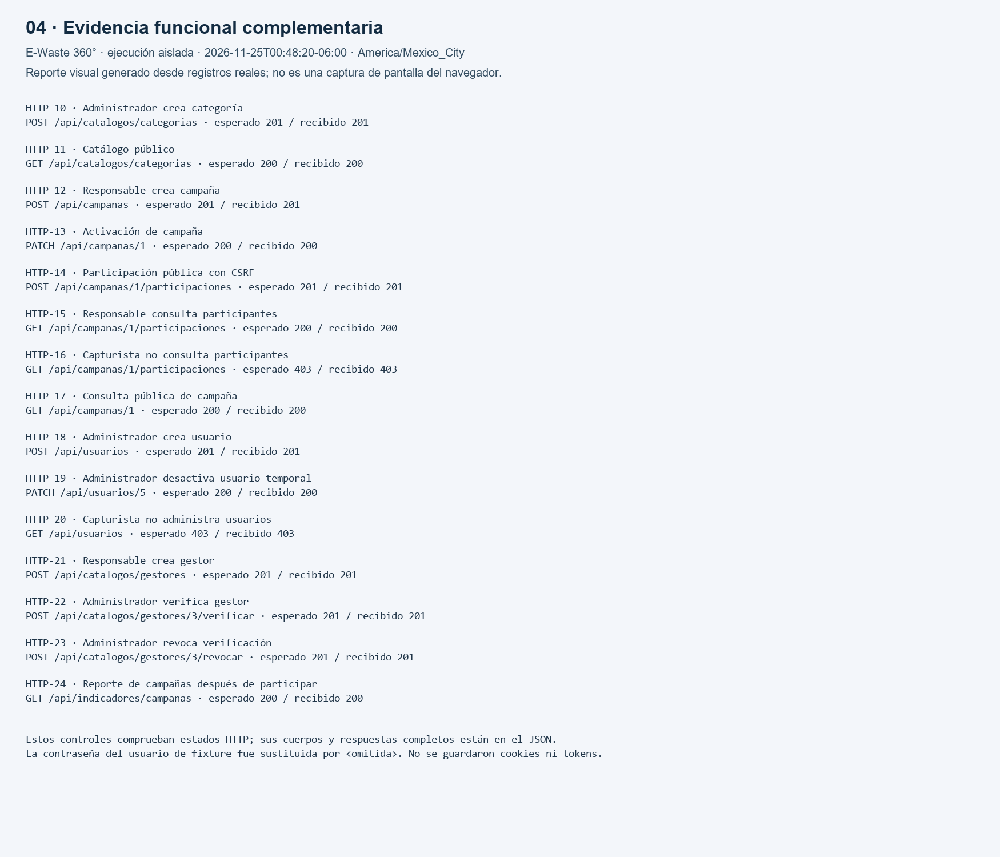
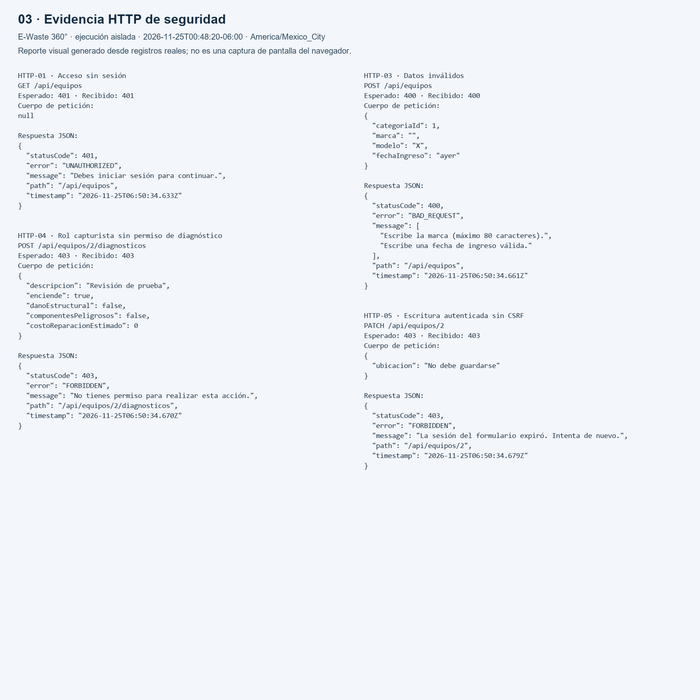

# Documentación técnica de E-Waste 360°

## Pruebas

Este apartado reúne la estrategia, los casos ejecutados, la evidencia y los resultados de las pruebas de E-Waste 360°. Se realizó una nueva ejecución el **25 de noviembre de 2026**, además de conservar la evidencia histórica del 23 de noviembre.

**Resultado actual:** 12 pruebas unitarias y 20 pruebas de servicios web aprobadas en Jest; adicionalmente, 24 comprobaciones HTTP complementarias devolvieron el estado esperado. Estas últimas son un conjunto separado y no aumentan el número de pruebas de Jest.

### 1. Estrategia de pruebas

#### 1.1. Niveles y objetivos

| Nivel | Herramientas | Objetivo y alcance |
|---|---|---|
| Unitario | Jest y ts-jest | Comprobar perfiles de creación, reglas de `Equipo` y estrategias de clasificación sin requerir PostgreSQL. |
| Integración de servicios web | Jest, `@nestjs/testing`, Supertest y PostgreSQL | Ejecutar peticiones sobre la aplicación NestJS real: guards, pipes, controladores, servicios, repositorios y base de datos. |
| HTTP complementario | Python, `urllib` y cookies por cliente | Verificar estados HTTP y conservar cuerpos de petición/respuesta contra un servidor de pruebas en ejecución; ampliar el recorrido por campañas, usuarios y catálogos. |
| Interfaz y aceptación | Plan de comprobación manual | Revisar navegación, formularios, diseño responsivo, impresión y exportación. No se ejecutó una validación completa de interfaz en esta sesión. |

Las suites utilizan casos positivos y negativos. Para los servicios se comprueba el acceso de usuarios de distintos roles, la validación de datos y los cambios de estado e historial. Las pruebas e2e del repositorio son de la **API**; no automatizan un navegador ni prueban el DOM de React.

#### 1.2. Entorno y aislamiento

La ejecución actual utilizó:

- Backend del código fuente con sus dependencias instaladas desde el lockfile mediante `npm ci --offline`.
- PostgreSQL `16-alpine` en un contenedor temporal exclusivo, `ewaste360-doc-tests-20261125`, publicado únicamente en `127.0.0.1:5545`.
- Base `ewaste360_test`, independiente de la base del proyecto en el puerto 5544.
- `NODE_ENV=test`, `DB_SSL=false` y secretos exclusivos para pruebas.
- Ejecución serial de Jest mediante `--runInBand`, porque los casos e2e comparten datos y algunos dependen del flujo previo.
- Backend adicional en `http://127.0.0.1:3001` para las comprobaciones HTTP complementarias.

El `beforeAll` e2e aplica la configuración de la aplicación, vacía las tablas de la base de pruebas con `TRUNCATE ... RESTART IDENTITY CASCADE` y crea sus fixtures: administrador, responsable, capturista, dos categorías y dos gestores, uno verificado. Los casos crean después una laptop y una batería. No se utilizó el seed de 46 equipos para estas pruebas.

**Importante para reproducir:** [setup-env.ts](../backend/test/setup-env.ts) utiliza `DATABASE_URL_TEST` si está definida; de lo contrario apunta a `ewaste360_test` en el puerto 5544. El aislamiento depende de comprobar ese destino. La suite elimina los registros de las tablas de dominio de la base seleccionada; no debe apuntar a una base con datos que se quieran conservar.

#### 1.3. Criterios de aprobación

- **Unitarias:** todas las expectativas sobre valores, transiciones y excepciones deben cumplirse.
- **E2e:** deben coincidir los códigos HTTP y las aserciones de contenido, como el folio, el ahorro, las acciones y el orden del historial.
- **HTTP complementarias:** debe coincidir el estado de cada respuesta. Los JSON se conservaron para revisión; el script no contiene una validación exhaustiva de todos sus campos.
- Una respuesta 400, 401, 403, 409 o 422 representa un resultado aprobado cuando el caso pretende provocar ese rechazo.

No se ejecutó `test:cov`; por tanto, no se informa un porcentaje de cobertura de líneas o ramas. Aprobar los casos existentes no demuestra que todos los escenarios posibles estén cubiertos.

### 2. Pruebas de los servicios web y evidencia visual

#### 2.1. Evidencias producidas

| Archivo | Contenido y procedencia |
|---|---|
| [unitarias.json](evidencias/pruebas-2026-11-25/unitarias.json) | Resultado estructurado generado por Jest: 12 pruebas y dos suites aprobadas. |
| [unitarias.log](evidencias/pruebas-2026-11-25/unitarias.log) | Salida de consola de esa ejecución, incluida la envoltura de redirección de PowerShell. |
| [servicios-web.json](evidencias/pruebas-2026-11-25/servicios-web.json) | Resultado estructurado generado por Jest: 20 pruebas y una suite aprobadas. |
| [servicios-web.log](evidencias/pruebas-2026-11-25/servicios-web.log) | Salida de la ejecución e2e. |
| [peticiones-http.json](evidencias/pruebas-2026-11-25/peticiones-http.json) | 24 peticiones complementarias con método, ruta, cuerpo, estado esperado, estado recibido y respuesta real. |
| Imágenes 01 a 04 incluidas abajo | Reportes visuales renderizados desde esos JSON; no son pantallas simuladas de Postman, Swagger o una terminal. |

**Alcance de las capturas:** el control del navegador se detuvo al no poder verificar la URL de su ventana con suficiente confianza. No se obtuvieron capturas de pantalla de la interfaz. Para aportar evidencia visual verificable se generaron las láminas siguientes desde los registros reales. Si la entrega exige específicamente capturas de Postman, Swagger o del navegador, esas capturas de interfaz siguen pendientes y no deben confundirse con estos reportes.

Las cookies, los tokens CSRF y las credenciales enviadas al login no se incorporaron al archivo de peticiones. La contraseña del usuario temporal creado por HTTP se sustituyó por `<omitida>` en el registro.

#### 2.2. Resultado de la suite de servicios web

Los casos corresponden a [servicios-web.e2e-spec.ts](../backend/test/servicios-web.e2e-spec.ts). Los identificadores E2E se asignan en este documento para facilitar la referencia.

| Caso | Comprobación | Resultado esperado | Estado actual |
|---|---|---|---|
| E2E-01 | Consultar equipos sin sesión. | 401. | Aprobado |
| E2E-02 | Iniciar sesión sin token CSRF. | 403. | Aprobado |
| E2E-03 | Contraseña incorrecta. | 401 y mensaje genérico. | Aprobado |
| E2E-04 | Cookie de sesión del login. | Incluye `HttpOnly`. | Aprobado |
| E2E-05 | Cuenta desactivada con sesión abierta. | Pasa de acceso 200 a rechazo 401. | Aprobado |
| E2E-06 | Consultar `/auth/me`. | 200, rol correcto y ausencia de `passwordHash`. | Aprobado |
| E2E-07 | Registrar equipo con marca vacía y fecha inválida. | 400 y arreglo de mensajes. | Aprobado |
| E2E-08 | Enviar `condicion` en el alta. | 400 por campo no permitido. | Aprobado |
| E2E-09 | Alta de cómputo sin serie. | 422 por regla del perfil. | Aprobado |
| E2E-10 | Registrar laptop y batería. | 201, folio, ingreso en historial y condición inicial según categoría. | Aprobado |
| E2E-11 | Duplicar serie cambiando mayúsculas. | 409. | Aprobado |
| E2E-12 | Buscar por texto y paginación. | 200 y equipo esperado. | Aprobado |
| E2E-13 | Consultar detalle e id ausente. | 200 con acciones/recomendaciones y 404 en consulta inexistente. | Aprobado |
| E2E-14 | Actualizar ubicación e intentar cambiar destino directamente. | 200 para ubicación y 400 para destino. | Aprobado |
| E2E-15 | Capturista intenta diagnosticar. | 403. | Aprobado |
| E2E-16 | Diagnosticar, reparar y reasignar; probar reglas intermedias. | Rechazos 422 y creaciones 201; ahorro 12 500 e historial de cinco movimientos. | Aprobado |
| E2E-17 | Entregar a gestor con y sin requisitos. | 400 sin evidencia, 422 sin verificación y 201 con requisitos. | Aprobado |
| E2E-18 | Consultar indicadores generales. | Dos equipos, uno reasignado, uno entregado y ahorro 12 500. | Aprobado |
| E2E-19 | Reportes detallados por rol. | 403 para capturista; 200 para responsable, tasa de éxito 100 y serie de 12 meses. | Aprobado |
| E2E-20 | Indicadores públicos sin sesión. | 200, dos registrados y uno recuperado. | Aprobado |



#### 2.3. Respuestas HTTP registradas

La evidencia complementaria utilizó un backend escuchando en el puerto 3001 y agentes con cookies independientes. Las comprobaciones se realizaron después de la suite e2e, sobre sus datos resultantes.

| Caso | Solicitud y contexto | Esperado / recibido |
|---|---|---|
| HTTP-01 | `GET /api/equipos`, sin sesión. | 401 / 401 |
| HTTP-02 | `GET /api/equipos?pagina=1&porPagina=5`, capturista. | 200 / 200 |
| HTTP-03 | `POST /api/equipos`, marca vacía y fecha `ayer`, con sesión y CSRF. | 400 / 400 |
| HTTP-04 | `POST /api/equipos/2/diagnosticos`, capturista con CSRF. | 403 / 403 |
| HTTP-05 | `PATCH /api/equipos/2`, sesión válida pero sin CSRF. | 403 / 403 |
| HTTP-06 | `GET /api/indicadores`, responsable. | 200 / 200 |
| HTTP-07 | `GET /api/indicadores/publico`, sin sesión. | 200 / 200 |
| HTTP-08 | `GET /api/equipos/99999`, capturista. | 404 / 404 |
| HTTP-09 | `GET /api/indicadores/reutilizacion`, capturista. | 403 / 403 |
| HTTP-10 | `POST /api/catalogos/categorias`, administrador. | 201 / 201 |
| HTTP-11 | `GET /api/catalogos/categorias`, público. | 200 / 200 |
| HTTP-12 | `POST /api/campanas`, responsable. | 201 / 201 |
| HTTP-13 | `PATCH /api/campanas/1`, activar campaña como responsable. | 200 / 200 |
| HTTP-14 | `POST /api/campanas/1/participaciones`, público con CSRF. | 201 / 201 |
| HTTP-15 | `GET /api/campanas/1/participaciones`, responsable. | 200 / 200 |
| HTTP-16 | La misma consulta de participantes como capturista. | 403 / 403 |
| HTTP-17 | `GET /api/campanas/1`, público. | 200 / 200 |
| HTTP-18 | `POST /api/usuarios`, administrador, cuenta temporal. | 201 / 201 |
| HTTP-19 | `PATCH /api/usuarios/5`, desactivar la cuenta temporal. | 200 / 200 |
| HTTP-20 | `GET /api/usuarios`, capturista. | 403 / 403 |
| HTTP-21 | `POST /api/catalogos/gestores`, responsable. | 201 / 201 |
| HTTP-22 | `POST /api/catalogos/gestores/3/verificar`, administrador. | 201 / 201 |
| HTTP-23 | `POST /api/catalogos/gestores/3/revocar`, administrador. | 201 / 201 |
| HTTP-24 | `GET /api/indicadores/campanas`, responsable. | 200 / 200 |

Los ids de la tabla corresponden a esta ejecución y no son valores universales. La consulta HTTP-06 ocurrió antes de crear la campaña complementaria: devuelve participación cero. HTTP-24, ejecutada después, devuelve una participación, dos equipos declarados y cero equipos recibidos. No hay contradicción: las peticiones reflejan momentos diferentes y declarar equipos no los incorpora al inventario.



### 3. Pruebas funcionales por módulo

#### 3.1. Cobertura ejecutada

| Módulo o área | Funciones comprobadas | Evidencia | Alcance |
|---|---|---|---|
| Autenticación y sesiones | Login válido como prerrequisito, credenciales inválidas, HttpOnly, usuario actual y rechazo tras desactivación. | E2E-01 a E2E-06. | Aserciones automatizadas sobre API y cookies. |
| Inventario | Alta por categoría, serie obligatoria y duplicada, búsqueda, detalle y edición permitida. | E2E-07 a E2E-14; HTTP-02, HTTP-03 y HTTP-08. | API y reglas de creación; no interacción visual del formulario. |
| Diagnóstico | Clasificación funcional, reparación y peligrosidad; restricción por rol y registro persistente. | Cinco unitarias del clasificador; E2E-15 y E2E-16. | No se prueba por HTTP el endpoint de simulación en las suites actuales. |
| Reparación y reutilización | Envío a reparación, resultado exitoso, ahorro, rechazo de reasignación prematura y exigencia de borrado. | Unitarias de `Equipo`; E2E-16. | No cubre por HTTP todos los resultados fallidos ni todas las rutas de conservación. |
| Movimientos e historial | Secuencia de cinco movimientos del ciclo reparado/reasignado y entrega documentada a gestor. | E2E-16 y E2E-17. | Verifica contenido y orden del historial; no cubre todos los casos de actividad reciente. |
| Catálogos y gestores | Creación de categoría, catálogo público, alta de gestor, verificación y revocación; entrega restringida. | HTTP-10, HTTP-11 y HTTP-21 a HTTP-23; E2E-17. | HTTP complementario verifica estados; el caso e2e comprueba la regla de entrega. |
| Campañas y participación | Crear, activar, participar sin cuenta, consultar detalle y restringir participantes. | HTTP-12 a HTTP-17. | Estados HTTP y respuestas conservadas; no cubre todos los rangos de fechas o campañas cerradas. |
| Indicadores y reportes | Totales coherentes, ahorro, entrega a gestor, acceso público, permisos de reportes y serie mensual. | E2E-18 a E2E-20; HTTP-06, HTTP-07, HTTP-09 y HTTP-24. | No valida la descarga CSV o la impresión desde React. |
| Administración de cuentas | Crear y desactivar cuenta temporal; rechazar administración por capturista. | HTTP-18 a HTTP-20; E2E-05. | No cubre todos los cambios de contraseña, correo o protección del último administrador. |
| Información y navegación pública | API pública de campañas, categorías e indicadores. | HTTP-07, HTTP-11 y HTTP-17. | No constituye una revisión del contenido, navegación o accesibilidad visual del frontend. |



#### 3.2. Pruebas unitarias ejecutadas

| Grupo | Casos | Resultado |
|---|---|---|
| `EquipoFactory` | Cómputo exige borrado; exige serie; energía nace en gestión especializada; perfiles dan recomendaciones propias. | 4 / 4 |
| Reglas de `Equipo` | Impide reasignar reparable; flujo reparar/reasignar exige borrado; exige gestor verificado. | 3 / 3 |
| `ClasificadorDestino` | Funcional sin costo; reparación bajo el umbral; reparación no rentable; energía peligrosa; prioridad del daño estructural. | 5 / 5 |

Archivos: [equipo.spec.ts](../backend/src/modules/equipos/equipo.spec.ts) y [clasificador-destino.spec.ts](../backend/src/modules/diagnosticos/strategies/clasificador-destino.spec.ts). El caso que exige gestor verificado también comprueba la entrega después de verificarlo; el flujo de borrado también comprueba el destino final y la ausencia de acciones disponibles.

#### 3.3. Comprobaciones manuales pendientes

| Área | Procedimiento de aceptación | Resultado esperado | Estado |
|---|---|---|---|
| Navegación pública | Recorrer información, guía y campañas sin sesión. | Enlaces internos correctos y contenido legible. | Pendiente de ejecución visual |
| Responsividad | Abrir las pantallas principales en tamaños móvil y escritorio. | Formularios utilizables, menú accesible y tablas consultables. | Pendiente |
| Inventario en React | Registrar por pasos, corregir campos y recuperar/descartar borrador. | Mensajes, foco, navegación y borrador coherentes. | Pendiente |
| Sesión y roles en la interfaz | Entrar con cada rol y abrir rutas directas. | Navegación y pantallas acordes con la sesión; API mantiene sus restricciones. | Pendiente de ejecución visual |
| Reportes | Exportar CSV e imprimir ficha o reporte. | Archivo y vista de impresión con datos correctos. | Pendiente |
| Accesibilidad | Usar teclado, foco, contraste y ajuste de texto. | Controles utilizables y mensajes perceptibles. | Pendiente |

Estas filas son un plan de aceptación y no se contabilizan como pruebas aprobadas.

### 4. Pruebas de seguridad

#### 4.1. Casos principales ejecutados

| Escenario | Preparación | Solicitud | Resultado comprobado |
|---|---|---|---|
| Acceso sin sesión | Cliente sin login. | `GET /api/equipos`. | 401, `Debes iniciar sesión para continuar.`; E2E-01 y HTTP-01. |
| Rol incorrecto | Sesión de capturista y CSRF válido. | POST de diagnóstico. | 403, `No tienes permiso para realizar esta acción.`; E2E-15 y HTTP-04. |
| Datos inválidos | Sesión autorizada y CSRF válido. | Alta con marca vacía y fecha `ayer`. | 400 con arreglo de errores de validación; E2E-07 y HTTP-03. |
| Falta de CSRF | Sesión válida; se omite encabezado. | PATCH de ubicación. | 403, `La sesión del formulario expiró. Intenta de nuevo.`; HTTP-05. E2E-02 verifica además login sin CSRF. |
| Campos no permitidos | Sesión y token válidos. | Alta con `condicion` o edición con `estadoDestino`. | 400; E2E-08 y E2E-14. |
| Cuenta desactivada | Abrir sesión, acceder y desactivar la cuenta desde el servicio. | Nueva consulta privada. | 401 aunque existiera sesión; E2E-05. |
| Exposición del hash | Login como responsable. | `GET /api/auth/me`. | No contiene `passwordHash`; E2E-06. |
| Datos de participantes | Sesiones de responsable y capturista. | GET de participantes de la campaña. | 200 para responsable y 403 para capturista; HTTP-15 y HTTP-16. |
| Administración restringida | Sesión de capturista. | `GET /api/usuarios`. | 403; HTTP-20. |



#### 4.2. Límites de estas pruebas

No se realizaron pruebas de penetración, fuerza bruta, carga, concurrencia, payloads de inyección SQL/XSS, certificado HTTPS o verificación TLS de PostgreSQL. La revisión de consultas parametrizadas y configuración se documentó en [Seguridad](documentacion-tecnica-seguridad.md), pero una revisión estática no equivale a esas pruebas dinámicas.

El entorno `test` omite el rate limiting, por lo que no se demuestra aquí un 429. El caso de cookie prueba `HttpOnly`, no `Secure` en producción. Los rechazos por rol y validación comprueban los escenarios indicados, no todas las combinaciones de rutas, roles y cuerpos.

### 5. Resultados y correcciones realizadas

#### 5.1. Resumen de resultados actuales

| Conjunto | Aprobadas | Fallidas | Fuente |
|---|---|---|---|
| Unitarias Jest | 12 | 0 | `unitarias.json` |
| Servicios web Jest | 20 | 0 | `servicios-web.json` |
| Comprobaciones HTTP complementarias | 24 | 0 | `peticiones-http.json` |
| Aceptación visual manual | No ejecutada | No evaluada | Plan de la sección 3.3. |

Los archivos históricos [evidencia-pruebas-unitarias.txt](evidencia-pruebas-unitarias.txt) y [evidencia-pruebas-e2e.txt](evidencia-pruebas-e2e.txt) registraban también 12/12 y 20/20 el 23 de noviembre de 2026 a las 21:39. Se conservaron sin sustituirlos; los registros nuevos están en una carpeta fechada distinta.

En el recorrido e2e, la laptop con valor de reposición de 14 000 y reparación de 1500 produjo ahorro de 12 500. Los indicadores comprobaron dos equipos, uno reasignado y uno entregado a gestor. El historial de la laptop quedó en orden descendente: `REASIGNACION`, `REPARACION`, `ENVIO_REPARACION`, `DIAGNOSTICO`, `INGRESO`.

#### 5.2. Correcciones y hallazgos

**No fue necesario modificar el código de la aplicación para aprobar esta ejecución.** Se preparó un entorno aislado, se añadieron el recolector HTTP y los reportes de evidencia, y se documentó el alcance real de las pruebas. No se dispone de un historial de fallos y cambios que permita atribuir las implementaciones existentes a correcciones concretas; no se presenta una lista inventada de errores resueltos.

| Hallazgo | Estado y efecto en la evidencia |
|---|---|
| El cliente espera `code: CSRF_INVALIDO`, pero el filtro no devuelve ese campo. | Pendiente de corrección en la aplicación. HTTP-05 conserva una respuesta real 403 sin `code`; no demuestra el reintento automático del cliente. |
| El bloqueo con `getOneOrFail()` puede producir 500 ante equipo inexistente en ciertas escrituras. | Identificado por revisión estática en la documentación de API; no reproducido como caso negativo de esta ejecución. El 404 aprobado corresponde a GET de detalle. |
| El listado de entregas y las reparaciones pueden tener reglas de conteo diferentes según la consulta. | Documentado en [Servicios web](documentacion-tecnica-servicios-web.md). Los fixtures actuales no cubren equipos con múltiples reparaciones exitosas. |
| No hay capturas del navegador ni validación completa de React. | Pendiente. Se entregan reportes visuales de registros reales con su procedencia explícita. |

#### 5.3. Reproducción

Desde `proyecto_final/backend`, con dependencias instaladas:

```powershell
# Pruebas unitarias, sin conexión a PostgreSQL.
npm.cmd test -- --runInBand --verbose

# Configurar exclusivamente una base temporal de pruebas antes de la suite e2e.
# La suite vacía las tablas de dominio de la base indicada.
$env:DATABASE_URL_TEST = 'postgres://<usuario>:<clave>@127.0.0.1:5545/ewaste360_test'
$env:DB_SSL = 'false'
$env:SESSION_SECRET = '<secreto-de-pruebas-de-al-menos-24-caracteres>'
$env:CSRF_SECRET = '<otro-secreto-de-pruebas-de-al-menos-24-caracteres>'
npm.cmd run test:e2e -- --runInBand --verbose
```

Para conservar resultados estructurados, Jest admite los argumentos `--json --outputFile=<ruta>`, utilizados en esta ejecución. El `setup-env.ts` fija `NODE_ENV=test` para e2e. Ejecutar las suites completas en su orden: varios casos comparten los equipos e historial creados previamente.

El script [capturar_http.py](evidencias/pruebas-2026-11-25/capturar_http.py) requiere que la suite e2e haya dejado sus fixtures y que el backend aislado esté escuchando en el puerto 3001 con la misma base, `NODE_ENV=test` y secretos de pruebas. Utiliza únicamente las cuentas `@test.mx` y la contraseña de fixture del archivo e2e. Crea registros complementarios y no hace upsert: para repetirlo desde el mismo estado se debe reconstruir primero el fixture mediante la suite en una base descartable.

[generar_reportes.py](evidencias/pruebas-2026-11-25/generar_reportes.py) lee los JSON y produce las cuatro láminas PNG; requiere Pillow y utiliza fuentes de Windows. No ejecuta pruebas ni transforma fallos en aprobaciones.

La ejecución actual no modificó la base del proyecto ni necesitó aplicar correcciones al frontend o backend. Los servicios temporales utilizados para la evidencia se detuvieron al finalizar.
