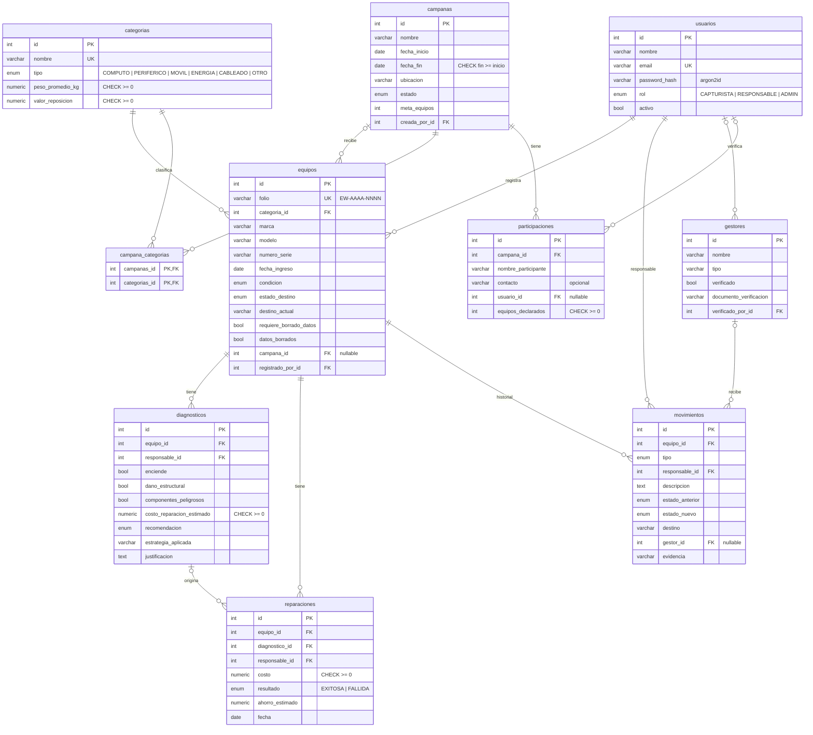

# Modelo de datos

Base de datos relacional **PostgreSQL** con **10 tablas de dominio** más la tabla `sesiones` (almacén de sesiones).
El esquema se crea con migraciones versionadas de TypeORM (`backend/src/database/migrations`). Nunca se usa
`synchronize`.

## Diagrama entidad-relación

## Justificación de relaciones y restricciones de integridad

| Relación / restricción | Justificación |
|---|---|
| `equipos.categoria_id` → `categorias` **ON DELETE RESTRICT** | No se puede borrar una categoría con equipos: se perdería el tipo del equipo y su peso para los indicadores. |
| `diagnosticos`, `reparaciones`, `movimientos` → `equipos` **ON DELETE CASCADE** | Son parte del historial del equipo (composición). |
| `movimientos.gestor_id` → `gestores` **ON DELETE RESTRICT** | Un gestor con entregas registradas no puede desaparecer: la trazabilidad se rompería. |
| `*.responsable_id`, `registrado_por_id` → `usuarios` **ON DELETE SET NULL** | Si se elimina una cuenta, el historial se conserva. (En la aplicación los usuarios se *desactivan*, no se borran.) |
| `equipos.campana_id` **nullable, SET NULL** | Un equipo puede ingresar directamente o por campaña. |
| `campana_categorias` (N:M) | Una campaña acepta varios tipos de equipo y un tipo puede aceptarse en varias campañas. |
| `UNIQUE (usuarios.email)`, `UNIQUE (equipos.folio)`, `UNIQUE (categorias.nombre)` | Identificadores únicos. |
| `CHECK` en costos, pesos y equipos declarados | Evitan valores negativos aunque alguien intente saltarse la API. |
| `CHECK (fecha_fin >= fecha_inicio)` en campañas | Coherencia de fechas también en la base. |
| Tipos `enum` de PostgreSQL | La base solo acepta condiciones, estados y roles válidos. |
| Índices en `equipos.condicion`, `equipos.estado_destino`, `movimientos.equipo_id`, `movimientos.tipo` | Aceleran los filtros del inventario y los indicadores. |

## Reglas que se verifican en la aplicación

- Un equipo solo se entrega a un gestor con `verificado = true` y documento de autorización, y el movimiento debe
  incluir evidencia.
- Los indicadores solo cuentan como "entregado a gestor" lo que tiene un movimiento `ENTREGA_GESTOR` con gestor y
  evidencia. No se presentan como gestionados equipos sin destino documentado.
- Los equipos de cómputo y móviles exigen confirmar el borrado de datos antes de reasignarse o entregarse.
- Los movimientos no tienen endpoint de edición ni de borrado: el historial es de solo inserción.
- Los cambios de estado de un equipo y su movimiento se guardan en la **misma transacción**, con bloqueo de fila
  (`SELECT … FOR UPDATE`) para evitar condiciones de carrera.
- El folio consecutivo se genera bajo un `pg_advisory_xact_lock` para que dos registros simultáneos no obtengan el
  mismo número.

## Operaciones CRUD por tabla

| Tabla | Crear | Consultar | Actualizar | Eliminar / desactivar |
|---|---|---|---|---|
| usuarios | Admin | Admin | Admin (rol, datos, contraseña) | Desactivar (`activo = false`) |
| categorias | Admin | Todos | Admin | — (RESTRICT) |
| gestores | Responsable/Admin | Responsable/Admin | Responsable/Admin; verificar/revocar solo Admin | Revocar verificación |
| equipos | Todos los roles | Todos | Campos permitidos | — (el destino final es el "cierre") |
| diagnosticos | Responsable/Admin | Todos (detalle) | — | — |
| reparaciones | Responsable/Admin | Todos (detalle) | — | — |
| movimientos | Responsable/Admin y eventos | Todos | **Nunca** | **Nunca** |
| campanas | Responsable/Admin | Público | Responsable/Admin (incluye cerrar) | Cerrar campaña |
| participaciones | Público | Responsable/Admin | — | Cascada con la campaña |
