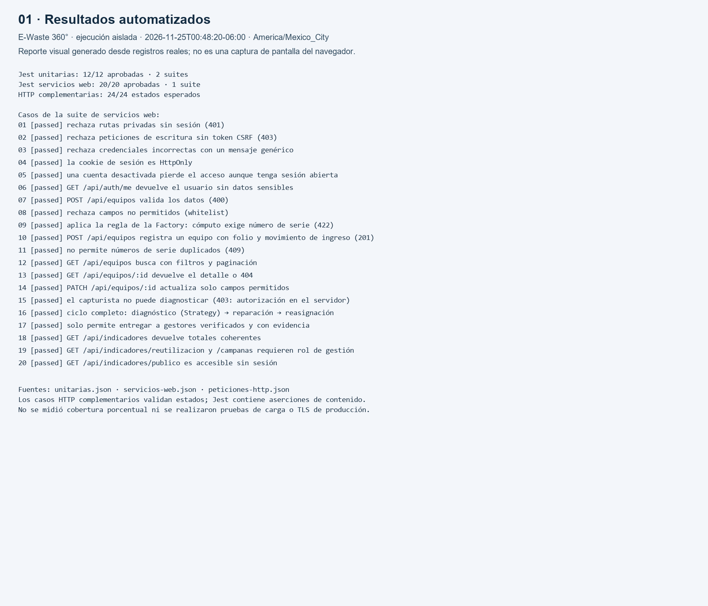
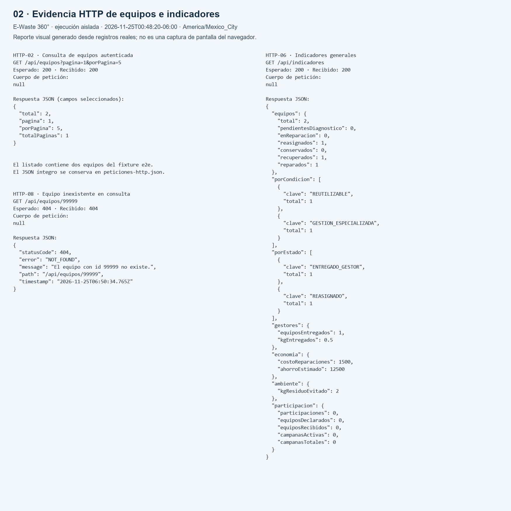
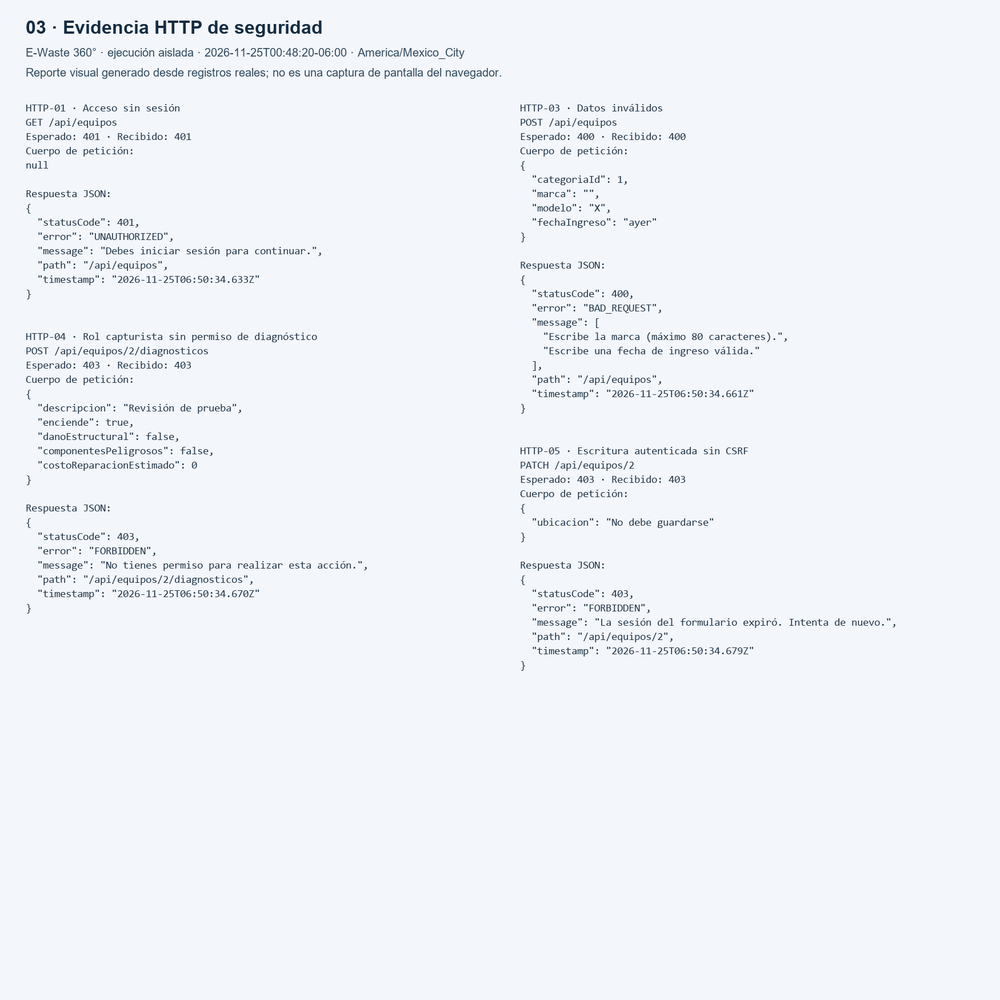
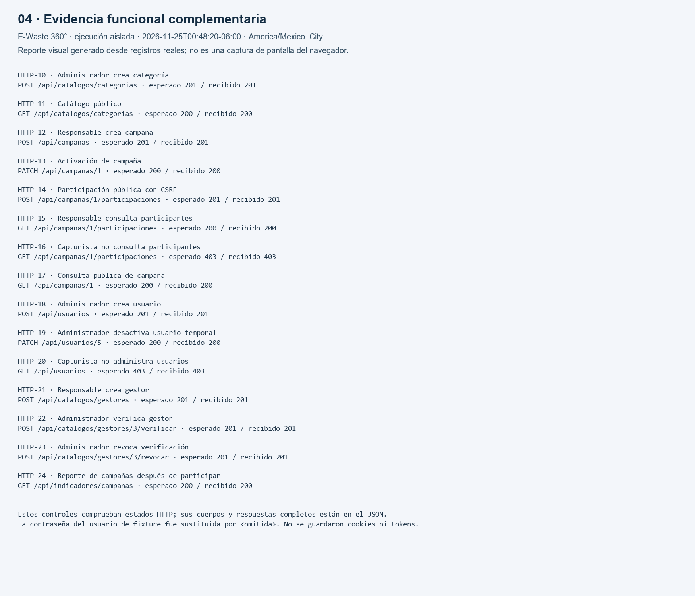

# 6. Cumplimiento de los criterios de la sección 12

[Portada e índice](../reporte-sustentabilidad.md)

La tabla reproduce los siete criterios de la sección 12 del [enunciado académico](../../Proyecto%20final%20de%20Programación%20Web%20AGO-DIC%202026.docx) y los contrasta con la implementación revisada.

**Alcance de la evidencia:** las imágenes disponibles son reportes visuales generados a partir de registros de pruebas, no capturas de la interfaz del navegador. Se identifican como E1–E4 y se incluyen al final. Las pantallas que conviene capturar se indican como C1–C7; son tomas pendientes, no archivos existentes.

Se intentó preparar una ejecución local para obtenerlas, pero la instalación encontró versiones de dependencias no disponibles y paquetes ausentes en caché. No se presentan imágenes simuladas como evidencia de ejecución. Este apartado deja documentada la verificación técnica y la evidencia visual todavía necesaria para una entrega que exija capturas de interfaz.

| Criterio | Funcionalidad del sistema que lo atiende | Evidencia (captura) |
|---|---|---|
| Permita identificar equipos que pueden repararse o reutilizarse antes de considerarlos residuos. | Diagnóstico y clasificación por riesgos, funcionamiento y costo estimado. Admite reparación con costo de hasta el 50 % del valor de reposición. **Implementado**, sujeto a calidad del diagnóstico. | **E1:** registro de la prueba del ciclo diagnóstico → reparación → reasignación. **C1 pendiente:** formulario de diagnóstico con recomendación y ficha resultante. |
| Mantenga un historial verificable de los movimientos y destinos de los equipos. | Historial con responsable, fecha, estados y referencias documentales. Destinos finales respaldados. **Implementado con límites:** no es inmutable frente a acceso directo a la base y algunos eventos se registran fuera de la transacción principal. | **E1:** caso de ciclo completo; la prueba comprueba los cinco movimientos esperados. **C2 pendiente:** historial visible con destino y referencia de oficio. |
| Facilite la organización de campañas de recolección y educación ambiental. | Campañas públicas, categorías aceptadas, participaciones, equipos recibidos y recomendaciones de entrega. Guía de cuidado, reparación y entrega. **Implementado**; no se mide aprendizaje. | **E4:** pruebas HTTP de campañas y participación. **C3 pendiente:** campaña pública y guía educativa. |
| Genere indicadores que permitan evaluar el desempeño de las acciones sustentables. | Conteos, tasas, masa estimada, costos, ahorro, campañas, gráficas y CSV. **Implementado**, con supuestos y límites descritos en el apartado 7. | **E2:** respuesta de indicadores del fixture. **C4 pendiente:** pantalla de reportes y archivo CSV correspondiente. |
| Promueva el consumo responsable y la prolongación de la vida útil de los dispositivos. | Guía pública, reparación, reasignación y conservación como respaldo. **Implementado como apoyo**; no prueba vida útil adicional efectivamente obtenida. | **E1:** reparación y reasignación de prueba. **C5 pendiente:** guía pública y equipo reasignado. |
| Evite presentar como reciclados o recuperados equipos cuyo destino no haya sido documentado. | Entrega exige gestor verificado y evidencia. El resumen de entregas exige movimiento documentado. **Cumplimiento parcial:** “recuperados” también cuenta reparaciones exitosas sin exigir destino final; no existe confirmación de reciclaje concluido. | **E1:** prueba que rechaza gestor sin verificar y entrega sin evidencia. **E2:** conteos diferenciados. **C6 pendiente:** entrega con comprobante y comparación de reparados frente a destinos. |
| Considere la seguridad de los usuarios, la protección de datos y la accesibilidad de la plataforma. | Sesión, roles, CSRF, contraseñas con hash, datos mínimos, confirmación de borrado y controles de lectura y teclado. **Implementado en controles específicos**; falta auditoría integral de privacidad y accesibilidad. | **E3:** rechazos por sesión, rol, validación y CSRF. **C7 pendiente:** controles de lectura y formulario con mensajes accesibles. Las capturas no sustituyen pruebas de teclado o lector de pantalla. |

## Evidencia visual existente

### E1. Resultados automatizados

Fuente: [resultados de servicios web](../evidencias/pruebas-2026-11-25/servicios-web.json) y [prueba del ciclo y del historial](../../backend/test/servicios-web.e2e-spec.ts). La imagen resume casos; el detalle de las aserciones se consulta en el código de prueba.

### E2. Indicadores y consultas HTTP

Fuente: [peticiones y respuestas conservadas](../evidencias/pruebas-2026-11-25/peticiones-http.json), especialmente HTTP-06. Son datos de un entorno de pruebas aislado, no resultados ambientales institucionales.

### E3. Controles de seguridad

Permite observar respuestas de rechazo de las pruebas seleccionadas. No acredita una auditoría de seguridad de producción.

### E4. Campañas y funciones complementarias

Documenta estados HTTP de campañas, participantes, usuarios y gestores. Los cuerpos completos están en el JSON; un código de estado correcto no valida por sí solo toda la experiencia de usuario.

## Cómo completar las capturas de interfaz

Al disponer del sistema ejecutándose, obtener las tomas C1–C7 de la tabla con datos de prueba. Cada imagen debe identificar pantalla, fecha y entorno; mostrar el folio o referencia necesarios y omitir contraseñas, cookies, tokens y datos personales reales.

Para el criterio 12.6, conservar también un caso reparado aún sin reasignar: permite evidenciar la limitación del indicador sin ocultarla. La conclusión de cumplimiento debe mantenerse parcial mientras no se ajuste esa regla.
